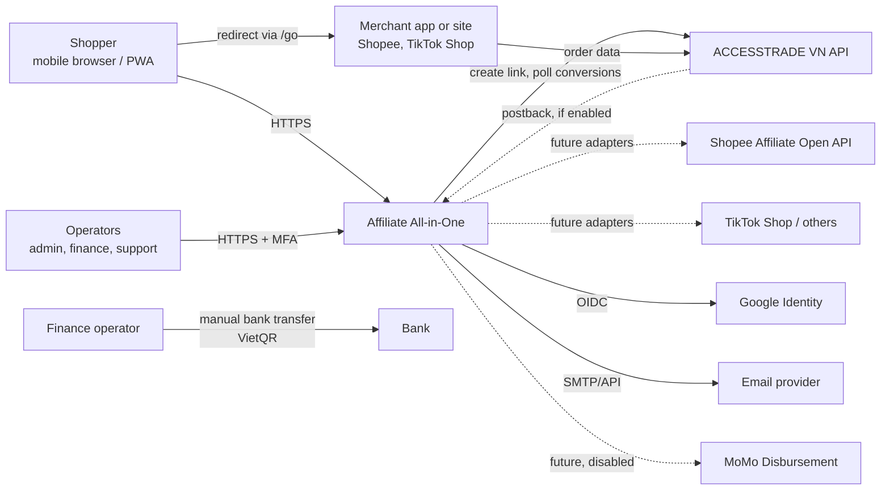
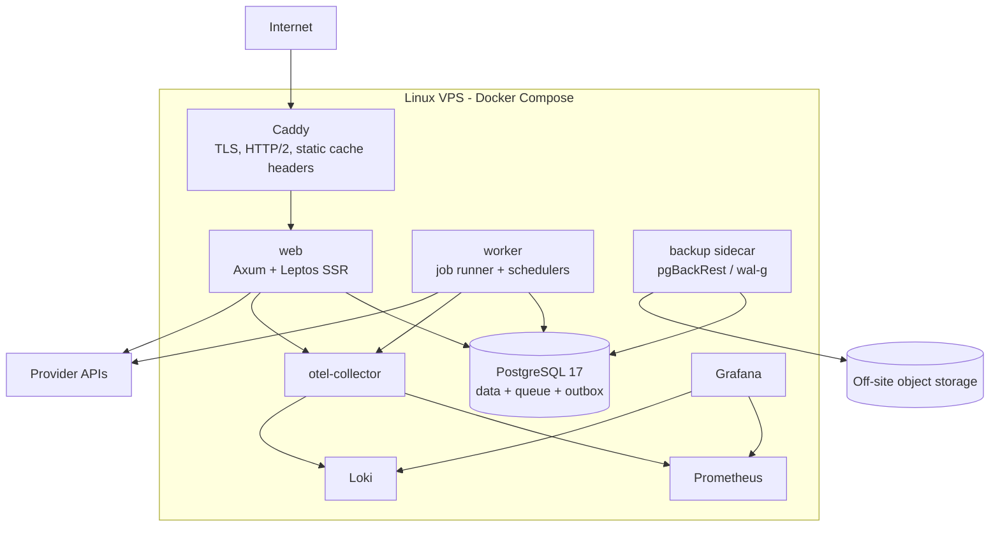
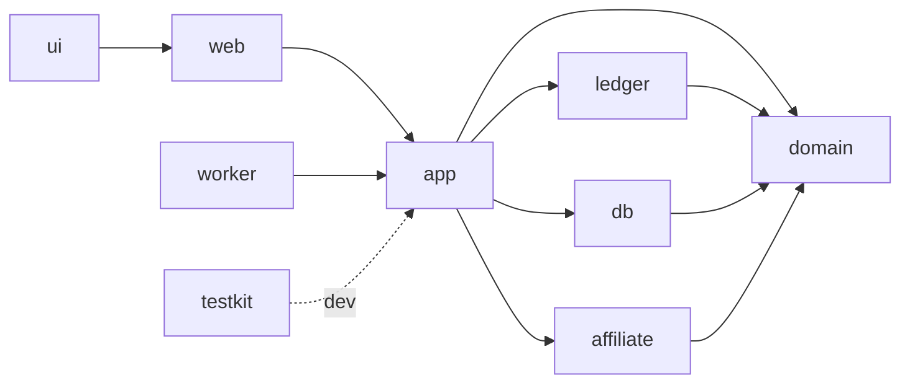
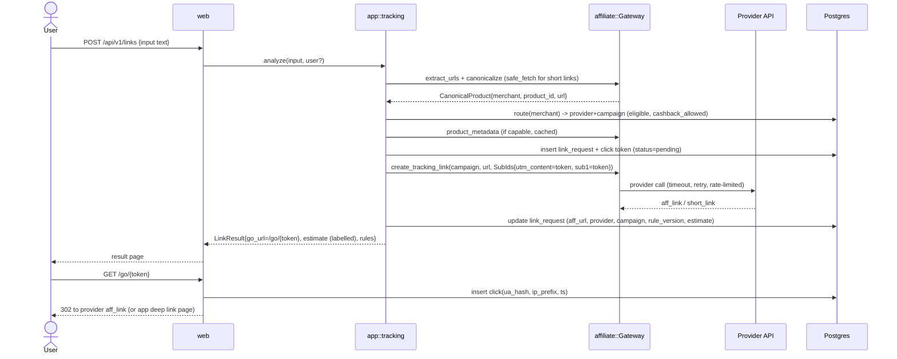
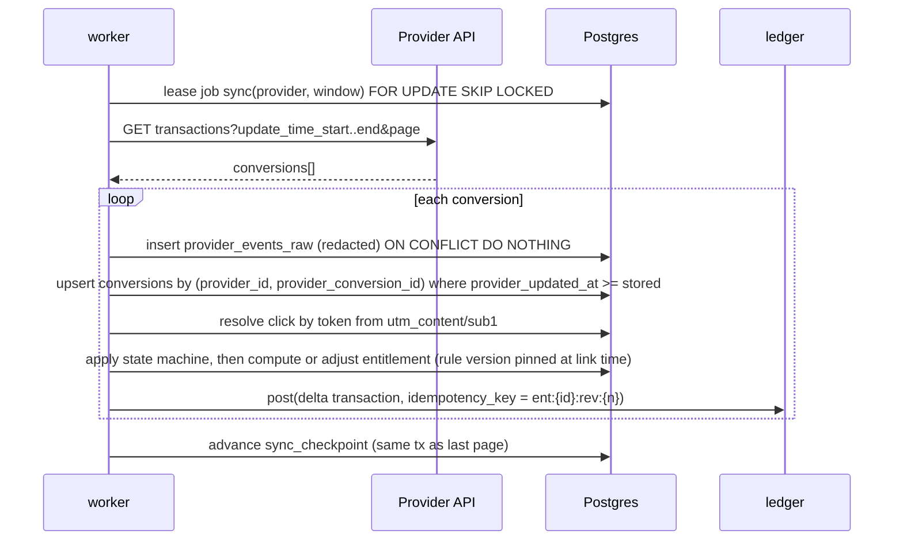

# Architecture

Status: PROPOSED (awaiting owner approval). Read with `TECH_STACK.md` and `adr/`.

## 1. Summary

A **modular monolith in Rust** that ships as two processes built from one Cargo workspace:

| Process | Responsibility |
|---|---|
| `web` | Axum HTTP server: Leptos SSR pages, JSON API, `/go/{token}` redirector, provider webhooks, admin console |
| `worker` | Background jobs from a PostgreSQL-backed queue: provider polling, ingestion, reconciliation, notifications, scheduled maintenance |

They share all business logic through library crates. PostgreSQL is the only stateful dependency in V1 (system of record, job queue, cache tables, rate-limit buckets). Caddy terminates TLS. Everything runs under Docker Compose on one VPS.

Why this shape: the money path (conversion → entitlement → ledger → withdrawal) needs strict transactional consistency. One database plus one codebase gives us ACID across the whole path with no distributed coordination. Both processes are stateless, so we can scale out later without redesigning anything (§9).

## 2. System context



## 3. Container view



Redis is not in V1 (ADR-0004). Rate limits, sessions, the job queue and caches all live in PostgreSQL until measurements show they shouldn't.

## 4. Crate map and dependency rules

```
crates/
  domain/     pure types & rules: Money, Bps, IDs, state machines, commission calc, BusinessClock
  db/         SQLx pool, migrations runner, repositories for non-ledger tables, job queue, outbox
  ledger/     double-entry posting engine, balances, invariants; sole writer of ledger_* tables
  affiliate/  Affiliate Gateway: traits, provider adapters, URL engine, safe_fetch (SSRF guard)
  app/        application services/use-cases, authz, policies, telemetry setup
  ui/         Leptos components & pages (SSR + hydrate), i18n catalog, design tokens
  web/        binary: Axum router, handlers, sessions, CSRF, webhooks, OpenAPI (utoipa)
  worker/     binary: job runner, schedulers, provider sync loops
  testkit/    dev-only: Postgres testcontainers, fixtures, provider mocks, property generators
migrations/   forward-only SQL, numbered
```



Rules (enforced by review plus a CI check over `cargo metadata`):
1. `domain` has no I/O dependencies. Every financial calculation lives here and is property-tested.
2. Only `ledger` writes `ledger_*` tables. Other crates read balances through `ledger::Balances`.
3. Only `affiliate` makes outbound provider calls or fetches user-supplied URLs.
4. `web` and `worker` hold no business rules.
5. Nine crates is the ceiling for V1. Add a crate only through an ADR.

## 5. Bounded contexts (modules inside `app`)

| Context | Owns tables | Key use-cases |
|---|---|---|
| identity | `users`, `user_credentials`, `oauth_identities`, `sessions`, `mfa_factors`, `email_tokens` | register, login, Google OIDC, reset, step-up |
| catalog | `providers`, `merchants`, `campaigns`, `provider_merchant_routes`, `product_cache` | provider/merchant config, routing |
| rules | `commission_rules`, `commission_rule_versions` | resolve share, versioning |
| tracking | `link_requests`, `clicks` | analyze URL, create link, redirect |
| conversions | `provider_events_raw`, `conversions`, `conversion_status_history`, `orders`, `sync_checkpoints` | ingest, normalize, attribute |
| entitlements | `cashback_entitlements` | compute, transition, reverse |
| settlement | `provider_settlements`, `settlement_allocations` | record cash received, allocate |
| ledger | `ledger_accounts`, `ledger_transactions`, `ledger_entries`, `ledger_balances` | post, balance, invariants |
| payouts | `bank_accounts`, `withdrawals`, `withdrawal_status_history`, `payout_attempts` | request, review, pay, reconcile |
| referrals | `referral_codes`, `referrals`, `reward_campaigns`, `checkins` | attribute, reward |
| support | `tickets`, `ticket_messages`, `missing_cashback_claims` | claims, investigation |
| content | `posts`, `post_tags`, `legal_documents`, `consents` | blog, legal versions |
| notifications | `notifications`, `outbox` | fan-out, email |
| admin | `roles`, `role_grants`, `audit_log`, `feature_flags`, `config_values` | RBAC, audit, flags |

Contexts call each other only through `app` service interfaces, never through each other's tables. The one exception is that the ledger posting happens inside the same DB transaction as the state change that causes it.

## 6. Key flows

### 6.1 Link generation



The provider and campaign are fixed when the link is created and copied onto every click and conversion. Routing changes later never re-attribute history.

### 6.2 Attribution and entitlement



### 6.3 Settlement → available → withdrawal
See `FINANCIAL_LEDGER.md` §5 and `WITHDRAWAL_DESIGN.md` §3.

## 7. Cross-cutting concerns

| Concern | Approach |
|---|---|
| Transactions | Each use-case is one `sqlx::Transaction`; ledger posting and state change commit together. |
| Idempotency | API: `Idempotency-Key` header stored in `idempotency_keys` (24h). Jobs: natural keys with unique constraints. Ledger: `ledger_transactions.idempotency_key UNIQUE`. |
| Concurrency | Row locks (`SELECT … FOR UPDATE`) on `ledger_balances` rows for spend; `SKIP LOCKED` job leasing; optimistic `version` columns on config. |
| Job queue | `jobs` table, lease with timeout, exponential backoff, max attempts → `dead_letter`. Scheduled jobs are deduplicated by `(kind, dedupe_key)`. |
| Outbox | Domain events written to `outbox` inside the business tx; worker publishes (email, notifications, metrics). |
| Config | Business parameters (rates, windows, minimums, limits) live in DB tables with effective dates. Infra config comes from env vars. Nothing business-critical is in code. |
| Time | UTC in storage. `BusinessClock` handles `Asia/Ho_Chi_Minh` day boundaries (check-in, limits, reports). |
| i18n | Fluent catalogs in `ui`; `vi` default; API error `code` stable, message localized. |
| Observability | `tracing` → OTLP; RED metrics per route and provider; business gauges (liabilities, exposure); trace IDs in error responses. |
| Feature flags | `feature_flags` table, cached 30s; dangerous flags (`payouts.automated`, `referrals.multilevel`) need two-person approval and are audited. |

## 8. Failure model

| Failure | Behaviour |
|---|---|
| Provider API down at link time | Return a retryable error with a localized message. **Never** hand out an untracked merchant link presented as a cashback link. |
| Provider API down during sync | Job backs off. The checkpoint doesn't advance. Alert after N failures. Overlapping windows on resume. |
| Worker crash mid-batch | Lease expires and the job retries. Upserts and ledger keys are idempotent, so a replay has no effect. |
| Duplicate / out-of-order events | Unique keys, plus a monotonic `provider_updated_at` guard. Older events are stored raw but don't regress state. |
| DB unavailable | `web` readiness fails and Caddy serves the maintenance page. Nothing is queued in memory. |
| Unknown payout outcome | Withdrawal → `unknown`. Reserved funds stay locked until a human reconciles (WITHDRAWAL_DESIGN §5). |

## 9. Scaling path (no premature distribution)

1. **1 VPS** (V1): all containers on one host. Daily off-site backup plus WAL archiving.
2. **Vertical**: bigger VPS, tuned Postgres, read-only replica for admin analytics.
3. **Split host**: managed PostgreSQL or a dedicated DB VM. Run `web` ×2 behind Caddy and `worker` ×N (SKIP LOCKED already supports this).
4. **Only if measured**: Redis for hot rate-limit/session paths; a CDN for static assets; partition `clicks` and `provider_events_raw` by month.

Kafka, Kubernetes and microservices are out of scope until a measured bottleneck justifies them through an ADR.

## 10. Diagram index

| Diagram | Location |
|---|---|
| System context, container, module | this file §2–4 |
| ERD | `DATABASE_DESIGN.md` §2 |
| Affiliate link generation | this file §6.1; `TRACKING_AND_ATTRIBUTION.md` §3 |
| Purchase attribution | this file §6.2; `TRACKING_AND_ATTRIBUTION.md` §5 |
| Commission reconciliation | `ORDER_RECONCILIATION.md` §3 |
| Financial ledger | `FINANCIAL_LEDGER.md` §3 |
| Withdrawal processing | `WITHDRAWAL_DESIGN.md` §3 |
| Deployment | `INFRASTRUCTURE.md` §2 |
