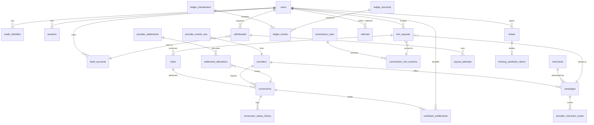

# Database Design

Status: PROPOSED. PostgreSQL 17. Every timestamp is `timestamptz` (UTC) and every amount is `bigint` VND. PKs are `uuid` (v7, generated in app) unless stated.

## 1. Conventions
- Table names are plural snake_case. FKs are `ON DELETE RESTRICT` unless stated (we never hard-delete financial rows).
- `created_at timestamptz NOT NULL DEFAULT now()`, plus `updated_at` maintained by trigger on mutable tables.
- Enums are `text` + `CHECK`, not PG `ENUM` (easier expand/contract migrations).
- Optimistic concurrency: `version int NOT NULL DEFAULT 0` on admin-editable config rows.
- PII columns are marked `-- PII`. Encrypted columns are `bytea` + `key_id`.
- Two DB roles: `app_rw` (no UPDATE/DELETE on `ledger_*`, `audit_log`, `*_history`, `provider_events_raw`) and `migrator` (DDL). Reporting uses `app_ro`.

## 2. ERD



## 3. Domain boundaries → tables
See `ARCHITECTURE.md` §5. Each context owns its tables, and cross-context writes go through services.

## 4. DDL (authoritative draft; migrations are split per issue)

### 4.1 Identity
```sql
CREATE TABLE users (
  id uuid PRIMARY KEY,
  email citext UNIQUE,                         -- PII
  email_verified_at timestamptz,
  phone text,                                  -- PII, optional, E.164
  display_name text NOT NULL,                  -- PII
  locale text NOT NULL DEFAULT 'vi' CHECK (locale IN ('vi','en')),
  status text NOT NULL DEFAULT 'active' CHECK (status IN ('active','locked','suspended','closed')),
  tier_code text NOT NULL DEFAULT 'standard',
  referral_code text UNIQUE NOT NULL,          -- public, random, not derived from id
  risk_score smallint NOT NULL DEFAULT 0,
  created_at timestamptz NOT NULL DEFAULT now(), updated_at timestamptz NOT NULL DEFAULT now(),
  closed_at timestamptz
);
CREATE TABLE user_credentials (user_id uuid PRIMARY KEY REFERENCES users, password_hash text NOT NULL,
  password_changed_at timestamptz NOT NULL, failed_attempts int NOT NULL DEFAULT 0, locked_until timestamptz);
CREATE TABLE oauth_identities (id uuid PRIMARY KEY, user_id uuid NOT NULL REFERENCES users,
  issuer text NOT NULL, subject text NOT NULL, email citext, created_at timestamptz NOT NULL DEFAULT now(),
  UNIQUE (issuer, subject));
CREATE TABLE sessions (id uuid PRIMARY KEY, user_id uuid NOT NULL REFERENCES users,
  token_hash bytea NOT NULL UNIQUE, kind text NOT NULL CHECK (kind IN ('user','staff')),
  created_at timestamptz NOT NULL DEFAULT now(), last_seen_at timestamptz NOT NULL, expires_at timestamptz NOT NULL,
  step_up_at timestamptz, ip_prefix inet, ua_hash bytea, revoked_at timestamptz);
CREATE INDEX ON sessions (user_id) WHERE revoked_at IS NULL;
CREATE TABLE mfa_factors (id uuid PRIMARY KEY, user_id uuid NOT NULL REFERENCES users, kind text NOT NULL CHECK (kind='totp'),
  secret_enc bytea NOT NULL, key_id text NOT NULL, confirmed_at timestamptz, last_used_step bigint);
CREATE TABLE email_tokens (token_hash bytea PRIMARY KEY, user_id uuid NOT NULL REFERENCES users,
  purpose text NOT NULL CHECK (purpose IN ('verify','reset','change_email')), expires_at timestamptz NOT NULL, used_at timestamptz);
CREATE TABLE consents (id uuid PRIMARY KEY, user_id uuid NOT NULL REFERENCES users, document_id uuid NOT NULL,
  purpose text NOT NULL, granted boolean NOT NULL, at timestamptz NOT NULL DEFAULT now(), ip_prefix inet);
```

### 4.2 Admin, config, audit
```sql
CREATE TABLE roles (code text PRIMARY KEY);  -- owner, admin, finance, support, auditor
CREATE TABLE role_grants (user_id uuid REFERENCES users, role_code text REFERENCES roles,
  granted_by uuid NOT NULL REFERENCES users, granted_at timestamptz NOT NULL DEFAULT now(), revoked_at timestamptz,
  PRIMARY KEY (user_id, role_code, granted_at));
CREATE TABLE audit_log (id bigserial PRIMARY KEY, at timestamptz NOT NULL DEFAULT now(), actor_user_id uuid,
  actor_kind text NOT NULL CHECK (actor_kind IN ('user','staff','system')), action text NOT NULL,
  target_type text NOT NULL, target_id text NOT NULL, before jsonb, after jsonb, reason text,
  request_id text, ip_prefix inet, prev_hash bytea, hash bytea NOT NULL);   -- hash chain for tamper evidence
CREATE TABLE feature_flags (key text PRIMARY KEY, enabled boolean NOT NULL, rules jsonb NOT NULL DEFAULT '{}',
  dangerous boolean NOT NULL DEFAULT false, version int NOT NULL DEFAULT 0, updated_by uuid, updated_at timestamptz);
CREATE TABLE approvals (id uuid PRIMARY KEY, subject_type text NOT NULL, subject_id text NOT NULL, action text NOT NULL,
  payload jsonb NOT NULL, requested_by uuid NOT NULL, approved_by uuid, approved_at timestamptz,
  status text NOT NULL CHECK (status IN ('pending','approved','rejected','expired')),
  CHECK (approved_by IS NULL OR approved_by <> requested_by));             -- maker-checker
CREATE TABLE config_values (key text, effective_from timestamptz, value jsonb NOT NULL, set_by uuid NOT NULL,
  PRIMARY KEY (key, effective_from));  -- e.g. withdrawal.min_vnd, withdrawal.daily_limit_vnd
```

### 4.3 Catalog and routing
```sql
CREATE TABLE providers (id uuid PRIMARY KEY, code text UNIQUE NOT NULL,   -- 'accesstrade_vn', 'shopee_direct'
  name text NOT NULL, status text NOT NULL CHECK (status IN ('disabled','mock','sandbox','live')),
  capabilities jsonb NOT NULL, credentials_enc bytea, key_id text, health_score smallint NOT NULL DEFAULT 100,
  attribution_quality_score smallint NOT NULL DEFAULT 100, version int NOT NULL DEFAULT 0);
CREATE TABLE merchants (id uuid PRIMARY KEY, code text UNIQUE NOT NULL,  -- 'shopee_vn','tiktokshop_vn'
  name text NOT NULL, hostnames text[] NOT NULL, app_schemes text[] NOT NULL DEFAULT '{}', enabled boolean NOT NULL);
CREATE TABLE campaigns (id uuid PRIMARY KEY, provider_id uuid NOT NULL REFERENCES providers, merchant_id uuid REFERENCES merchants,
  provider_campaign_id text NOT NULL, name text NOT NULL,
  approval text NOT NULL CHECK (approval IN ('unregistered','pending','successful','unknown')),
  cashback_allowed text NOT NULL DEFAULT 'unknown' CHECK (cashback_allowed IN ('yes','no','unknown')),
  cashback_evidence_ref text,                 -- link to written permission in ops drive (not the file)
  cookie_duration_secs int, starts_at timestamptz, ends_at timestamptz, raw jsonb, synced_at timestamptz,
  UNIQUE (provider_id, provider_campaign_id));
CREATE TABLE provider_merchant_routes (id uuid PRIMARY KEY, merchant_id uuid NOT NULL REFERENCES merchants,
  campaign_id uuid NOT NULL REFERENCES campaigns, priority int NOT NULL, enabled boolean NOT NULL,
  weight_overrides jsonb NOT NULL DEFAULT '{}', version int NOT NULL DEFAULT 0, UNIQUE (merchant_id, campaign_id));
CREATE TABLE product_cache (merchant_id uuid REFERENCES merchants, merchant_product_id text,
  data jsonb NOT NULL, source_provider_id uuid, fetched_at timestamptz NOT NULL, expires_at timestamptz NOT NULL,
  PRIMARY KEY (merchant_id, merchant_product_id));
```

### 4.4 Commission rules
```sql
CREATE TABLE commission_rules (id uuid PRIMARY KEY, name text NOT NULL, created_by uuid NOT NULL);
CREATE TABLE commission_rule_versions (
  id uuid PRIMARY KEY, rule_id uuid NOT NULL REFERENCES commission_rules, version int NOT NULL,
  provider_id uuid, merchant_id uuid, campaign_id uuid, category_code text, user_tier text, promo_code text,
  share_bps int NOT NULL CHECK (share_bps BETWEEN 0 AND 10000),
  cap_vnd bigint CHECK (cap_vnd IS NULL OR cap_vnd >= 0),
  rounding text NOT NULL DEFAULT 'floor' CHECK (rounding IN ('floor','half_even')),
  priority int NOT NULL DEFAULT 0,
  effective_from timestamptz NOT NULL, effective_to timestamptz,
  approved_by uuid, approved_at timestamptz,               -- inactive until approved (maker-checker)
  created_at timestamptz NOT NULL DEFAULT now(), UNIQUE (rule_id, version),
  CHECK (effective_to IS NULL OR effective_to > effective_from));
CREATE INDEX ON commission_rule_versions (provider_id, merchant_id, campaign_id, effective_from);
-- Rows are immutable after approval (trigger). New terms = new version.
```

### 4.5 Tracking
```sql
CREATE TABLE link_requests (
  id uuid PRIMARY KEY, user_id uuid REFERENCES users,          -- null = anonymous preview only, no link issued
  input_hash bytea NOT NULL, canonical_url text NOT NULL, merchant_id uuid NOT NULL REFERENCES merchants,
  merchant_product_id text, campaign_id uuid REFERENCES campaigns, provider_id uuid REFERENCES providers,
  rule_version_id uuid REFERENCES commission_rule_versions,
  token text NOT NULL UNIQUE,                                  -- opaque 20-char base32 (96 bits)
  affiliate_url text, affiliate_short_url text,
  estimate_commission_vnd bigint, estimate_cashback_vnd bigint, estimate_basis jsonb,
  status text NOT NULL CHECK (status IN ('pending','ready','failed','expired')),
  failure_code text, expires_at timestamptz NOT NULL, created_at timestamptz NOT NULL DEFAULT now());
CREATE INDEX ON link_requests (user_id, created_at DESC);
CREATE TABLE clicks (id uuid NOT NULL, link_request_id uuid NOT NULL, user_id uuid, provider_id uuid NOT NULL,
  campaign_id uuid NOT NULL, at timestamptz NOT NULL, ip_prefix inet, ua_hash bytea, platform text, referrer_host text,
  PRIMARY KEY (at, id)) PARTITION BY RANGE (at);               -- monthly partitions
CREATE INDEX ON clicks (link_request_id);
```

### 4.6 Conversions, ingestion, entitlements, settlement
```sql
CREATE TABLE provider_events_raw (id uuid PRIMARY KEY, provider_id uuid NOT NULL, source text NOT NULL
  CHECK (source IN ('poll','webhook','csv','backfill')), dedupe_key text NOT NULL, received_at timestamptz NOT NULL,
  payload_redacted jsonb NOT NULL, payload_sha256 bytea NOT NULL, processed_at timestamptz, error text,
  UNIQUE (provider_id, dedupe_key, payload_sha256));           -- same event, same content = no-op
CREATE TABLE conversions (
  id uuid PRIMARY KEY, provider_id uuid NOT NULL REFERENCES providers, campaign_id uuid REFERENCES campaigns,
  provider_conversion_id text NOT NULL,                        -- ACCESSTRADE: conversion_id (per product line)
  provider_order_id text NOT NULL,                             -- ACCESSTRADE: transaction_id
  merchant_id uuid REFERENCES merchants, click_id uuid, link_request_id uuid REFERENCES link_requests,
  user_id uuid REFERENCES users, attribution text NOT NULL CHECK (attribution IN ('matched','unmatched','manual')),
  product_ref text, product_name text, quantity int, order_value_vnd bigint, commission_vnd bigint NOT NULL,
  provider_status text NOT NULL, status text NOT NULL CHECK (status IN
    ('reported','pending','approved','rejected','reversed','settled')),
  provider_updated_at timestamptz NOT NULL, transaction_at timestamptz, confirmed_at timestamptz,
  revision int NOT NULL DEFAULT 0, created_at timestamptz NOT NULL DEFAULT now(), updated_at timestamptz NOT NULL DEFAULT now(),
  UNIQUE (provider_id, provider_conversion_id));
CREATE INDEX ON conversions (user_id, transaction_at DESC);
CREATE INDEX ON conversions (provider_id, provider_order_id);
CREATE INDEX ON conversions (status) WHERE status IN ('pending','approved');
CREATE TABLE conversion_status_history (id bigserial PRIMARY KEY, conversion_id uuid NOT NULL REFERENCES conversions,
  revision int NOT NULL, from_status text, to_status text NOT NULL, commission_vnd bigint NOT NULL,
  raw_event_id uuid REFERENCES provider_events_raw, at timestamptz NOT NULL DEFAULT now(), UNIQUE (conversion_id, revision));
CREATE TABLE sync_checkpoints (provider_id uuid, stream text, cursor jsonb NOT NULL, updated_at timestamptz NOT NULL,
  PRIMARY KEY (provider_id, stream));
CREATE TABLE cashback_entitlements (
  id uuid PRIMARY KEY, conversion_id uuid NOT NULL REFERENCES conversions, beneficiary_user_id uuid NOT NULL REFERENCES users,
  kind text NOT NULL CHECK (kind IN ('cashback','referral')), rule_version_id uuid NOT NULL REFERENCES commission_rule_versions,
  amount_vnd bigint NOT NULL CHECK (amount_vnd >= 0), platform_share_vnd bigint NOT NULL,
  state text NOT NULL CHECK (state IN ('pending','approved','available','reversed','void')),
  availability_basis text CHECK (availability_basis IN ('settled','advance')),
  revision int NOT NULL DEFAULT 0, hold_until timestamptz, frozen_reason text,
  UNIQUE (conversion_id, beneficiary_user_id, kind));
CREATE TABLE provider_settlements (id uuid PRIMARY KEY, provider_id uuid NOT NULL REFERENCES providers,
  period_start date, period_end date, amount_vnd bigint NOT NULL, received_at timestamptz NOT NULL,
  bank_reference text NOT NULL, evidence_sha256 bytea, statement_raw jsonb,
  status text NOT NULL CHECK (status IN ('recorded','allocating','allocated','disputed')),
  created_by uuid NOT NULL, UNIQUE (provider_id, bank_reference));
CREATE TABLE settlement_allocations (settlement_id uuid REFERENCES provider_settlements, conversion_id uuid REFERENCES conversions,
  amount_vnd bigint NOT NULL, PRIMARY KEY (settlement_id, conversion_id));
CREATE UNIQUE INDEX ON settlement_allocations (conversion_id);  -- a conversion is settled once (adjustments are new rows in a separate table)
CREATE TABLE advance_policy (id smallint PRIMARY KEY CHECK (id = 1), enabled boolean NOT NULL DEFAULT false,
  max_total_exposure_vnd bigint NOT NULL DEFAULT 0, max_per_user_vnd bigint NOT NULL DEFAULT 0,
  min_conversion_age_days int NOT NULL DEFAULT 0, rules jsonb NOT NULL DEFAULT '{}', version int NOT NULL DEFAULT 0);
```

### 4.7 Ledger
```sql
CREATE TABLE ledger_accounts (id uuid PRIMARY KEY, code text NOT NULL, scope_kind text NOT NULL
  CHECK (scope_kind IN ('platform','provider','user','bank')), scope_id uuid, currency char(3) NOT NULL DEFAULT 'VND',
  normal_side char(1) NOT NULL CHECK (normal_side IN ('D','C')), created_at timestamptz NOT NULL DEFAULT now(),
  UNIQUE NULLS NOT DISTINCT (code, scope_kind, scope_id, currency));
CREATE TABLE ledger_transactions (id uuid PRIMARY KEY, kind text NOT NULL, idempotency_key text NOT NULL UNIQUE,
  payload_sha256 bytea NOT NULL, occurred_at timestamptz NOT NULL, posted_at timestamptz NOT NULL DEFAULT now(),
  ref_type text NOT NULL, ref_id text NOT NULL, memo text, created_by uuid);
CREATE INDEX ON ledger_transactions (ref_type, ref_id);
CREATE TABLE ledger_entries (id bigserial PRIMARY KEY, transaction_id uuid NOT NULL REFERENCES ledger_transactions,
  account_id uuid NOT NULL REFERENCES ledger_accounts, side char(1) NOT NULL CHECK (side IN ('D','C')),
  amount bigint NOT NULL CHECK (amount > 0), currency char(3) NOT NULL);
CREATE INDEX ON ledger_entries (account_id, id);
CREATE TABLE ledger_balances (account_id uuid PRIMARY KEY REFERENCES ledger_accounts,
  debit_total bigint NOT NULL DEFAULT 0, credit_total bigint NOT NULL DEFAULT 0, version bigint NOT NULL DEFAULT 0);
-- + constraint trigger ledger_tx_balanced (deferred), + immutability triggers. See FINANCIAL_LEDGER.md §3.
```

### 4.8 Payouts
```sql
CREATE TABLE bank_accounts (id uuid PRIMARY KEY, user_id uuid NOT NULL REFERENCES users,
  rail text NOT NULL CHECK (rail IN ('bank','momo')), bank_bin text, account_number_enc bytea NOT NULL, key_id text NOT NULL,
  account_last4 text NOT NULL, holder_name text NOT NULL,          -- PII, uppercase no diacritics for matching
  status text NOT NULL CHECK (status IN ('active','cooling_down','disabled')), usable_from timestamptz NOT NULL,
  created_at timestamptz NOT NULL DEFAULT now(), disabled_at timestamptz);
CREATE UNIQUE INDEX ON bank_accounts (user_id) WHERE status <> 'disabled' AND rail = 'bank';  -- one active bank account per user (V1)
CREATE TABLE withdrawals (id uuid PRIMARY KEY, user_id uuid NOT NULL REFERENCES users, bank_account_id uuid NOT NULL REFERENCES bank_accounts,
  amount_vnd bigint NOT NULL CHECK (amount_vnd > 0), fee_vnd bigint NOT NULL DEFAULT 0, tax_withheld_vnd bigint NOT NULL DEFAULT 0,
  status text NOT NULL CHECK (status IN ('requested','reserved','under_review','approved','submitted','processing',
                                         'paid','rejected','failed','unknown','cancelled')),
  idempotency_key text NOT NULL, transfer_reference text NOT NULL UNIQUE, risk_flags jsonb NOT NULL DEFAULT '[]',
  reviewed_by uuid, approved_by uuid, submitted_by uuid, paid_at timestamptz, created_at timestamptz NOT NULL DEFAULT now(),
  version int NOT NULL DEFAULT 0, UNIQUE (user_id, idempotency_key),
  CHECK (approved_by IS NULL OR submitted_by IS NULL OR approved_by <> submitted_by));
CREATE UNIQUE INDEX one_open_withdrawal_per_user ON withdrawals (user_id)
  WHERE status IN ('requested','reserved','under_review','approved','submitted','processing','unknown');
CREATE TABLE withdrawal_status_history (id bigserial PRIMARY KEY, withdrawal_id uuid NOT NULL REFERENCES withdrawals,
  from_status text, to_status text NOT NULL, actor_user_id uuid, reason text, at timestamptz NOT NULL DEFAULT now());
CREATE TABLE payout_attempts (id uuid PRIMARY KEY, withdrawal_id uuid NOT NULL REFERENCES withdrawals, rail text NOT NULL,
  external_reference text, amount_vnd bigint NOT NULL, status text NOT NULL CHECK (status IN ('created','sent','confirmed','returned','unknown')),
  evidence_sha256 bytea, created_at timestamptz NOT NULL DEFAULT now());
CREATE UNIQUE INDEX one_confirmed_payout ON payout_attempts (withdrawal_id) WHERE status = 'confirmed';
CREATE TABLE bank_statement_lines (id uuid PRIMARY KEY, bank_account_ref text NOT NULL, booked_at date NOT NULL,
  amount_vnd bigint NOT NULL, direction char(1) NOT NULL, description text NOT NULL, bank_txn_id text NOT NULL,
  matched_type text, matched_id uuid, UNIQUE (bank_account_ref, bank_txn_id));
```

### 4.9 Referrals, rewards, support, content, notifications, infra
```sql
CREATE TABLE referrals (referee_user_id uuid PRIMARY KEY REFERENCES users, referrer_user_id uuid NOT NULL REFERENCES users,
  depth smallint NOT NULL DEFAULT 1 CHECK (depth = 1),        -- ADR-0014; relaxing requires migration + approval
  attributed_at timestamptz NOT NULL, status text NOT NULL CHECK (status IN ('active','void')), void_reason text,
  CHECK (referee_user_id <> referrer_user_id));
CREATE TABLE reward_campaigns (id uuid PRIMARY KEY, kind text NOT NULL CHECK (kind IN ('referral','checkin','promo')),
  rules jsonb NOT NULL, budget_vnd bigint NOT NULL, spent_vnd bigint NOT NULL DEFAULT 0, starts_at timestamptz, ends_at timestamptz,
  enabled boolean NOT NULL DEFAULT false, CHECK (spent_vnd <= budget_vnd));
CREATE TABLE checkins (user_id uuid REFERENCES users, vn_date date, streak int NOT NULL, reward_vnd bigint NOT NULL,
  ledger_tx_id uuid, PRIMARY KEY (user_id, vn_date));
CREATE TABLE tickets (id uuid PRIMARY KEY, user_id uuid NOT NULL REFERENCES users, kind text NOT NULL, status text NOT NULL,
  assignee uuid, created_at timestamptz NOT NULL DEFAULT now(), updated_at timestamptz NOT NULL DEFAULT now());
CREATE TABLE ticket_messages (id uuid PRIMARY KEY, ticket_id uuid NOT NULL REFERENCES tickets, author_user_id uuid,
  body text NOT NULL, internal boolean NOT NULL DEFAULT false, created_at timestamptz NOT NULL DEFAULT now());
CREATE TABLE missing_cashback_claims (ticket_id uuid PRIMARY KEY REFERENCES tickets, link_request_id uuid REFERENCES link_requests,
  merchant_order_ref text NOT NULL, order_date date NOT NULL, order_value_vnd bigint, evidence_object_keys text[] NOT NULL DEFAULT '{}',
  found_conversion_id uuid REFERENCES conversions, resolution text);
CREATE TABLE posts (id uuid PRIMARY KEY, slug text UNIQUE NOT NULL, locale text NOT NULL, title text NOT NULL, body_md text NOT NULL,
  status text NOT NULL, published_at timestamptz, seo jsonb NOT NULL DEFAULT '{}', view_count bigint NOT NULL DEFAULT 0);
CREATE TABLE legal_documents (id uuid PRIMARY KEY, kind text NOT NULL, locale text NOT NULL, version int NOT NULL,
  body_md text NOT NULL, effective_at timestamptz NOT NULL, UNIQUE (kind, locale, version));
CREATE TABLE notifications (id uuid PRIMARY KEY, user_id uuid NOT NULL REFERENCES users, kind text NOT NULL, payload jsonb NOT NULL,
  dedupe_key text NOT NULL, read_at timestamptz, created_at timestamptz NOT NULL DEFAULT now(), UNIQUE (user_id, dedupe_key));
CREATE TABLE outbox (id uuid PRIMARY KEY, topic text NOT NULL, payload jsonb NOT NULL, created_at timestamptz NOT NULL DEFAULT now(),
  published_at timestamptz);
CREATE INDEX ON outbox (created_at) WHERE published_at IS NULL;
CREATE TABLE processed_events (consumer text, event_id uuid, processed_at timestamptz NOT NULL DEFAULT now(), PRIMARY KEY (consumer, event_id));
CREATE TABLE jobs (id uuid PRIMARY KEY, kind text NOT NULL, payload jsonb NOT NULL, dedupe_key text, run_at timestamptz NOT NULL,
  attempts int NOT NULL DEFAULT 0, max_attempts int NOT NULL DEFAULT 10, status text NOT NULL
  CHECK (status IN ('queued','running','succeeded','dead','cancelled')), leased_until timestamptz, leased_by text, last_error text,
  created_at timestamptz NOT NULL DEFAULT now());
CREATE UNIQUE INDEX jobs_dedupe ON jobs (kind, dedupe_key) WHERE status IN ('queued','running');
CREATE INDEX jobs_ready ON jobs (run_at) WHERE status = 'queued';
CREATE TABLE idempotency_keys (scope text, key text, request_sha256 bytea NOT NULL, response_status int, response_body jsonb,
  created_at timestamptz NOT NULL DEFAULT now(), PRIMARY KEY (scope, key));
CREATE TABLE rate_limit_buckets (key text PRIMARY KEY, tokens double precision NOT NULL, updated_at timestamptz NOT NULL);
-- (float is acceptable here: not money)
```

## 5. Indexing strategy
- Every FK used in a join has an index. User-facing lists use `(user_id, created_at DESC)` composite indexes with keyset pagination.
- Partial indexes on "open" states (pending conversions, open withdrawals, queued jobs).
- `clicks` and `provider_events_raw` are range-partitioned monthly once volume exceeds about 5M rows/month (create partitions ahead via a job). Old partitions get detached and archived per retention policy.
- `pg_stat_statements` is enabled. Any query over 50 ms p95 gets an issue.

## 6. Transactions and locking
| Use-case | Isolation | Locks |
|---|---|---|
| Ledger post | READ COMMITTED | `SELECT … FOR UPDATE` on `ledger_balances` rows, ordered by `account_id` |
| Withdrawal request | READ COMMITTED | lock user's 2120 balance row → guard → insert withdrawal (partial unique index blocks a second open one) |
| Entitlement → available (advance) | READ COMMITTED | lock `advance_policy` row (id=1), then balances |
| Conversion upsert | READ COMMITTED | `INSERT … ON CONFLICT (provider_id, provider_conversion_id) DO UPDATE … WHERE excluded.provider_updated_at > conversions.provider_updated_at OR (= AND status rank higher)` |
| Config edits | READ COMMITTED | optimistic `version` check |
| Reports | REPEATABLE READ, read-only | none |

No SERIALIZABLE in V1. Correctness relies on explicit row locks and unique constraints, which are easier to reason about and test.

## 7. Data retention (PROPOSED; legal review in COMPLIANCE_CHECKLIST)
| Data | Retention | Then |
|---|---|---|
| Ledger, withdrawals, settlements, audit log | 10 years (accounting record convention; confirm) | archive cold |
| Conversions, entitlements | 10 years | archive |
| provider_events_raw | 24 months | drop partition (normalized data kept) |
| clicks | 13 months (IP prefix /24, UA hashed) | aggregate then drop |
| sessions | 90 days after expiry | delete |
| email_tokens | 7 days after expiry | delete |
| Closed user accounts | PII pseudonymized 30 days after closure, financial records kept with pseudonym | — |
| Support evidence uploads | 24 months after ticket close | delete objects |

## 8. Migrations
- `sqlx migrate`, forward-only, file `NNNN_AAO-xxx_desc.sql`. One per PR. Number claimed in `migrations/README.md`.
- Expand → backfill (job) → switch reads → contract in a later release.
- CI runs migrations from zero and from the previous release's schema dump, then `sqlx prepare --check`.
- Any migration touching `ledger_*`, `withdrawals`, `payout_*` needs owner approval.
- Long index builds use `CREATE INDEX CONCURRENTLY` in separate non-transactional migrations.
