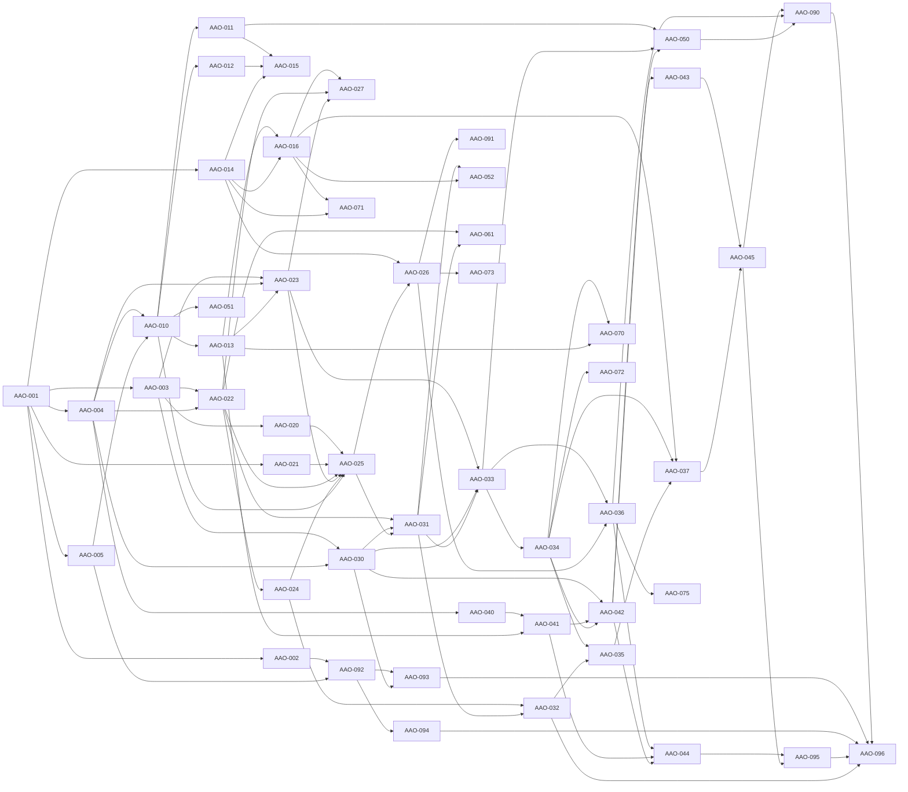

# Engineering Backlog

Generated by `python3 scripts/backlog/generate.py . /tmp/issues.json` — edit the generator, not this file. GitHub issues mirror it. Status: PROPOSED until the architecture PR is approved.

Model policy: complex financial, security, and architectural work → **Claude Opus 5.5**; well-defined frontend, standard APIs, docs, tests, infra → **Claude Sonnet 5.5**.

## 1. Milestones

| Milestone | Goal | Issues |
|---|---|---|
| M0 Foundations | Compiling workspace, CI, primitives, DB infra | AAO-001, AAO-002, AAO-003, AAO-004, AAO-005 |
| M1 Identity & Admin base | Accounts, staff security, UI shell | AAO-010, AAO-011, AAO-012, AAO-013, AAO-014, AAO-015, AAO-016 |
| M2 Link engine | Paste → link → redirect working (mock + ACCESSTRADE) | AAO-020, AAO-021, AAO-022, AAO-023, AAO-024, AAO-025, AAO-026, AAO-027 |
| M3 Ledger & Conversions | Conversions flow into a correct ledger | AAO-030, AAO-031, AAO-032, AAO-033, AAO-034, AAO-035, AAO-036, AAO-037 |
| M4 Withdrawals | Users can withdraw; finance can pay and reconcile | AAO-040, AAO-041, AAO-042, AAO-043, AAO-044, AAO-045 |
| M5 Launch hardening | Production-ready, verified with real providers | AAO-050, AAO-051, AAO-090, AAO-091, AAO-092, AAO-093, AAO-094, AAO-095, AAO-096 |
| M6 V1.x Engagement | V1.x engagement features | AAO-052, AAO-060, AAO-061, AAO-070, AAO-071, AAO-072, AAO-073, AAO-075 |

## 2. Dependency graph

## 3. Parallel lanes (safe to run concurrently once deps are merged)

| Wave | Opus lane | Sonnet lane |
|---|---|---|
| 1 | — | AAO-001 |
| 2 | AAO-003, AAO-004, AAO-021 | AAO-002, AAO-005, AAO-014, AAO-060 |
| 3 | AAO-010, AAO-020, AAO-022, AAO-030, AAO-040 | — |
| 4 | AAO-012, AAO-013, AAO-024 | AAO-011, AAO-051 |
| 5 | AAO-023, AAO-041 | AAO-015, AAO-016, AAO-092 |
| 6 | AAO-025 | AAO-027, AAO-093, AAO-094 |
| 7 | AAO-031 | AAO-026 |
| 8 | AAO-032, AAO-033 | AAO-091, AAO-052 |
| 9 | AAO-034 | AAO-036, AAO-071, AAO-073 |
| 10 | AAO-035, AAO-042 | — |
| 11 | AAO-043 | AAO-037, AAO-044, AAO-050 |
| 12 | — | AAO-045 |
| 13 | AAO-090 | AAO-095 |
| 14 | AAO-096 (launch gate) | — |
| V1.x | AAO-061, AAO-070, AAO-072 | AAO-075 |

**File-ownership rule:** two concurrently open PRs must not list the same file under *Expected files* except `Cargo.toml` workspace members (append-only) and `crates/web/src/routes/mod.rs` (one line each). Migrations are numbered at rebase time (AGENTS.md §8); each migration's tables are owned by exactly one issue (see table owner column below).

## 4. Issue index

| ID | GitHub | Title | Milestone | Model | Effort | Size | Depends on |
|---|---|---|---|---|---|---|---|
| AAO-001 | #1 | Cargo workspace skeleton, toolchain, CI baseline | M0 Foundations | Sonnet 5.5 | medium | M | — |
| AAO-002 | #2 | Container build, image signing, SBOM, dependency automation | M0 Foundations | Sonnet 5.5 | medium | M | AAO-001 |
| AAO-003 | #3 | Domain core: Money, Bps, IDs, BusinessClock, share split | M0 Foundations | Opus 5.5 | high | M | AAO-001 |
| AAO-004 | #4 | DB foundation: pool, migrations runner, DB roles, job queue, outbox, idempotency | M0 Foundations | Opus 5.5 | high | L | AAO-001 |
| AAO-005 | #5 | Telemetry, health/readiness, problem+json errors, typed config | M0 Foundations | Sonnet 5.5 | medium | M | AAO-001 |
| AAO-010 | #6 | Identity core: registration, login, sessions, CSRF, Argon2id, rate limits | M1 Identity & Admin base | Opus 5.5 | high | L | AAO-004, AAO-005 |
| AAO-011 | #7 | Email verification, password reset, EmailSender (SMTP) | M1 Identity & Admin base | Sonnet 5.5 | medium | M | AAO-010 |
| AAO-012 | #8 | Google Sign-In (OIDC + PKCE) and account linking | M1 Identity & Admin base | Opus 5.5 | medium | M | AAO-010 |
| AAO-013 | #9 | Staff RBAC, TOTP MFA, step-up, hash-chained audit log, feature flags, approvals | M1 Identity & Admin base | Opus 5.5 | high | L | AAO-010 |
| AAO-014 | #10 | UI shell: design tokens, AppShell, theme, i18n (vi/en), base components | M1 Identity & Admin base | Sonnet 5.5 | medium | L | AAO-001 |
| AAO-015 | #11 | Auth pages: register, login, Google, verify, forgot/reset, profile basics | M1 Identity & Admin base | Sonnet 5.5 | medium | M | AAO-011, AAO-012, AAO-014 |
| AAO-016 | #12 | Admin console shell and Users module | M1 Identity & Admin base | Sonnet 5.5 | medium | M | AAO-013, AAO-014 |
| AAO-020 | #13 | URL engine: extraction, merchant detection, canonicalization, product IDs | M2 Link engine | Opus 5.5 | medium | M | AAO-003 |
| AAO-021 | #14 | safe_fetch: SSRF-hardened short-link resolver | M2 Link engine | Opus 5.5 | high | M | AAO-001 |
| AAO-022 | #15 | Affiliate Gateway traits, provider registry, catalog tables, routing | M2 Link engine | Opus 5.5 | high | L | AAO-003, AAO-004 |
| AAO-023 | #16 | Commission rules engine: versions, resolver, approval, simulation | M2 Link engine | Opus 5.5 | high | M | AAO-003, AAO-004, AAO-013 |
| AAO-024 | #17 | ACCESSTRADE adapter: link creation (generic + TikTok v2), campaign catalog, product feed | M2 Link engine | Opus 5.5 | high | L | AAO-022 |
| AAO-025 | #18 | Tracking: /analyze, /links, opaque tokens, /go redirect, clicks | M2 Link engine | Opus 5.5 | high | L | AAO-020, AAO-021, AAO-022, AAO-023, AAO-024, AAO-010 |
| AAO-026 | #19 | Landing, analyzer result, link result pages | M2 Link engine | Sonnet 5.5 | medium | L | AAO-014, AAO-025 |
| AAO-027 | #20 | Admin: providers, merchants, campaigns, routing, rules UI | M2 Link engine | Sonnet 5.5 | medium | M | AAO-016, AAO-022, AAO-023 |
| AAO-030 | #21 | Ledger core: accounts, post(), guards, immutability, balances, invariant checker | M3 Ledger & Conversions | Opus 5.5 | max | XL | AAO-003, AAO-004 |
| AAO-031 | #22 | Conversion ingestion pipeline: raw events, normalizer, monotonic upsert, state machine | M3 Ledger & Conversions | Opus 5.5 | high | L | AAO-022, AAO-030, AAO-025 |
| AAO-032 | #23 | ACCESSTRADE conversion sync (transactions API) with schedules and quota control | M3 Ledger & Conversions | Opus 5.5 | high | M | AAO-024, AAO-031 |
| AAO-033 | #24 | Cashback entitlements: compute, transitions, ledger postings, freeze | M3 Ledger & Conversions | Opus 5.5 | xhigh | L | AAO-023, AAO-030, AAO-031 |
| AAO-034 | #25 | Settlements, allocation, suspense, advance policy, coverage invariant | M3 Ledger & Conversions | Opus 5.5 | max | L | AAO-033 |
| AAO-035 | #26 | Reconciliation jobs and cases | M3 Ledger & Conversions | Opus 5.5 | high | M | AAO-034, AAO-032 |
| AAO-036 | #27 | User dashboard, orders, order detail, wallet pages | M3 Ledger & Conversions | Sonnet 5.5 | medium | L | AAO-033, AAO-026 |
| AAO-037 | #28 | Admin: conversions, ledger, settlements, reconciliation UI | M3 Ledger & Conversions | Sonnet 5.5 | medium | L | AAO-016, AAO-034, AAO-035 |
| AAO-040 | #29 | Envelope encryption at rest and key rotation | M4 Withdrawals | Opus 5.5 | high | M | AAO-004 |
| AAO-041 | #30 | Bank accounts: add/change with step-up and cooldown, bank list | M4 Withdrawals | Opus 5.5 | medium | M | AAO-040, AAO-013 |
| AAO-042 | #31 | Withdrawals: state machine, reservation, limits, risk checks | M4 Withdrawals | Opus 5.5 | max | L | AAO-030, AAO-041, AAO-034 |
| AAO-043 | #32 | Payout operations: VietQR payload, batches, statement import, unknown handling, suspension | M4 Withdrawals | Opus 5.5 | high | L | AAO-042 |
| AAO-044 | #33 | User withdrawal and bank account UI | M4 Withdrawals | Sonnet 5.5 | medium | M | AAO-036, AAO-041, AAO-042 |
| AAO-045 | #34 | Admin withdrawal review queue and payout batch UI | M4 Withdrawals | Sonnet 5.5 | medium | M | AAO-043, AAO-037 |
| AAO-050 | #35 | Notifications: outbox consumer, email templates, in-app centre | M5 Launch hardening | Sonnet 5.5 | medium | M | AAO-011, AAO-033, AAO-042 |
| AAO-051 | #36 | Legal documents, consents, data export and account closure | M5 Launch hardening | Sonnet 5.5 | medium | M | AAO-010 |
| AAO-090 | #37 | Security review: authz matrix, threat model re-check, abuse tests | M5 Launch hardening | Opus 5.5 | high | M | AAO-045, AAO-036, AAO-050 |
| AAO-091 | #38 | Security headers, CSP, CAPTCHA hook, rate-limit tuning | M5 Launch hardening | Sonnet 5.5 | medium | S | AAO-026 |
| AAO-092 | #39 | Production compose, Caddy, observability stack, alerts | M5 Launch hardening | Sonnet 5.5 | medium | L | AAO-002, AAO-005 |
| AAO-093 | #40 | Backups: WAL archiving, encrypted off-site, automated restore test | M5 Launch hardening | Sonnet 5.5 | medium | M | AAO-092, AAO-030 |
| AAO-094 | #41 | Deploy/rollback workflows and runbooks | M5 Launch hardening | Sonnet 5.5 | medium | M | AAO-092 |
| AAO-095 | #42 | Full E2E, accessibility and load test suites | M5 Launch hardening | Sonnet 5.5 | medium | M | AAO-044, AAO-045 |
| AAO-096 | #43 | Launch readiness: live provider verification, financial dry run, staging soak | M5 Launch hardening | Opus 5.5 | high | M | AAO-090, AAO-093, AAO-094, AAO-095, AAO-032 |
| AAO-052 | #44 | Support tickets and missing-cashback claims | M6 V1.x Engagement | Sonnet 5.5 | medium | M | AAO-031, AAO-016 |
| AAO-060 | #45 | P1 provider research: Lazada, Ecomobi, MasOffer, Adpia, Permate | M6 V1.x Engagement | Sonnet 5.5 | medium | M | — |
| AAO-061 | #46 | Shopee direct adapter (disabled + mock) and readiness checklist | M6 V1.x Engagement | Opus 5.5 | high | M | AAO-022, AAO-031 |
| AAO-070 | #47 | Single-level referral programme | M6 V1.x Engagement | Opus 5.5 | high | M | AAO-034, AAO-013 |
| AAO-071 | #48 | Blog CMS, FAQ and SEO (sitemap, canonical, JSON-LD) | M6 V1.x Engagement | Sonnet 5.5 | medium | M | AAO-016, AAO-014 |
| AAO-072 | #49 | Daily check-in and reward campaigns | M6 V1.x Engagement | Opus 5.5 | medium | M | AAO-034 |
| AAO-073 | #50 | PWA: manifest, service worker (static only), install prompt | M6 V1.x Engagement | Sonnet 5.5 | low | S | AAO-026 |
| AAO-075 | #51 | Leaderboard (flag-gated) | M6 V1.x Engagement | Sonnet 5.5 | low | S | AAO-036 |

## 5. V1 requirement → issue coverage

| Requirement | Issues |
|---|---|
| F-01 Landing | AAO-026 |
| F-02 URL submission | AAO-020, AAO-021, AAO-025, AAO-026 |
| F-03 Preview | AAO-024, AAO-025, AAO-026 |
| F-04 Estimate | AAO-023, AAO-025 |
| F-05 Link generation | AAO-022, AAO-024, AAO-025 |
| F-06 App redirection | AAO-025, AAO-026 |
| F-07 Registration | AAO-010, AAO-011, AAO-015 |
| F-08 Login | AAO-010, AAO-015 |
| F-09 Google | AAO-012, AAO-015 |
| F-10 Recovery | AAO-011, AAO-015 |
| F-11 Dashboard | AAO-036 |
| F-12 Order history | AAO-031, AAO-032, AAO-033, AAO-036 |
| F-13 Wallet | AAO-030, AAO-036 |
| F-14 Withdrawal | AAO-042, AAO-043, AAO-044, AAO-045 |
| F-15 Bank account | AAO-041, AAO-044 |
| F-22 Theme | AAO-014 |
| F-23 i18n | AAO-014 |
| F-25 Support channels | AAO-026 |
| F-27 ToS/Privacy | AAO-051 |
| F-28 Purchase rules | AAO-026 |
| Admin console (PRD §4) | AAO-013, AAO-016, AAO-027, AAO-037, AAO-045 |
| Settlement gating (ADR-0011) | AAO-034 |
| Reconciliation | AAO-035 |
| Security / launch | AAO-090, AAO-091, AAO-095, AAO-096 |
| Infra / backups / deploy | AAO-002, AAO-092, AAO-093, AAO-094 |
| Enablers (workspace, primitives, DB infra, telemetry, encryption) | AAO-001, AAO-003, AAO-004, AAO-005, AAO-040 |
| Provider diversification (post-V1) | AAO-060, AAO-061 |
| V1.x: F-16 Referral | AAO-070 |
| V1.x: F-18 Check-in | AAO-072 |
| V1.x: F-20 Notifications | AAO-050 |
| V1.x: F-21 Blog | AAO-071 |
| V1.x: F-24 PWA | AAO-073 |
| V1.x: F-26 Missing cashback | AAO-052 |
| P2: F-19 Leaderboard | AAO-075 |
| F-17 Multi-level | none — disabled by ADR-0014 |

## 6. Issue details

### AAO-001: Cargo workspace skeleton, toolchain, CI baseline

**Milestone:** M0 Foundations · **Assigned AI model:** Claude Sonnet 5.5 · **Reasoning effort:** medium · **Estimated complexity:** M

**Objective.** Create the empty-but-compiling workspace and CI so all later issues have a home.

**Business context.** Every other issue depends on a consistent workspace layout and enforced quality gates.

**Technical requirements**
- Workspace with crates: domain, db, ledger, affiliate, app, ui, web (bin), worker (bin), testkit (dev) — stubs only
- rust-toolchain.toml pinned stable; workspace lints: forbid(unsafe_code), clippy::float_arithmetic denied in domain/ledger/app
- justfile: dev, test, lint, e2e; compose.dev.yml with postgres:17
- .github/workflows/ci.yml: fmt, clippy, nextest, cargo deny, cargo audit, gitleaks, grep-check forbidding format! into SQL
- deny.toml (licenses allowlist, bans), CODEOWNERS (owner on crates/ledger, migrations, .github, infra, docs/adr), PR template with 'Owner decision needed' section
- migrations/README.md describing numbering rule (see AGENTS.md §8); dependency-direction check script over cargo metadata

**Dependencies.** None · *Parallelism:* First issue. Blocks everything.

**Architecture references.** ARCHITECTURE.md §4; `TECH_STACK.md`; `AGENTS.md`

**Expected files or modules**
- `Cargo.toml`
- `rust-toolchain.toml`
- `crates/*/Cargo.toml`
- `crates/*/src/lib.rs|main.rs`
- `justfile`
- `compose.dev.yml`
- `.github/workflows/ci.yml`
- `deny.toml`
- `.github/CODEOWNERS`
- `.github/pull_request_template.md`
- `migrations/README.md`
- `scripts/check-deps.sh`

**Acceptance criteria**
- [ ] `just lint` and `just test` pass on a clean checkout
- [ ] CI runs on PRs and blocks merge on failure
- [ ] Dependency check fails if e.g. domain depends on sqlx

**Security considerations**
- Actions pinned by SHA; workflow permissions read-only by default
- gitleaks blocks committed secrets

**Test requirements**
- CI self-test: a deliberately failing lint in a scratch branch is caught (documented in PR)

**Definition of Done**
- [ ] CI green (fmt, clippy -D warnings, nextest, sqlx check, deny, audit, gitleaks)
- [ ] Tests listed below exist and pass; coverage of new domain logic ≥ 90% lines
- [ ] Docs referenced above updated if behaviour differs; PROJECT_STATUS session log entry added
- [ ] No secrets, PII, or real provider data committed
- [ ] PR reviewed (owner review required on protected paths per CODEOWNERS)

### AAO-002: Container build, image signing, SBOM, dependency automation

**Milestone:** M0 Foundations · **Assigned AI model:** Claude Sonnet 5.5 · **Reasoning effort:** medium · **Estimated complexity:** M

**Objective.** Produce reproducible, minimal, signed images for web and worker.

**Business context.** Supply-chain integrity for a product handling money.

**Technical requirements**
- Multi-stage Dockerfile with cargo-chef; distroless cc nonroot runtime; Tailwind standalone CLI in build stage
- Trivy scan (fail on fixable HIGH/CRITICAL); cosign keyless signing; SBOM (cargo-cyclonedx) as artifact
- Renovate config: weekly grouped Rust deps, actions digests, Docker base images

**Dependencies.** AAO-001 · *Parallelism:* Parallel with AAO-003/004/005/014/021.

**Architecture references.** INFRASTRUCTURE.md §3–4; SECURITY_THREAT_MODEL.md E-2

**Expected files or modules**
- `Dockerfile`
- `.dockerignore`
- `.github/workflows/ci.yml (image job)`
- `renovate.json`

**Acceptance criteria**
- [ ] Images < 60 MB, run as UID 10001, no shell
- [ ] Signature verifiable with cosign verify
- [ ] Trivy job blocks on seeded vulnerable dep in test branch

**Security considerations**
- No secrets in build args or layers

**Test requirements**
- Image smoke: container starts and /healthz returns 200 (once AAO-005 lands; stub endpoint until then)

**Definition of Done**
- [ ] CI green (fmt, clippy -D warnings, nextest, sqlx check, deny, audit, gitleaks)
- [ ] Tests listed below exist and pass; coverage of new domain logic ≥ 90% lines
- [ ] Docs referenced above updated if behaviour differs; PROJECT_STATUS session log entry added
- [ ] No secrets, PII, or real provider data committed
- [ ] PR reviewed (owner review required on protected paths per CODEOWNERS)

### AAO-003: Domain core: Money, Bps, IDs, BusinessClock, share split

**Milestone:** M0 Foundations · **Assigned AI model:** Claude Opus 5.5 · **Reasoning effort:** high · **Estimated complexity:** M

**Objective.** Implement the pure financial and identity primitives every other crate uses.

**Business context.** Correct money math is the foundation of user trust and cash-flow safety.

**Technical requirements**
- `Money{amount:i64,currency}` with checked ops; `Bps(u32)` 0..=10000; `Rounding{Floor,HalfEven}`
- `split_commission(commission, share_bps, rounding, cap) -> (user, platform)` with platform taking remainder (I7)
- UUIDv7 newtype IDs (UserId, ClickId, ConversionId, …) with serde + sqlx Type behind feature flag
- `BusinessClock` trait: now(), vn_date(), vn_day_bounds(); fake clock for tests
- State enums for Conversion, Entitlement, Withdrawal with `can_transition(from,to)` tables (no I/O)

**Dependencies.** AAO-001 · *Parallelism:* Parallel with AAO-002/004/005/014/021.

**Architecture references.** ADR-0006; FINANCIAL_LEDGER.md §5, §7; ORDER_RECONCILIATION.md §4; WITHDRAWAL_DESIGN.md §3

**Expected files or modules**
- `crates/domain/src/{money.rs,bps.rs,ids.rs,clock.rs,split.rs,state/*.rs}`

**Acceptance criteria**
- [ ] No f32/f64 in crate (lint)
- [ ] split satisfies user+platform==commission for all inputs
- [ ] Illegal transitions return Err

**Security considerations**
- Overflow returns error, never wraps or panics

**Test requirements**
- proptest: split invariants, rounding bounds, cap respected
- exhaustive transition table tests
- serde round-trip

**Definition of Done**
- [ ] CI green (fmt, clippy -D warnings, nextest, sqlx check, deny, audit, gitleaks)
- [ ] Tests listed below exist and pass; coverage of new domain logic ≥ 90% lines
- [ ] Docs referenced above updated if behaviour differs; PROJECT_STATUS session log entry added
- [ ] No secrets, PII, or real provider data committed
- [ ] PR reviewed (owner review required on protected paths per CODEOWNERS)

### AAO-004: DB foundation: pool, migrations runner, DB roles, job queue, outbox, idempotency

**Milestone:** M0 Foundations · **Assigned AI model:** Claude Opus 5.5 · **Reasoning effort:** high · **Estimated complexity:** L

**Objective.** Provide transactional infrastructure: migrations, a durable job queue, outbox/inbox, idempotency keys.

**Business context.** Reliable background processing without double financial effects.

**Technical requirements**
- sqlx pool config from env; `migrator` binary subcommand; roles app_rw/app_ro/migrator with grants
- Tables: jobs, outbox, processed_events, idempotency_keys, rate_limit_buckets, config_values (effective-dated)
- Job API: enqueue(tx, kind, payload, dedupe_key, run_at); lease(n) via SKIP LOCKED; heartbeat; complete; fail with backoff; dead-letter
- Outbox writer (in caller tx) + publisher loop skeleton in worker; inbox dedupe helper
- testkit: Postgres testcontainer with template DB per test

**Dependencies.** AAO-001 · *Parallelism:* Parallel with AAO-002/003/005/014/021.

**Architecture references.** ADR-0004; ADR-0005; DATABASE_DESIGN.md §4.2, §4.9, §6, §8

**Expected files or modules**
- `crates/db/src/{pool.rs,jobs.rs,outbox.rs,idempotency.rs,config.rs}`
- `crates/worker/src/runner.rs`
- `crates/testkit/src/pg.rs`
- `migrations/0001_AAO-004_foundation.sql`

**Acceptance criteria**
- [ ] Two workers never lease the same job
- [ ] Expired lease is reclaimed
- [ ] dedupe_key prevents duplicate queued jobs
- [ ] Outbox event published exactly once per consumer (inbox)

**Security considerations**
- app_rw cannot ALTER/DROP; least-privilege grants

**Test requirements**
- integration: concurrent leasing (50 tasks)
- crash simulation: drop connection mid-job → retried
- migration from zero in CI

**Definition of Done**
- [ ] CI green (fmt, clippy -D warnings, nextest, sqlx check, deny, audit, gitleaks)
- [ ] Tests listed below exist and pass; coverage of new domain logic ≥ 90% lines
- [ ] Docs referenced above updated if behaviour differs; PROJECT_STATUS session log entry added
- [ ] No secrets, PII, or real provider data committed
- [ ] PR reviewed (owner review required on protected paths per CODEOWNERS)

### AAO-005: Telemetry, health/readiness, problem+json errors, typed config

**Milestone:** M0 Foundations · **Assigned AI model:** Claude Sonnet 5.5 · **Reasoning effort:** medium · **Estimated complexity:** M

**Objective.** Make both binaries observable and fail predictably.

**Business context.** Operability from day one; trace ids help support resolve user issues.

**Technical requirements**
- tracing + OTLP exporter, JSON logs with redaction layer (deny-list of field names: email, phone, account_number, token, password)
- Prometheus metrics endpoint on internal port; RED middleware for Axum
- /healthz (process) and /readyz (DB ping + migrations current)
- `AppError` → RFC 9457 problem+json with stable `code`, localized `detail`, `trace_id`
- Typed config (figment or envy) with validation at startup; secrets read from /run/secrets/*

**Dependencies.** AAO-001 · *Parallelism:* Parallel with AAO-002/003/004/014/021.

**Architecture references.** ARCHITECTURE.md §7; API_SPECIFICATION.md §2; INFRASTRUCTURE.md §8

**Expected files or modules**
- `crates/app/src/telemetry.rs`
- `crates/app/src/error.rs`
- `crates/web/src/{health.rs,middleware/*.rs}`
- `crates/app/src/config.rs`

**Acceptance criteria**
- [ ] Error responses match schema in docs/api/openapi.yaml
- [ ] Logs never contain redacted fields (test)
- [ ] /readyz 503 when DB down

**Security considerations**
- Metrics port not exposed publicly (documented for AAO-092)

**Test requirements**
- unit: redaction layer
- integration: readiness with stopped DB

**Definition of Done**
- [ ] CI green (fmt, clippy -D warnings, nextest, sqlx check, deny, audit, gitleaks)
- [ ] Tests listed below exist and pass; coverage of new domain logic ≥ 90% lines
- [ ] Docs referenced above updated if behaviour differs; PROJECT_STATUS session log entry added
- [ ] No secrets, PII, or real provider data committed
- [ ] PR reviewed (owner review required on protected paths per CODEOWNERS)

### AAO-010: Identity core: registration, login, sessions, CSRF, Argon2id, rate limits

**Milestone:** M1 Identity & Admin base · **Assigned AI model:** Claude Opus 5.5 · **Reasoning effort:** high · **Estimated complexity:** L

**Objective.** Secure email/password accounts with revocable server-side sessions.

**Business context.** Accounts gate link attribution and payouts; ATO is the main fraud vector.

**Technical requirements**
- Tables users, user_credentials, sessions, email_tokens (migration)
- Argon2id params per ADR-0008 with rehash-on-login
- Session cookie __Host-, token hash stored, idle+absolute expiry, revoke-all
- CSRF middleware (synchronizer token)
- Postgres token-bucket rate limiter (per IP, per account); generic auth errors; lockout backoff
- Consent capture fields at registration (document versions)
- referral_code generation (random, unique)

**Dependencies.** AAO-004, AAO-005 · *Parallelism:* Parallel with AAO-020/021/022/030 once deps merged.

**Architecture references.** ADR-0008; SECURITY_THREAT_MODEL.md S-1,S-2,I-4; DATABASE_DESIGN.md §4.1; API_SPECIFICATION.md §3

**Expected files or modules**
- `crates/app/src/identity/*`
- `crates/web/src/routes/auth.rs`
- `crates/web/src/middleware/{session.rs,csrf.rs,ratelimit.rs}`
- `migrations/NNNN_AAO-010_identity.sql`

**Acceptance criteria**
- [ ] Register/login/logout via API
- [ ] Session revoked on logout and password change
- [ ] Enumeration-safe responses
- [ ] Rate limits enforced with 429 + Retry-After

**Security considerations**
- Timing-safe comparisons; password max length 128; breached-password check hook (offline list)

**Test requirements**
- integration: auth flows
- security: CSRF missing token rejected, session fixation prevented
- property: rate limiter never exceeds budget

**Definition of Done**
- [ ] CI green (fmt, clippy -D warnings, nextest, sqlx check, deny, audit, gitleaks)
- [ ] Tests listed below exist and pass; coverage of new domain logic ≥ 90% lines
- [ ] Docs referenced above updated if behaviour differs; PROJECT_STATUS session log entry added
- [ ] No secrets, PII, or real provider data committed
- [ ] PR reviewed (owner review required on protected paths per CODEOWNERS)

### AAO-011: Email verification, password reset, EmailSender (SMTP)

**Milestone:** M1 Identity & Admin base · **Assigned AI model:** Claude Sonnet 5.5 · **Reasoning effort:** medium · **Estimated complexity:** M

**Objective.** Complete account lifecycle emails.

**Business context.** Verified email is required to withdraw.

**Technical requirements**
- EmailSender trait + SMTP adapter (lettre, rustls) + dev mailbox (log)
- Bilingual templates (vi/en)
- Verify-email and reset flows with single-use hashed tokens (30 min reset, 24h verify); reset revokes sessions

**Dependencies.** AAO-010

**Architecture references.** ADR-0008; SECURITY_THREAT_MODEL.md S-2

**Expected files or modules**
- `crates/app/src/identity/{verify.rs,reset.rs}`
- `crates/app/src/email/*`
- `crates/ui/locales/*/email.ftl`

**Acceptance criteria**
- [ ] Tokens single-use and expire
- [ ] Same response whether or not account exists

**Security considerations**
- Email content contains no secrets except the one-time link

**Test requirements**
- integration: token reuse rejected, expired rejected

**Definition of Done**
- [ ] CI green (fmt, clippy -D warnings, nextest, sqlx check, deny, audit, gitleaks)
- [ ] Tests listed below exist and pass; coverage of new domain logic ≥ 90% lines
- [ ] Docs referenced above updated if behaviour differs; PROJECT_STATUS session log entry added
- [ ] No secrets, PII, or real provider data committed
- [ ] PR reviewed (owner review required on protected paths per CODEOWNERS)

### AAO-012: Google Sign-In (OIDC + PKCE) and account linking

**Milestone:** M1 Identity & Admin base · **Assigned AI model:** Claude Opus 5.5 · **Reasoning effort:** medium · **Estimated complexity:** M

**Objective.** Allow one-tap Google login.

**Business context.** Parity feature F-09; reduces signup friction.

**Technical requirements**
- openidconnect crate; state+nonce+PKCE; require email_verified
- oauth_identities table
- Linking rules: auto-link only when logged in or after email confirmation; never silently merge

**Dependencies.** AAO-010

**Architecture references.** ADR-0008; SECURITY_THREAT_MODEL.md S-3

**Expected files or modules**
- `crates/app/src/identity/oidc.rs`
- `crates/web/src/routes/oauth.rs`
- `migrations/NNNN_AAO-012_oauth.sql`

**Acceptance criteria**
- [ ] New user via Google gets verified email
- [ ] Existing email account requires confirmation to link

**Security considerations**
- Client secret from secret file; redirect URI exact match

**Test requirements**
- integration with stub IdP (testkit)

**Definition of Done**
- [ ] CI green (fmt, clippy -D warnings, nextest, sqlx check, deny, audit, gitleaks)
- [ ] Tests listed below exist and pass; coverage of new domain logic ≥ 90% lines
- [ ] Docs referenced above updated if behaviour differs; PROJECT_STATUS session log entry added
- [ ] No secrets, PII, or real provider data committed
- [ ] PR reviewed (owner review required on protected paths per CODEOWNERS)

### AAO-013: Staff RBAC, TOTP MFA, step-up, hash-chained audit log, feature flags, approvals

**Milestone:** M1 Identity & Admin base · **Assigned AI model:** Claude Opus 5.5 · **Reasoning effort:** high · **Estimated complexity:** L

**Objective.** Provide the privileged-access backbone for all admin and money actions.

**Business context.** Insider and ATO risk control; maker-checker for money.

**Technical requirements**
- roles/role_grants; owner seeded via CLI only
- TOTP enrolment/verify with replay protection (last_used_step)
- step-up guard (≤5 min) as Axum extractor
- audit_log with SHA-256 hash chain + verifier job
- feature_flags with 30s cache; dangerous flags require approvals row by a different staff user
- approvals table + service (maker≠checker DB CHECK)
- `app::authz` policy functions per permission (ADMIN_DASHBOARD.md §2)

**Dependencies.** AAO-010

**Architecture references.** ADMIN_DASHBOARD.md §2; ADR-0008; SECURITY_THREAT_MODEL.md S-4,T-3,E-1,A-9

**Expected files or modules**
- `crates/app/src/{authz.rs,audit.rs,flags.rs,approvals.rs,identity/mfa.rs}`
- `crates/web/src/extract/{staff.rs,step_up.rs}`
- `migrations/NNNN_AAO-013_admin.sql`

**Acceptance criteria**
- [ ] Every staff route requires TOTP-verified session
- [ ] Audit chain verification detects tampering
- [ ] Dangerous flag cannot be enabled by a single person

**Security considerations**
- Owner role not grantable via API

**Test requirements**
- authz matrix test generated from ADMIN_DASHBOARD.md table
- audit chain tamper test

**Definition of Done**
- [ ] CI green (fmt, clippy -D warnings, nextest, sqlx check, deny, audit, gitleaks)
- [ ] Tests listed below exist and pass; coverage of new domain logic ≥ 90% lines
- [ ] Docs referenced above updated if behaviour differs; PROJECT_STATUS session log entry added
- [ ] No secrets, PII, or real provider data committed
- [ ] PR reviewed (owner review required on protected paths per CODEOWNERS)

### AAO-014: UI shell: design tokens, AppShell, theme, i18n (vi/en), base components

**Milestone:** M1 Identity & Admin base · **Assigned AI model:** Claude Sonnet 5.5 · **Reasoning effort:** medium · **Estimated complexity:** L

**Objective.** Create the Leptos SSR app shell and component library.

**Business context.** Mobile-first, Vietnamese-first UX parity (F-22, F-23).

**Technical requirements**
- cargo-leptos setup with islands; Tailwind v4 standalone; tokens from UI_UX_SPECIFICATION.md §2
- AppShell (bottom nav mobile / top nav desktop), ThemeToggle without FOUC, LanguageSwitch, MoneyText, StatePill, EmptyState, ErrorState, Toast, Modal
- Fluent catalogs vi/en; CI missing-key check; self-hosted Be Vietnam Pro subset

**Dependencies.** AAO-001 · *Parallelism:* Parallel with M0 issues after AAO-001.

**Architecture references.** `UI_UX_SPECIFICATION.md`; ADR-0003

**Expected files or modules**
- `crates/ui/src/{app.rs,components/*,theme.rs,i18n.rs}`
- `crates/ui/style/tailwind.css`
- `crates/ui/locales/{vi,en}/*.ftl`
- `crates/web/src/ssr.rs`

**Acceptance criteria**
- [ ] Lighthouse mobile: Perf ≥ 90, A11y ≥ 95 on shell page
- [ ] No hydration warnings
- [ ] Dark/light respects prefers-color-scheme

**Security considerations**
- CSP-compatible (no inline scripts except hashed)

**Test requirements**
- Playwright: theme + language persist; axe no serious violations

**Definition of Done**
- [ ] CI green (fmt, clippy -D warnings, nextest, sqlx check, deny, audit, gitleaks)
- [ ] Tests listed below exist and pass; coverage of new domain logic ≥ 90% lines
- [ ] Docs referenced above updated if behaviour differs; PROJECT_STATUS session log entry added
- [ ] No secrets, PII, or real provider data committed
- [ ] PR reviewed (owner review required on protected paths per CODEOWNERS)

### AAO-015: Auth pages: register, login, Google, verify, forgot/reset, profile basics

**Milestone:** M1 Identity & Admin base · **Assigned AI model:** Claude Sonnet 5.5 · **Reasoning effort:** medium · **Estimated complexity:** M

**Objective.** User-facing authentication UI.

**Business context.** Parity F-07..F-10.

**Technical requirements**
- Pages per UI spec §5 with inline validation, password strength (zxcvbn), consent checkboxes linking legal docs
- Session list + revoke on profile page

**Dependencies.** AAO-011, AAO-012, AAO-014

**Architecture references.** UI_UX_SPECIFICATION.md §5; API_SPECIFICATION.md §3

**Expected files or modules**
- `crates/ui/src/pages/auth/*`
- `crates/ui/src/pages/profile.rs`

**Acceptance criteria**
- [ ] All flows work without JS for submit (progressive enhancement)
- [ ] Errors localized

**Security considerations**
- No credentials in URLs; autocomplete attributes correct

**Test requirements**
- Playwright: register→verify→login; Google stub; reset

**Definition of Done**
- [ ] CI green (fmt, clippy -D warnings, nextest, sqlx check, deny, audit, gitleaks)
- [ ] Tests listed below exist and pass; coverage of new domain logic ≥ 90% lines
- [ ] Docs referenced above updated if behaviour differs; PROJECT_STATUS session log entry added
- [ ] No secrets, PII, or real provider data committed
- [ ] PR reviewed (owner review required on protected paths per CODEOWNERS)

### AAO-016: Admin console shell and Users module

**Milestone:** M1 Identity & Admin base · **Assigned AI model:** Claude Sonnet 5.5 · **Reasoning effort:** medium · **Estimated complexity:** M

**Objective.** Admin layout, navigation by role, users search/detail/actions.

**Business context.** Operators need tooling before launch.

**Technical requirements**
- admin subdomain routing; role-aware nav
- Users: search, detail, lock/suspend, revoke sessions, view-as (read-only)
- Audit log viewer

**Dependencies.** AAO-013, AAO-014

**Architecture references.** ADMIN_DASHBOARD.md §1–2

**Expected files or modules**
- `crates/ui/src/admin/{shell.rs,users/*,audit.rs}`
- `crates/web/src/routes/admin/users.rs`

**Acceptance criteria**
- [ ] Each action audited with reason
- [ ] Support role sees masked bank data

**Security considerations**
- CSRF + step-up on mutations

**Test requirements**
- Playwright admin smoke; authz tests per role

**Definition of Done**
- [ ] CI green (fmt, clippy -D warnings, nextest, sqlx check, deny, audit, gitleaks)
- [ ] Tests listed below exist and pass; coverage of new domain logic ≥ 90% lines
- [ ] Docs referenced above updated if behaviour differs; PROJECT_STATUS session log entry added
- [ ] No secrets, PII, or real provider data committed
- [ ] PR reviewed (owner review required on protected paths per CODEOWNERS)

### AAO-020: URL engine: extraction, merchant detection, canonicalization, product IDs

**Milestone:** M2 Link engine · **Assigned AI model:** Claude Opus 5.5 · **Reasoning effort:** medium · **Estimated complexity:** M

**Objective.** Turn arbitrary user input into a canonical merchant product.

**Business context.** Parity F-02; robust parsing drives conversion.

**Technical requirements**
- extract_urls from text (≤4 KB, ≤5 URLs)
- Merchant modules: Shopee VN, TikTok Shop VN (hosts, short hosts, patterns, app schemes)
- Canonical URL builder; strip tracking/other-publisher params
- Fixture corpus of real public URL shapes (no PII)

**Dependencies.** AAO-003 · *Parallelism:* Parallel with AAO-021/022/030.

**Architecture references.** TRACKING_AND_ATTRIBUTION.md §2

**Expected files or modules**
- `crates/affiliate/src/url/{extract.rs,merchants/shopee.rs,merchants/tiktok.rs,canonical.rs}`
- `crates/affiliate/tests/url_corpus.rs`

**Acceptance criteria**
- [ ] ≥ 40 fixture inputs pass incl. share-text with emoji/Vietnamese
- [ ] Unknown hosts rejected

**Security considerations**
- No network calls here (short links delegated to safe_fetch)

**Test requirements**
- unit + proptest (never panics on arbitrary input)

**Definition of Done**
- [ ] CI green (fmt, clippy -D warnings, nextest, sqlx check, deny, audit, gitleaks)
- [ ] Tests listed below exist and pass; coverage of new domain logic ≥ 90% lines
- [ ] Docs referenced above updated if behaviour differs; PROJECT_STATUS session log entry added
- [ ] No secrets, PII, or real provider data committed
- [ ] PR reviewed (owner review required on protected paths per CODEOWNERS)

### AAO-021: safe_fetch: SSRF-hardened short-link resolver

**Milestone:** M2 Link engine · **Assigned AI model:** Claude Opus 5.5 · **Reasoning effort:** high · **Estimated complexity:** M

**Objective.** Resolve short links safely.

**Business context.** Short/shared mobile links are the common input; SSRF is the main risk of resolving them.

**Technical requirements**
- reqwest+rustls with custom resolver; allowlisted hosts; IP range blocklist (v4/v6); connect to vetted IP
- Manual redirect following with per-hop validation, ≤5 hops, loop detection
- HEAD then ranged GET; size cap 512 KB; total timeout 4s; no cookies/proxy env
- 24h cache by input hash (product_cache or dedicated table)

**Dependencies.** AAO-001 · *Parallelism:* Parallel with AAO-003/004/005.

**Architecture references.** TRACKING_AND_ATTRIBUTION.md §2.1; SECURITY_THREAT_MODEL.md D-2

**Expected files or modules**
- `crates/affiliate/src/safe_fetch/*`

**Acceptance criteria**
- [ ] Blocks private/loopback/link-local/metadata/rebinding cases
- [ ] Resolves allowlisted short links in fixtures

**Security considerations**
- Primary SSRF control — reviewed by owner

**Test requirements**
- SSRF corpus tests with local DNS stub and redirect servers (T-SSRF-1)

**Definition of Done**
- [ ] CI green (fmt, clippy -D warnings, nextest, sqlx check, deny, audit, gitleaks)
- [ ] Tests listed below exist and pass; coverage of new domain logic ≥ 90% lines
- [ ] Docs referenced above updated if behaviour differs; PROJECT_STATUS session log entry added
- [ ] No secrets, PII, or real provider data committed
- [ ] PR reviewed (owner review required on protected paths per CODEOWNERS)

### AAO-022: Affiliate Gateway traits, provider registry, catalog tables, routing

**Milestone:** M2 Link engine · **Assigned AI model:** Claude Opus 5.5 · **Reasoning effort:** high · **Estimated complexity:** L

**Objective.** Provider-independent gateway with capability discovery and route selection.

**Business context.** Lets us add providers without touching business logic; protects history.

**Technical requirements**
- Traits per AFFILIATE_INTEGRATION_GUIDE.md §1; ProviderError taxonomy
- Registry with modes Disabled/Mock/Sandbox/Live; prod refuses Mock
- Tables providers, merchants, campaigns, provider_merchant_routes, product_cache
- Routing eligibility + scoring (§3), decision persisted
- Per-provider rate limiter + circuit breaker + health score

**Dependencies.** AAO-003, AAO-004 · *Parallelism:* Parallel with AAO-020/021/030.

**Architecture references.** ADR-0007; `AFFILIATE_INTEGRATION_GUIDE.md`; DATABASE_DESIGN.md §4.3

**Expected files or modules**
- `crates/affiliate/src/{gateway.rs,registry.rs,routing.rs,resilience.rs}`
- `crates/app/src/catalog/*`
- `migrations/NNNN_AAO-022_catalog.sql`

**Acceptance criteria**
- [ ] Route never chosen when cashback_allowed≠yes
- [ ] Mock providers rejected at startup in prod profile

**Security considerations**
- Credentials encrypted (uses AAO-040 when available; until then field remains null and provider disabled)

**Test requirements**
- unit: routing table-driven
- integration: registry + DB

**Definition of Done**
- [ ] CI green (fmt, clippy -D warnings, nextest, sqlx check, deny, audit, gitleaks)
- [ ] Tests listed below exist and pass; coverage of new domain logic ≥ 90% lines
- [ ] Docs referenced above updated if behaviour differs; PROJECT_STATUS session log entry added
- [ ] No secrets, PII, or real provider data committed
- [ ] PR reviewed (owner review required on protected paths per CODEOWNERS)

### AAO-023: Commission rules engine: versions, resolver, approval, simulation

**Milestone:** M2 Link engine · **Assigned AI model:** Claude Opus 5.5 · **Reasoning effort:** high · **Estimated complexity:** M

**Objective.** Configurable, versioned, reproducible cashback share rules.

**Business context.** Margin control; no hardcoded rates (brief §3).

**Technical requirements**
- Tables commission_rules, commission_rule_versions (immutable after approval trigger)
- Pure resolver in domain: specificity, tier/promo overlays, priority, effective dates
- Admin API: create version, approve (maker≠checker), simulate on last N conversions
- Ceiling alert when share_bps > config max

**Dependencies.** AAO-003, AAO-004, AAO-013

**Architecture references.** ADR-0006; DATABASE_DESIGN.md §4.4; `ADMIN_DASHBOARD.md`

**Expected files or modules**
- `crates/domain/src/rules.rs`
- `crates/app/src/rules/*`
- `crates/web/src/routes/admin/rules.rs`
- `migrations/NNNN_AAO-023_rules.sql`

**Acceptance criteria**
- [ ] Same inputs → same version (deterministic)
- [ ] Unapproved versions never resolve

**Security considerations**
- Rule edits audited; diff stored

**Test requirements**
- proptest resolver determinism
- integration approval flow

**Definition of Done**
- [ ] CI green (fmt, clippy -D warnings, nextest, sqlx check, deny, audit, gitleaks)
- [ ] Tests listed below exist and pass; coverage of new domain logic ≥ 90% lines
- [ ] Docs referenced above updated if behaviour differs; PROJECT_STATUS session log entry added
- [ ] No secrets, PII, or real provider data committed
- [ ] PR reviewed (owner review required on protected paths per CODEOWNERS)

### AAO-024: ACCESSTRADE adapter: link creation (generic + TikTok v2), campaign catalog, product feed

**Milestone:** M2 Link engine · **Assigned AI model:** Claude Opus 5.5 · **Reasoning effort:** high · **Estimated complexity:** L

**Objective.** First real provider integration for link generation.

**Business context.** Unlocks Shopee and TikTok Shop cashback links via one network (ADR-0013).

**Technical requirements**
- Client with Token auth, timeouts, limiter
- LinkBuilder: POST /v1/product_link/create; TikTok: POST /v2/tiktokshop_product_feeds/create_link?minify=true
- SubIds: utm_source=aaio, utm_campaign, utm_content=token, sub1=token
- CampaignCatalog: GET /v1/campaigns?approval=successful (daily job)
- ProductLookup for TikTok via product feed when possible; Shopee preview = none (capability false)
- Mock adapter + wiremock contract tests; fixtures only from real redacted responses once OB-2 done

**Dependencies.** AAO-022

**Architecture references.** AFFILIATE_PROVIDER_MATRIX.md §2; AFFILIATE_INTEGRATION_GUIDE.md §7

**Expected files or modules**
- `crates/affiliate/src/providers/accesstrade/*`

**Acceptance criteria**
- [ ] Ineligible/suspended URLs map to ProviderError::Ineligible
- [ ] Never logs token header
- [ ] Live verification checklist completed in staging before mode=Live

**Security considerations**
- Credentials only via admin, encrypted

**Test requirements**
- contract tests; live verification evidence (manual) — required before enabling

**Definition of Done**
- [ ] Owner confirms OB-2/OB-3 (account + campaign approval) before live verification
- [ ] CI green (fmt, clippy -D warnings, nextest, sqlx check, deny, audit, gitleaks)
- [ ] Tests listed below exist and pass; coverage of new domain logic ≥ 90% lines
- [ ] Docs referenced above updated if behaviour differs; PROJECT_STATUS session log entry added
- [ ] No secrets, PII, or real provider data committed
- [ ] PR reviewed (owner review required on protected paths per CODEOWNERS)

### AAO-025: Tracking: /analyze, /links, opaque tokens, /go redirect, clicks

**Milestone:** M2 Link engine · **Assigned AI model:** Claude Opus 5.5 · **Reasoning effort:** high · **Estimated complexity:** L

**Objective.** End-to-end link generation and click tracking.

**Business context.** Core parity journey F-02..F-06, F-28.

**Technical requirements**
- Tables link_requests, clicks (monthly partitions + creator job)
- Token: 96-bit OsRng, Crockford base32
- Estimate via rules (labelled estimate, basis recorded)
- /go/{token}: validate, record click, 302 or interstitial for in-app UAs; redirect only to stored provider URL on allowlisted host
- Link TTL config; expired page

**Dependencies.** AAO-020, AAO-021, AAO-022, AAO-023, AAO-024, AAO-010

**Architecture references.** `TRACKING_AND_ATTRIBUTION.md`; ARCHITECTURE.md §6.1; `API_SPECIFICATION.md`

**Expected files or modules**
- `crates/app/src/tracking/*`
- `crates/web/src/routes/{analyze.rs,links.rs,go.rs}`
- `migrations/NNNN_AAO-025_tracking.sql`

**Acceptance criteria**
- [ ] Provider/campaign/rule version pinned on link
- [ ] No PII in any outbound URL
- [ ] /go p95 < 50 ms in k6 smoke

**Security considerations**
- Open-redirect impossible (T-REDIR-1)
- Rate limits per API spec

**Test requirements**
- integration with mock provider
- T-REDIR-1, k6 smoke

**Definition of Done**
- [ ] CI green (fmt, clippy -D warnings, nextest, sqlx check, deny, audit, gitleaks)
- [ ] Tests listed below exist and pass; coverage of new domain logic ≥ 90% lines
- [ ] Docs referenced above updated if behaviour differs; PROJECT_STATUS session log entry added
- [ ] No secrets, PII, or real provider data committed
- [ ] PR reviewed (owner review required on protected paths per CODEOWNERS)

### AAO-026: Landing, analyzer result, link result pages

**Milestone:** M2 Link engine · **Assigned AI model:** Claude Sonnet 5.5 · **Reasoning effort:** medium · **Estimated complexity:** L

**Objective.** User-facing link flow UI.

**Business context.** Primary conversion funnel; parity F-01, F-03..F-06, F-25, F-28.

**Technical requirements**
- Pages per UI spec §5–6; PasteBox with clipboard; preview card; EstimateBadge; purchase-rules checklist; in-app browser notice; desktop QR
- Support contact links from config
- SEO meta + JSON-LD for landing

**Dependencies.** AAO-014, AAO-025

**Architecture references.** UI_UX_SPECIFICATION.md §5–6

**Expected files or modules**
- `crates/ui/src/pages/{landing.rs,analyze.rs,link_result.rs}`

**Acceptance criteria**
- [ ] Works without JS for paste+submit
- [ ] Never shows estimate without 'ước tính'

**Security considerations**
- No third-party scripts

**Test requirements**
- Playwright mobile+desktop journey 1 (TEST_STRATEGY §3)

**Definition of Done**
- [ ] CI green (fmt, clippy -D warnings, nextest, sqlx check, deny, audit, gitleaks)
- [ ] Tests listed below exist and pass; coverage of new domain logic ≥ 90% lines
- [ ] Docs referenced above updated if behaviour differs; PROJECT_STATUS session log entry added
- [ ] No secrets, PII, or real provider data committed
- [ ] PR reviewed (owner review required on protected paths per CODEOWNERS)

### AAO-027: Admin: providers, merchants, campaigns, routing, rules UI

**Milestone:** M2 Link engine · **Assigned AI model:** Claude Sonnet 5.5 · **Reasoning effort:** medium · **Estimated complexity:** M

**Objective.** Operate catalog and rules without SQL.

**Business context.** Commission config must not be hardcoded.

**Technical requirements**
- CRUD + simulation views; cashback_allowed toggle requires evidence ref; rules diff + approve

**Dependencies.** AAO-016, AAO-022, AAO-023

**Architecture references.** ADMIN_DASHBOARD.md §1

**Expected files or modules**
- `crates/ui/src/admin/{providers,merchants,campaigns,routes,rules}/*`

**Acceptance criteria**
- [ ] Optimistic concurrency (412) handled in UI

**Security considerations**
- Credentials write-only

**Test requirements**
- Playwright admin flows; authz per role

**Definition of Done**
- [ ] CI green (fmt, clippy -D warnings, nextest, sqlx check, deny, audit, gitleaks)
- [ ] Tests listed below exist and pass; coverage of new domain logic ≥ 90% lines
- [ ] Docs referenced above updated if behaviour differs; PROJECT_STATUS session log entry added
- [ ] No secrets, PII, or real provider data committed
- [ ] PR reviewed (owner review required on protected paths per CODEOWNERS)

### AAO-030: Ledger core: accounts, post(), guards, immutability, balances, invariant checker

**Milestone:** M3 Ledger & Conversions · **Assigned AI model:** Claude Opus 5.5 · **Reasoning effort:** max · **Estimated complexity:** XL

**Objective.** Implement the double-entry ledger exactly as specified.

**Business context.** Financial source of truth; every cashback đồng flows through it.

**Technical requirements**
- Tables ledger_accounts, ledger_transactions, ledger_entries, ledger_balances
- Deferred balanced-transaction constraint trigger; UPDATE/DELETE blocking triggers; app_rw grants without UPDATE/DELETE
- `post(tx, Posting, guards)` with deterministic lock order, idempotency key + payload hash
- Account resolver/creator (lazy per user/provider)
- Nightly invariant job I1–I6, I11 with metrics + alerts
- Views v_user_wallet, v_platform_position

**Dependencies.** AAO-003, AAO-004 · *Parallelism:* Parallel with AAO-020/021/022 after M0.

**Architecture references.** ADR-0010; FINANCIAL_LEDGER.md (all); DATABASE_DESIGN.md §4.7, §6

**Expected files or modules**
- `crates/ledger/src/*`
- `migrations/NNNN_AAO-030_ledger.sql`
- `crates/worker/src/jobs/ledger_invariants.rs`

**Acceptance criteria**
- [ ] All §5 worked examples reproduced as tests with exact balances
- [ ] Unbalanced tx rejected at commit
- [ ] Replay returns same TxId; mismatched payload errors

**Security considerations**
- Owner approval required (protected path)

**Test requirements**
- T-LEDGER-1/2, proptest random posting sequences keep I1/I3/I4
- concurrency: parallel posts to same account

**Definition of Done**
- [ ] Owner signs off chart of accounts
- [ ] CI green (fmt, clippy -D warnings, nextest, sqlx check, deny, audit, gitleaks)
- [ ] Tests listed below exist and pass; coverage of new domain logic ≥ 90% lines
- [ ] Docs referenced above updated if behaviour differs; PROJECT_STATUS session log entry added
- [ ] No secrets, PII, or real provider data committed
- [ ] PR reviewed (owner review required on protected paths per CODEOWNERS)

### AAO-031: Conversion ingestion pipeline: raw events, normalizer, monotonic upsert, state machine

**Milestone:** M3 Ledger & Conversions · **Assigned AI model:** Claude Opus 5.5 · **Reasoning effort:** high · **Estimated complexity:** L

**Objective.** One idempotent pipeline for poll/webhook/CSV/backfill.

**Business context.** Accurate order tracking (F-12) and protection from duplicates/out-of-order data.

**Technical requirements**
- Tables provider_events_raw, conversions, conversion_status_history, sync_checkpoints
- Per-provider redaction allowlist
- Upsert with provider_updated_at guard + status rank; row lock for transitions
- Attribution by token → matched/unmatched
- Emits outbox events

**Dependencies.** AAO-022, AAO-030, AAO-025

**Architecture references.** ORDER_RECONCILIATION.md §1–2, §4.1, §5; ARCHITECTURE.md §6.2

**Expected files or modules**
- `crates/app/src/conversions/*`
- `migrations/NNNN_AAO-031_conversions.sql`

**Acceptance criteria**
- [ ] T-DUP-1, T-OOO-1/2, T-MULTI-1, T-CRASH-1/2, T-CONC-2 pass

**Security considerations**
- Raw payloads redacted before insert

**Test requirements**
- listed scenario tests

**Definition of Done**
- [ ] CI green (fmt, clippy -D warnings, nextest, sqlx check, deny, audit, gitleaks)
- [ ] Tests listed below exist and pass; coverage of new domain logic ≥ 90% lines
- [ ] Docs referenced above updated if behaviour differs; PROJECT_STATUS session log entry added
- [ ] No secrets, PII, or real provider data committed
- [ ] PR reviewed (owner review required on protected paths per CODEOWNERS)

### AAO-032: ACCESSTRADE conversion sync (transactions API) with schedules and quota control

**Milestone:** M3 Ledger & Conversions · **Assigned AI model:** Claude Opus 5.5 · **Reasoning effort:** high · **Estimated complexity:** M

**Objective.** Poll ACCESSTRADE transactions reliably within 10 req/min.

**Business context.** Primary source of order status.

**Technical requirements**
- ConversionSource: GET /v1/transactions with update_time windows, limit=300, paging
- Status mapping table (0/1/2 + is_confirmed) — confirm against live data
- Streams recent/daily/monthly per ORDER_RECONCILIATION §2; 429 Retry-After handling
- Quota metrics + alert at 70%

**Dependencies.** AAO-024, AAO-031

**Architecture references.** AFFILIATE_PROVIDER_MATRIX.md §2; ORDER_RECONCILIATION.md §2

**Expected files or modules**
- `crates/affiliate/src/providers/accesstrade/conversions.rs`
- `crates/worker/src/schedules/accesstrade.rs`

**Acceptance criteria**
- [ ] Sync freshness SLO measurable
- [ ] Never exceeds 8 req/min in tests

**Security considerations**
- Token never logged

**Test requirements**
- contract tests with paging, 429, timeouts

**Definition of Done**
- [ ] CI green (fmt, clippy -D warnings, nextest, sqlx check, deny, audit, gitleaks)
- [ ] Tests listed below exist and pass; coverage of new domain logic ≥ 90% lines
- [ ] Docs referenced above updated if behaviour differs; PROJECT_STATUS session log entry added
- [ ] No secrets, PII, or real provider data committed
- [ ] PR reviewed (owner review required on protected paths per CODEOWNERS)

### AAO-033: Cashback entitlements: compute, transitions, ledger postings, freeze

**Milestone:** M3 Ledger & Conversions · **Assigned AI model:** Claude Opus 5.5 · **Reasoning effort:** xhigh · **Estimated complexity:** L

**Objective.** Translate conversion changes into user obligations.

**Business context.** What users see as their cashback.

**Technical requirements**
- Table cashback_entitlements
- Recompute on each conversion revision with pinned rule; delta postings with ent:{id}:rev:{n} keys
- Transitions per §4.2; frozen_reason handling
- Outbox notifications

**Dependencies.** AAO-023, AAO-030, AAO-031

**Architecture references.** FINANCIAL_LEDGER.md §5–6; ORDER_RECONCILIATION.md §4.2

**Expected files or modules**
- `crates/app/src/entitlements/*`
- `migrations/NNNN_AAO-033_entitlements.sql`

**Acceptance criteria**
- [ ] T-REF-1, T-RULE-1 pass; I6/I7 hold under proptest sequences

**Security considerations**
- Fraud void requires approval

**Test requirements**
- proptest: random conversion event sequences → ledger consistent

**Definition of Done**
- [ ] CI green (fmt, clippy -D warnings, nextest, sqlx check, deny, audit, gitleaks)
- [ ] Tests listed below exist and pass; coverage of new domain logic ≥ 90% lines
- [ ] Docs referenced above updated if behaviour differs; PROJECT_STATUS session log entry added
- [ ] No secrets, PII, or real provider data committed
- [ ] PR reviewed (owner review required on protected paths per CODEOWNERS)

### AAO-034: Settlements, allocation, suspense, advance policy, coverage invariant

**Milestone:** M3 Ledger & Conversions · **Assigned AI model:** Claude Opus 5.5 · **Reasoning effort:** max · **Estimated complexity:** L

**Objective.** Make cashback available only when funded or explicitly advanced.

**Business context.** Cash-flow protection (brief §3, ADR-0011).

**Technical requirements**
- Tables provider_settlements, settlement_allocations, advance_policy
- Finance records settlement + uploads statement; matcher; allocation postings; suspense
- Advance availability job under policy lock; exposure calc
- Coverage invariant I8 daily + auto payout suspension

**Dependencies.** AAO-033

**Architecture references.** ADR-0011; FINANCIAL_LEDGER.md §5.1, §7

**Expected files or modules**
- `crates/app/src/settlement/*`
- `migrations/NNNN_AAO-034_settlement.sql`

**Acceptance criteria**
- [ ] T-SET-1, T-ADV-1, T-COV-1 pass
- [ ] Advance off by default

**Security considerations**
- Maker-checker on settlement recording

**Test requirements**
- integration + proptest on allocation sums (I12)

**Definition of Done**
- [ ] Owner decision D-2 recorded (advance policy values)
- [ ] CI green (fmt, clippy -D warnings, nextest, sqlx check, deny, audit, gitleaks)
- [ ] Tests listed below exist and pass; coverage of new domain logic ≥ 90% lines
- [ ] Docs referenced above updated if behaviour differs; PROJECT_STATUS session log entry added
- [ ] No secrets, PII, or real provider data committed
- [ ] PR reviewed (owner review required on protected paths per CODEOWNERS)

### AAO-035: Reconciliation jobs and cases

**Milestone:** M3 Ledger & Conversions · **Assigned AI model:** Claude Opus 5.5 · **Reasoning effort:** high · **Estimated complexity:** M

**Objective.** Detect and track discrepancies.

**Business context.** Catches provider/ledger drift before it costs money.

**Technical requirements**
- reconciliation_cases table
- Daily provider-vs-local totals per status/day
- Invariant results surfaced; case workflow with adjustment link

**Dependencies.** AAO-034, AAO-032

**Architecture references.** ORDER_RECONCILIATION.md §3

**Expected files or modules**
- `crates/app/src/reconciliation/*`
- `crates/worker/src/jobs/recon_*.rs`
- `migrations/NNNN_AAO-035_recon.sql`

**Acceptance criteria**
- [ ] Seeded discrepancy opens a case

**Security considerations**
- Adjustments require approval

**Test requirements**
- integration

**Definition of Done**
- [ ] CI green (fmt, clippy -D warnings, nextest, sqlx check, deny, audit, gitleaks)
- [ ] Tests listed below exist and pass; coverage of new domain logic ≥ 90% lines
- [ ] Docs referenced above updated if behaviour differs; PROJECT_STATUS session log entry added
- [ ] No secrets, PII, or real provider data committed
- [ ] PR reviewed (owner review required on protected paths per CODEOWNERS)

### AAO-036: User dashboard, orders, order detail, wallet pages

**Milestone:** M3 Ledger & Conversions · **Assigned AI model:** Claude Sonnet 5.5 · **Reasoning effort:** medium · **Estimated complexity:** L

**Objective.** Users see orders and balances accurately.

**Business context.** Parity F-11..F-13; trust.

**Technical requirements**
- APIs /wallet, /wallet/transactions, /orders, /orders/{id} (keyset pagination)
- Pages per UI spec with Timeline and state colours
- Owed (negative) banner

**Dependencies.** AAO-033, AAO-026

**Architecture references.** UI_UX_SPECIFICATION.md §5; `API_SPECIFICATION.md`

**Expected files or modules**
- `crates/web/src/routes/{wallet.rs,orders.rs}`
- `crates/ui/src/pages/{dashboard.rs,orders/*,wallet.rs}`

**Acceptance criteria**
- [ ] Totals equal v_user_wallet
- [ ] IDOR tests pass

**Security considerations**
- Owner-scoped queries

**Test requirements**
- T-AUTHZ-1; Playwright journey 3 (partial)

**Definition of Done**
- [ ] CI green (fmt, clippy -D warnings, nextest, sqlx check, deny, audit, gitleaks)
- [ ] Tests listed below exist and pass; coverage of new domain logic ≥ 90% lines
- [ ] Docs referenced above updated if behaviour differs; PROJECT_STATUS session log entry added
- [ ] No secrets, PII, or real provider data committed
- [ ] PR reviewed (owner review required on protected paths per CODEOWNERS)

### AAO-037: Admin: conversions, ledger, settlements, reconciliation UI

**Milestone:** M3 Ledger & Conversions · **Assigned AI model:** Claude Sonnet 5.5 · **Reasoning effort:** medium · **Estimated complexity:** L

**Objective.** Finance and support tooling for money states.

**Business context.** Operability of reconciliation.

**Technical requirements**
- Views per ADMIN_DASHBOARD.md; raw event viewer (redacted); settlement upload; suspense; invariant status

**Dependencies.** AAO-016, AAO-034, AAO-035

**Architecture references.** `ADMIN_DASHBOARD.md`

**Expected files or modules**
- `crates/ui/src/admin/{conversions,ledger,settlements,recon}/*`

**Acceptance criteria**
- [ ] Role permissions enforced

**Security considerations**
- Exports audited

**Test requirements**
- Playwright admin

**Definition of Done**
- [ ] CI green (fmt, clippy -D warnings, nextest, sqlx check, deny, audit, gitleaks)
- [ ] Tests listed below exist and pass; coverage of new domain logic ≥ 90% lines
- [ ] Docs referenced above updated if behaviour differs; PROJECT_STATUS session log entry added
- [ ] No secrets, PII, or real provider data committed
- [ ] PR reviewed (owner review required on protected paths per CODEOWNERS)

### AAO-040: Envelope encryption at rest and key rotation

**Milestone:** M4 Withdrawals · **Assigned AI model:** Claude Opus 5.5 · **Reasoning effort:** high · **Estimated complexity:** M

**Objective.** Encrypt bank numbers, TOTP secrets, provider credentials.

**Business context.** Limits blast radius of DB/backup leaks (I-2).

**Technical requirements**
- AES-256-GCM with per-row DEK wrapped by KEK from secret file; key_id column
- Rotation job re-wraps/re-encrypts; KEK loading fails closed

**Dependencies.** AAO-004 · *Parallelism:* Can start right after AAO-004.

**Architecture references.** ADR-0008; SECURITY_THREAT_MODEL.md I-2

**Expected files or modules**
- `crates/app/src/crypto.rs`
- `crates/worker/src/jobs/rekey.rs`

**Acceptance criteria**
- [ ] Ciphertext differs per row; tampering detected

**Security considerations**
- Keys never logged; zeroize

**Test requirements**
- unit + rotation integration

**Definition of Done**
- [ ] CI green (fmt, clippy -D warnings, nextest, sqlx check, deny, audit, gitleaks)
- [ ] Tests listed below exist and pass; coverage of new domain logic ≥ 90% lines
- [ ] Docs referenced above updated if behaviour differs; PROJECT_STATUS session log entry added
- [ ] No secrets, PII, or real provider data committed
- [ ] PR reviewed (owner review required on protected paths per CODEOWNERS)

### AAO-041: Bank accounts: add/change with step-up and cooldown, bank list

**Milestone:** M4 Withdrawals · **Assigned AI model:** Claude Opus 5.5 · **Reasoning effort:** medium · **Estimated complexity:** M

**Objective.** Users register a payout destination safely.

**Business context.** Parity F-15; ATO defence.

**Technical requirements**
- Table bank_accounts + banks seed (source documented)
- Encrypted number, last4, dedupe hash; holder name normalization
- Step-up, cooldown, old-email notification

**Dependencies.** AAO-040, AAO-013

**Architecture references.** WITHDRAWAL_DESIGN.md §6

**Expected files or modules**
- `crates/app/src/payouts/bank_accounts.rs`
- `migrations/NNNN_AAO-041_bank_accounts.sql`

**Acceptance criteria**
- [ ] Only one active account; cooldown enforced

**Security considerations**
- A-6 controls

**Test requirements**
- integration + authz

**Definition of Done**
- [ ] CI green (fmt, clippy -D warnings, nextest, sqlx check, deny, audit, gitleaks)
- [ ] Tests listed below exist and pass; coverage of new domain logic ≥ 90% lines
- [ ] Docs referenced above updated if behaviour differs; PROJECT_STATUS session log entry added
- [ ] No secrets, PII, or real provider data committed
- [ ] PR reviewed (owner review required on protected paths per CODEOWNERS)

### AAO-042: Withdrawals: state machine, reservation, limits, risk checks

**Milestone:** M4 Withdrawals · **Assigned AI model:** Claude Opus 5.5 · **Reasoning effort:** max · **Estimated complexity:** L

**Objective.** Request→review→approve flow with no double spend.

**Business context.** Parity F-14; highest fraud surface.

**Technical requirements**
- Tables withdrawals, withdrawal_status_history
- Reservation under lock + NonNegative guard + partial unique index + Idempotency-Key
- Config limits (effective-dated); risk flags §4
- Cancel/reject releases

**Dependencies.** AAO-030, AAO-041, AAO-034

**Architecture references.** WITHDRAWAL_DESIGN.md §2–4; FINANCIAL_LEDGER.md §5

**Expected files or modules**
- `crates/app/src/payouts/withdrawals.rs`
- `crates/web/src/routes/withdrawals.rs`
- `migrations/NNNN_AAO-042_withdrawals.sql`

**Acceptance criteria**
- [ ] T-CONC-1, T-DUP-2 pass
- [ ] Negative available blocks requests

**Security considerations**
- Step-up required; owner approval on migration

**Test requirements**
- concurrency + property tests

**Definition of Done**
- [ ] CI green (fmt, clippy -D warnings, nextest, sqlx check, deny, audit, gitleaks)
- [ ] Tests listed below exist and pass; coverage of new domain logic ≥ 90% lines
- [ ] Docs referenced above updated if behaviour differs; PROJECT_STATUS session log entry added
- [ ] No secrets, PII, or real provider data committed
- [ ] PR reviewed (owner review required on protected paths per CODEOWNERS)

### AAO-043: Payout operations: VietQR payload, batches, statement import, unknown handling, suspension

**Milestone:** M4 Withdrawals · **Assigned AI model:** Claude Opus 5.5 · **Reasoning effort:** high · **Estimated complexity:** L

**Objective.** Execute and reconcile manual payouts.

**Business context.** Pay users correctly and provably.

**Technical requirements**
- VietQR (EMVCo) payload generator with CRC, validated against official spec examples
- payout_attempts, bank_statement_lines; CSV importers per bank (pluggable)
- Submit (≠ approver), match, paid, failed, unknown transitions + postings
- payouts.suspended kill switch
- PayoutRail trait; MoMo adapter Disabled stub

**Dependencies.** AAO-042

**Architecture references.** WITHDRAWAL_DESIGN.md §1, §3, §5, §7; ADR-0012

**Expected files or modules**
- `crates/app/src/payouts/{rails.rs,vietqr.rs,statements.rs}`
- `migrations/NNNN_AAO-043_payout_ops.sql`

**Acceptance criteria**
- [ ] T-PAY-1, T-PAY-2 pass
- [ ] Unknown never auto-retried

**Security considerations**
- Evidence hashes stored; maker-checker

**Test requirements**
- integration + fixtures of statement CSV

**Definition of Done**
- [ ] CI green (fmt, clippy -D warnings, nextest, sqlx check, deny, audit, gitleaks)
- [ ] Tests listed below exist and pass; coverage of new domain logic ≥ 90% lines
- [ ] Docs referenced above updated if behaviour differs; PROJECT_STATUS session log entry added
- [ ] No secrets, PII, or real provider data committed
- [ ] PR reviewed (owner review required on protected paths per CODEOWNERS)

### AAO-044: User withdrawal and bank account UI

**Milestone:** M4 Withdrawals · **Assigned AI model:** Claude Sonnet 5.5 · **Reasoning effort:** medium · **Estimated complexity:** M

**Objective.** Self-service cash-out UI.

**Business context.** Parity F-14/F-15.

**Technical requirements**
- Pages per UI spec; StepUpDialog; client-generated Idempotency-Key per form; suspended banner

**Dependencies.** AAO-036, AAO-041, AAO-042

**Architecture references.** UI_UX_SPECIFICATION.md §5

**Expected files or modules**
- `crates/ui/src/pages/{withdraw.rs,withdrawals.rs,bank_account.rs}`

**Acceptance criteria**
- [ ] Double-click cannot create two requests

**Security considerations**
- Masked account display

**Test requirements**
- Playwright journey 3

**Definition of Done**
- [ ] CI green (fmt, clippy -D warnings, nextest, sqlx check, deny, audit, gitleaks)
- [ ] Tests listed below exist and pass; coverage of new domain logic ≥ 90% lines
- [ ] Docs referenced above updated if behaviour differs; PROJECT_STATUS session log entry added
- [ ] No secrets, PII, or real provider data committed
- [ ] PR reviewed (owner review required on protected paths per CODEOWNERS)

### AAO-045: Admin withdrawal review queue and payout batch UI

**Milestone:** M4 Withdrawals · **Assigned AI model:** Claude Sonnet 5.5 · **Reasoning effort:** medium · **Estimated complexity:** M

**Objective.** Finance UI for review, batch, VietQR display, statement import.

**Business context.** Operational payout capacity.

**Technical requirements**
- Review queue with risk flags; batch view with QR; mark submitted with evidence; unknown queue

**Dependencies.** AAO-043, AAO-037

**Architecture references.** `ADMIN_DASHBOARD.md`; WITHDRAWAL_DESIGN.md §5

**Expected files or modules**
- `crates/ui/src/admin/withdrawals/*`

**Acceptance criteria**
- [ ] Approver cannot submit same withdrawal (UI + server)

**Security considerations**
- Step-up on actions

**Test requirements**
- Playwright finance flow

**Definition of Done**
- [ ] CI green (fmt, clippy -D warnings, nextest, sqlx check, deny, audit, gitleaks)
- [ ] Tests listed below exist and pass; coverage of new domain logic ≥ 90% lines
- [ ] Docs referenced above updated if behaviour differs; PROJECT_STATUS session log entry added
- [ ] No secrets, PII, or real provider data committed
- [ ] PR reviewed (owner review required on protected paths per CODEOWNERS)

### AAO-050: Notifications: outbox consumer, email templates, in-app centre

**Milestone:** M5 Launch hardening · **Assigned AI model:** Claude Sonnet 5.5 · **Reasoning effort:** medium · **Estimated complexity:** M

**Objective.** Notify users of order and withdrawal changes exactly once.

**Business context.** Parity F-20; reduces support load.

**Technical requirements**
- notifications table; consumer with inbox dedupe; vi/en templates; bell + list UI

**Dependencies.** AAO-011, AAO-033, AAO-042

**Architecture references.** ARCHITECTURE.md §7; DATABASE_DESIGN.md §4.9

**Expected files or modules**
- `crates/app/src/notifications/*`
- `crates/ui/src/pages/notifications.rs`
- `migrations/NNNN_AAO-050_notifications.sql`

**Acceptance criteria**
- [ ] One notification per state change (dedupe_key)

**Security considerations**
- No sensitive data in email bodies beyond masked values

**Test requirements**
- integration dedupe

**Definition of Done**
- [ ] CI green (fmt, clippy -D warnings, nextest, sqlx check, deny, audit, gitleaks)
- [ ] Tests listed below exist and pass; coverage of new domain logic ≥ 90% lines
- [ ] Docs referenced above updated if behaviour differs; PROJECT_STATUS session log entry added
- [ ] No secrets, PII, or real provider data committed
- [ ] PR reviewed (owner review required on protected paths per CODEOWNERS)

### AAO-051: Legal documents, consents, data export and account closure

**Milestone:** M5 Launch hardening · **Assigned AI model:** Claude Sonnet 5.5 · **Reasoning effort:** medium · **Estimated complexity:** M

**Objective.** Versioned ToS/Privacy and PDPL rights.

**Business context.** Parity F-27 plus compliance gaps closed.

**Technical requirements**
- legal_documents, consents; re-consent on new version
- /me/data-export (async JSON), /me/close with pseudonymization job keeping financial records

**Dependencies.** AAO-010

**Architecture references.** `COMPLIANCE_CHECKLIST.md`; DATABASE_DESIGN.md §7

**Expected files or modules**
- `crates/app/src/privacy/*`
- `crates/ui/src/pages/legal.rs`
- `migrations/NNNN_AAO-051_legal.sql`

**Acceptance criteria**
- [ ] Export contains all user data categories
- [ ] Closure keeps ledger integrity

**Security considerations**
- Export download link expires; audited

**Test requirements**
- integration

**Definition of Done**
- [ ] Legal text supplied/approved by owner's counsel (placeholder until then)
- [ ] CI green (fmt, clippy -D warnings, nextest, sqlx check, deny, audit, gitleaks)
- [ ] Tests listed below exist and pass; coverage of new domain logic ≥ 90% lines
- [ ] Docs referenced above updated if behaviour differs; PROJECT_STATUS session log entry added
- [ ] No secrets, PII, or real provider data committed
- [ ] PR reviewed (owner review required on protected paths per CODEOWNERS)

### AAO-090: Security review: authz matrix, threat model re-check, abuse tests

**Milestone:** M5 Launch hardening · **Assigned AI model:** Claude Opus 5.5 · **Reasoning effort:** high · **Estimated complexity:** M

**Objective.** Independent pass over the complete V1.

**Business context.** Launch gate.

**Technical requirements**
- Generate authz tests from role table; review every route; update threat model; fix or ticket findings

**Dependencies.** AAO-045, AAO-036, AAO-050

**Architecture references.** `SECURITY_THREAT_MODEL.md`

**Expected files or modules**
- `crates/web/tests/authz_matrix.rs`
- `docs/SECURITY_THREAT_MODEL.md`

**Acceptance criteria**
- [ ] No open High findings

**Security considerations**
- —

**Test requirements**
- security regression suite

**Definition of Done**
- [ ] CI green (fmt, clippy -D warnings, nextest, sqlx check, deny, audit, gitleaks)
- [ ] Tests listed below exist and pass; coverage of new domain logic ≥ 90% lines
- [ ] Docs referenced above updated if behaviour differs; PROJECT_STATUS session log entry added
- [ ] No secrets, PII, or real provider data committed
- [ ] PR reviewed (owner review required on protected paths per CODEOWNERS)

### AAO-091: Security headers, CSP, CAPTCHA hook, rate-limit tuning

**Milestone:** M5 Launch hardening · **Assigned AI model:** Claude Sonnet 5.5 · **Reasoning effort:** medium · **Estimated complexity:** S

**Objective.** Harden HTTP surface.

**Business context.** XSS/clickjacking defence.

**Technical requirements**
- Headers per threat model §5; Turnstile (or equivalent) behind config; rate-limit values from config

**Dependencies.** AAO-026

**Architecture references.** SECURITY_THREAT_MODEL.md §5

**Expected files or modules**
- `crates/web/src/middleware/headers.rs`
- `infra/caddy/Caddyfile`

**Acceptance criteria**
- [ ] Mozilla Observatory A+ on staging

**Security considerations**
- —

**Test requirements**
- header tests

**Definition of Done**
- [ ] CI green (fmt, clippy -D warnings, nextest, sqlx check, deny, audit, gitleaks)
- [ ] Tests listed below exist and pass; coverage of new domain logic ≥ 90% lines
- [ ] Docs referenced above updated if behaviour differs; PROJECT_STATUS session log entry added
- [ ] No secrets, PII, or real provider data committed
- [ ] PR reviewed (owner review required on protected paths per CODEOWNERS)

### AAO-092: Production compose, Caddy, observability stack, alerts

**Milestone:** M5 Launch hardening · **Assigned AI model:** Claude Sonnet 5.5 · **Reasoning effort:** medium · **Estimated complexity:** L

**Objective.** Deployable stack on a VPS.

**Business context.** Go-live infrastructure.

**Technical requirements**
- compose.prod.yml per INFRASTRUCTURE.md §2; networks; secrets; hardening flags
- otel-collector, Prometheus, Loki, Grafana dashboards (RED, provider, business), alert rules §8
- VPS bootstrap script (ufw, users, fail2ban, unattended-upgrades)

**Dependencies.** AAO-002, AAO-005

**Architecture references.** `INFRASTRUCTURE.md`; ADR-0009

**Expected files or modules**
- `infra/compose.prod.yml`
- `infra/caddy/*`
- `infra/observability/*`
- `infra/bootstrap/*.sh`

**Acceptance criteria**
- [ ] Staging up from scratch with one command + documented secrets

**Security considerations**
- Only 80/443/22 open

**Test requirements**
- staging smoke

**Definition of Done**
- [ ] CI green (fmt, clippy -D warnings, nextest, sqlx check, deny, audit, gitleaks)
- [ ] Tests listed below exist and pass; coverage of new domain logic ≥ 90% lines
- [ ] Docs referenced above updated if behaviour differs; PROJECT_STATUS session log entry added
- [ ] No secrets, PII, or real provider data committed
- [ ] PR reviewed (owner review required on protected paths per CODEOWNERS)

### AAO-093: Backups: WAL archiving, encrypted off-site, automated restore test

**Milestone:** M5 Launch hardening · **Assigned AI model:** Claude Sonnet 5.5 · **Reasoning effort:** medium · **Estimated complexity:** M

**Objective.** Meet RPO 15 min / RTO 4 h.

**Business context.** Survive host loss.

**Technical requirements**
- wal-g or pgBackRest; client-side encryption; weekly restore + invariant check workflow

**Dependencies.** AAO-092, AAO-030

**Architecture references.** INFRASTRUCTURE.md §7

**Expected files or modules**
- `infra/backup/*`
- `.github/workflows/restore-test.yml`

**Acceptance criteria**
- [ ] Restore drill documented with timings

**Security considerations**
- Backup key not on VPS

**Test requirements**
- weekly restore job green

**Definition of Done**
- [ ] CI green (fmt, clippy -D warnings, nextest, sqlx check, deny, audit, gitleaks)
- [ ] Tests listed below exist and pass; coverage of new domain logic ≥ 90% lines
- [ ] Docs referenced above updated if behaviour differs; PROJECT_STATUS session log entry added
- [ ] No secrets, PII, or real provider data committed
- [ ] PR reviewed (owner review required on protected paths per CODEOWNERS)

### AAO-094: Deploy/rollback workflows and runbooks

**Milestone:** M5 Launch hardening · **Assigned AI model:** Claude Sonnet 5.5 · **Reasoning effort:** medium · **Estimated complexity:** M

**Objective.** Safe releases and incident playbooks.

**Business context.** Operational readiness.

**Technical requirements**
- deploy-staging/prod workflows with environment approval, migrate job, smoke, auto-rollback
- Runbooks RB-01..RB-09

**Dependencies.** AAO-092

**Architecture references.** INFRASTRUCTURE.md §4–6, §9

**Expected files or modules**
- `.github/workflows/deploy-*.yml`
- `scripts/rollback.sh`
- `docs/runbooks/*.md`

**Acceptance criteria**
- [ ] Rollback exercised on staging

**Security considerations**
- Prod deploy requires owner approval

**Test requirements**
- staging rehearsal

**Definition of Done**
- [ ] CI green (fmt, clippy -D warnings, nextest, sqlx check, deny, audit, gitleaks)
- [ ] Tests listed below exist and pass; coverage of new domain logic ≥ 90% lines
- [ ] Docs referenced above updated if behaviour differs; PROJECT_STATUS session log entry added
- [ ] No secrets, PII, or real provider data committed
- [ ] PR reviewed (owner review required on protected paths per CODEOWNERS)

### AAO-095: Full E2E, accessibility and load test suites

**Milestone:** M5 Launch hardening · **Assigned AI model:** Claude Sonnet 5.5 · **Reasoning effort:** medium · **Estimated complexity:** M

**Objective.** Automate journeys and performance gates.

**Business context.** Regression safety before launch.

**Technical requirements**
- Playwright journeys 1–5, axe, k6 scenarios with thresholds (TEST_STRATEGY §3–4)

**Dependencies.** AAO-044, AAO-045

**Architecture references.** `TEST_STRATEGY.md`

**Expected files or modules**
- `e2e/*`
- `load/*`
- `.github/workflows/nightly.yml`

**Acceptance criteria**
- [ ] Thresholds met on staging

**Security considerations**
- Test-only fixture endpoints compiled out of prod

**Test requirements**
- —

**Definition of Done**
- [ ] CI green (fmt, clippy -D warnings, nextest, sqlx check, deny, audit, gitleaks)
- [ ] Tests listed below exist and pass; coverage of new domain logic ≥ 90% lines
- [ ] Docs referenced above updated if behaviour differs; PROJECT_STATUS session log entry added
- [ ] No secrets, PII, or real provider data committed
- [ ] PR reviewed (owner review required on protected paths per CODEOWNERS)

### AAO-096: Launch readiness: live provider verification, financial dry run, staging soak

**Milestone:** M5 Launch hardening · **Assigned AI model:** Claude Opus 5.5 · **Reasoning effort:** high · **Estimated complexity:** M

**Objective.** Prove the money path end-to-end with real providers before opening to users.

**Business context.** Launch gate; integrations must not be declared verified from mocks.

**Technical requirements**
- Real low-value purchases via ACCESSTRADE links (Shopee + TikTok) → sync → approve → settlement record → payout to staff account
- 7-day staging soak with invariant checks
- Go/no-go checklist

**Dependencies.** AAO-090, AAO-093, AAO-094, AAO-095, AAO-032

**Architecture references.** AFFILIATE_INTEGRATION_GUIDE.md §6; TEST_STRATEGY.md §6

**Expected files or modules**
- `docs/LAUNCH_CHECKLIST.md`
- `docs/PROJECT_STATUS.md`

**Acceptance criteria**
- [ ] Evidence attached; all invariants green; owner go decision

**Security considerations**
- Real credentials only in staging/prod secrets

**Test requirements**
- manual + automated

**Definition of Done**
- [ ] Owner go/no-go recorded
- [ ] CI green (fmt, clippy -D warnings, nextest, sqlx check, deny, audit, gitleaks)
- [ ] Tests listed below exist and pass; coverage of new domain logic ≥ 90% lines
- [ ] Docs referenced above updated if behaviour differs; PROJECT_STATUS session log entry added
- [ ] No secrets, PII, or real provider data committed
- [ ] PR reviewed (owner review required on protected paths per CODEOWNERS)

### AAO-052: Support tickets and missing-cashback claims

**Milestone:** M6 V1.x Engagement · **Assigned AI model:** Claude Sonnet 5.5 · **Reasoning effort:** medium · **Estimated complexity:** M

**Objective.** Let users report missing cashback with evidence.

**Business context.** Parity F-26; trust.

**Technical requirements**
- tickets, ticket_messages, missing_cashback_claims; auto-search; private uploads (image only, 2 MB, scanned)

**Dependencies.** AAO-031, AAO-016

**Architecture references.** ORDER_RECONCILIATION.md §6

**Expected files or modules**
- `crates/app/src/support/*`
- `crates/ui/src/pages/support/*`
- `migrations/NNNN_AAO-052_support.sql`

**Acceptance criteria**
- [ ] Claim links to click and found conversion

**Security considerations**
- Upload validation; no public URLs

**Test requirements**
- integration + Playwright journey 4

**Definition of Done**
- [ ] CI green (fmt, clippy -D warnings, nextest, sqlx check, deny, audit, gitleaks)
- [ ] Tests listed below exist and pass; coverage of new domain logic ≥ 90% lines
- [ ] Docs referenced above updated if behaviour differs; PROJECT_STATUS session log entry added
- [ ] No secrets, PII, or real provider data committed
- [ ] PR reviewed (owner review required on protected paths per CODEOWNERS)

### AAO-060: P1 provider research: Lazada, Ecomobi, MasOffer, Adpia, Permate

**Milestone:** M6 V1.x Engagement · **Assigned AI model:** Claude Sonnet 5.5 · **Reasoning effort:** medium · **Estimated complexity:** M

**Objective.** Fill provider matrix with verified facts.

**Business context.** Diversify beyond one network (R-02).

**Technical requirements**
- Read official docs/terms; update matrix with labels and sources; onboarding questions list

**Dependencies.** None · *Parallelism:* Can run any time; docs only.

**Architecture references.** AFFILIATE_PROVIDER_MATRIX.md §5

**Expected files or modules**
- `docs/AFFILIATE_PROVIDER_MATRIX.md`

**Acceptance criteria**
- [ ] Each row has sources or UNKNOWN

**Security considerations**
- No credentials in docs

**Test requirements**
- —

**Definition of Done**
- [ ] CI green (fmt, clippy -D warnings, nextest, sqlx check, deny, audit, gitleaks)
- [ ] Tests listed below exist and pass; coverage of new domain logic ≥ 90% lines
- [ ] Docs referenced above updated if behaviour differs; PROJECT_STATUS session log entry added
- [ ] No secrets, PII, or real provider data committed
- [ ] PR reviewed (owner review required on protected paths per CODEOWNERS)

### AAO-061: Shopee direct adapter (disabled + mock) and readiness checklist

**Milestone:** M6 V1.x Engagement · **Assigned AI model:** Claude Opus 5.5 · **Reasoning effort:** high · **Estimated complexity:** M

**Objective.** Prepare a redundant Shopee route.

**Business context.** Reduce single-provider dependency.

**Technical requirements**
- Adapter skeleton behind Disabled; mock clearly labelled; enable only after Open API docs + permission

**Dependencies.** AAO-022, AAO-031

**Architecture references.** AFFILIATE_PROVIDER_MATRIX.md §3

**Expected files or modules**
- `crates/affiliate/src/providers/shopee_direct/*`

**Acceptance criteria**
- [ ] Cannot be enabled in prod without credentials + approval

**Security considerations**
- Secret signing per official docs only

**Test requirements**
- contract tests from real responses once available

**Definition of Done**
- [ ] CI green (fmt, clippy -D warnings, nextest, sqlx check, deny, audit, gitleaks)
- [ ] Tests listed below exist and pass; coverage of new domain logic ≥ 90% lines
- [ ] Docs referenced above updated if behaviour differs; PROJECT_STATUS session log entry added
- [ ] No secrets, PII, or real provider data committed
- [ ] PR reviewed (owner review required on protected paths per CODEOWNERS)

### AAO-070: Single-level referral programme

**Milestone:** M6 V1.x Engagement · **Assigned AI model:** Claude Opus 5.5 · **Reasoning effort:** high · **Estimated complexity:** M

**Objective.** Referral codes, attribution, rewards on settled orders.

**Business context.** Parity F-16 with anti-abuse.

**Technical requirements**
- referrals, reward_campaigns; attribution at signup only; reward postings from budget; reversal propagation; clustering signals
- Flag referrals.enabled; multilevel hard-off

**Dependencies.** AAO-034, AAO-013

**Architecture references.** ADR-0014; FINANCIAL_LEDGER.md §5.1; `SECURITY_THREAT_MODEL.md A-2/A-3`

**Expected files or modules**
- `crates/app/src/referrals/*`
- `crates/ui/src/pages/referral.rs`
- `migrations/NNNN_AAO-070_referrals.sql`

**Acceptance criteria**
- [ ] No self/circular referral; budget never exceeded (I13)

**Security considerations**
- Fraud signals hold rewards

**Test requirements**
- proptest budget; integration reversal

**Definition of Done**
- [ ] CI green (fmt, clippy -D warnings, nextest, sqlx check, deny, audit, gitleaks)
- [ ] Tests listed below exist and pass; coverage of new domain logic ≥ 90% lines
- [ ] Docs referenced above updated if behaviour differs; PROJECT_STATUS session log entry added
- [ ] No secrets, PII, or real provider data committed
- [ ] PR reviewed (owner review required on protected paths per CODEOWNERS)

### AAO-071: Blog CMS, FAQ and SEO (sitemap, canonical, JSON-LD)

**Milestone:** M6 V1.x Engagement · **Assigned AI model:** Claude Sonnet 5.5 · **Reasoning effort:** medium · **Estimated complexity:** M

**Objective.** Content for acquisition.

**Business context.** Parity F-21.

**Technical requirements**
- posts with Markdown (pulldown-cmark + ammonia), categories/tags, views, sitemap.xml, robots, hreflang

**Dependencies.** AAO-016, AAO-014

**Architecture references.** `UI_UX_SPECIFICATION.md`

**Expected files or modules**
- `crates/app/src/content/*`
- `crates/ui/src/pages/blog/*`
- `migrations/NNNN_AAO-071_content.sql`

**Acceptance criteria**
- [ ] Lighthouse SEO ≥ 95

**Security considerations**
- Sanitized HTML (XSS tests)

**Test requirements**
- Playwright blog

**Definition of Done**
- [ ] CI green (fmt, clippy -D warnings, nextest, sqlx check, deny, audit, gitleaks)
- [ ] Tests listed below exist and pass; coverage of new domain logic ≥ 90% lines
- [ ] Docs referenced above updated if behaviour differs; PROJECT_STATUS session log entry added
- [ ] No secrets, PII, or real provider data committed
- [ ] PR reviewed (owner review required on protected paths per CODEOWNERS)

### AAO-072: Daily check-in and reward campaigns

**Milestone:** M6 V1.x Engagement · **Assigned AI model:** Claude Opus 5.5 · **Reasoning effort:** medium · **Estimated complexity:** M

**Objective.** Engagement rewards within budget.

**Business context.** Parity F-18.

**Technical requirements**
- checkins per VN day; streaks; promo postings (5110); budget lock

**Dependencies.** AAO-034

**Architecture references.** FINANCIAL_LEDGER.md §5.1

**Expected files or modules**
- `crates/app/src/rewards/*`
- `crates/ui/src/pages/checkin.rs`
- `migrations/NNNN_AAO-072_checkins.sql`

**Acceptance criteria**
- [ ] One check-in per VN day even across midnight races

**Security considerations**
- Bot farming limits

**Test requirements**
- concurrency + clock tests

**Definition of Done**
- [ ] CI green (fmt, clippy -D warnings, nextest, sqlx check, deny, audit, gitleaks)
- [ ] Tests listed below exist and pass; coverage of new domain logic ≥ 90% lines
- [ ] Docs referenced above updated if behaviour differs; PROJECT_STATUS session log entry added
- [ ] No secrets, PII, or real provider data committed
- [ ] PR reviewed (owner review required on protected paths per CODEOWNERS)

### AAO-073: PWA: manifest, service worker (static only), install prompt

**Milestone:** M6 V1.x Engagement · **Assigned AI model:** Claude Sonnet 5.5 · **Reasoning effort:** low · **Estimated complexity:** S

**Objective.** Installable app experience.

**Business context.** Parity F-24.

**Technical requirements**
- Manifest + icons; SW caches static assets only; versioned

**Dependencies.** AAO-026

**Architecture references.** UI_UX_SPECIFICATION.md §8

**Expected files or modules**
- `crates/ui/public/{manifest.webmanifest,sw.js}`

**Acceptance criteria**
- [ ] Installable on Android Chrome and iOS

**Security considerations**
- Never caches authenticated HTML/API

**Test requirements**
- Playwright SW check

**Definition of Done**
- [ ] CI green (fmt, clippy -D warnings, nextest, sqlx check, deny, audit, gitleaks)
- [ ] Tests listed below exist and pass; coverage of new domain logic ≥ 90% lines
- [ ] Docs referenced above updated if behaviour differs; PROJECT_STATUS session log entry added
- [ ] No secrets, PII, or real provider data committed
- [ ] PR reviewed (owner review required on protected paths per CODEOWNERS)

### AAO-075: Leaderboard (flag-gated)

**Milestone:** M6 V1.x Engagement · **Assigned AI model:** Claude Sonnet 5.5 · **Reasoning effort:** low · **Estimated complexity:** S

**Objective.** Optional ranking page.

**Business context.** Parity F-19 (reference currently disabled).

**Technical requirements**
- Materialized ranks, masked names, period selector

**Dependencies.** AAO-036

**Architecture references.** FEATURE_PARITY_MATRIX.md F-19

**Expected files or modules**
- `crates/app/src/leaderboard.rs`
- `crates/ui/src/pages/leaderboard.rs`

**Acceptance criteria**
- [ ] Names masked

**Security considerations**
- No PII leakage

**Test requirements**
- integration

**Definition of Done**
- [ ] CI green (fmt, clippy -D warnings, nextest, sqlx check, deny, audit, gitleaks)
- [ ] Tests listed below exist and pass; coverage of new domain logic ≥ 90% lines
- [ ] Docs referenced above updated if behaviour differs; PROJECT_STATUS session log entry added
- [ ] No secrets, PII, or real provider data committed
- [ ] PR reviewed (owner review required on protected paths per CODEOWNERS)

