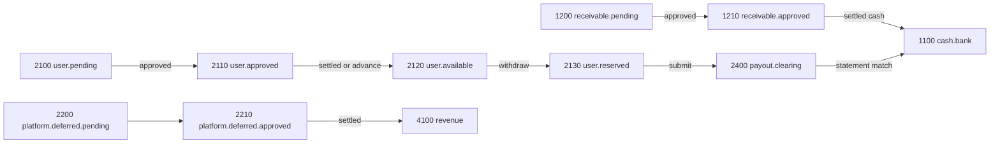

# Financial Ledger

Status: PROPOSED. Owner approval is required for any change to the chart of accounts (AGENTS.md §2.7).

## 1. Principles
1. The cashback balance is a **record of the platform's reward obligations**. It is not a custodial wallet: users can't top up, transfer to each other, or pay with it.
2. **Double entry, append-only.** Every value movement is one balanced `ledger_transaction`. Corrections are compensating transactions.
3. **Integer VND** (`i64`, 1 = 1 đồng). No floats anywhere on the money path (`clippy::float_arithmetic` denied).
4. **Approved ≠ funded.** Availability requires settlement or an explicit advance policy (ADR-0011).
5. **Idempotent.** Every posting carries a unique `idempotency_key`, and replays return the original transaction.

## 2. Chart of accounts

Account identity = `(code, scope)` where scope is `platform`, `provider:{id}`, `user:{id}` or `bank:{id}`. The normal side determines the sign of the displayed balance.

| Code | Name | Type | Normal | Scope | Notes |
|---|---|---|---|---|---|
| 1100 | `cash.bank` | Asset | Dr | bank | Company bank account(s). Moves only on evidence (statement import). |
| 1200 | `receivable.pending` | Asset (contingent) | Dr | provider | Commission reported, not approved |
| 1210 | `receivable.approved` | Asset | Dr | provider | Approved, not yet received. Can go Cr (net payable) after clawbacks |
| 2100 | `user.cashback.pending` | Liability (contingent) | Cr | user | |
| 2110 | `user.cashback.approved` | Liability | Cr | user | |
| 2120 | `user.cashback.available` | Liability | Cr | user | Withdrawable. May go Dr (user owes) only through reversals |
| 2130 | `user.withdrawal.reserved` | Liability | Cr | user | Locked by an open withdrawal; never Dr |
| 2200 | `platform.deferred.pending` | Liability | Cr | provider | Platform share not yet earned |
| 2210 | `platform.deferred.approved` | Liability | Cr | provider | |
| 2400 | `payout.clearing` | Liability | Cr | platform | Submitted to bank, not yet on statement |
| 2900 | `suspense.settlement` | Liability | Cr | provider | Settlement cash not yet matched to conversions |
| 3100 | `equity.owner_funding` | Equity | Cr | platform | Owner injections (e.g. to fund advances) |
| 4100 | `revenue.commission_retained` | Revenue | Cr | platform | Platform share once settled |
| 4110 | `revenue.commission_reversals` | Contra-revenue | Dr | platform | Clawbacks on already-earned revenue |
| 4200 | `revenue.withdrawal_fees` | Revenue | Cr | platform | If fees are enabled |
| 5100 | `expense.referral_rewards` | Expense | Dr | platform | |
| 5110 | `expense.promo_rewards` | Expense | Dr | platform | Check-in and campaigns |
| 5200 | `expense.payout_fees` | Expense | Dr | platform | Bank/MoMo transfer fees we absorb |
| 5300 | `expense.bad_debt` | Expense | Dr | platform | Written-off negative user balances |

Users see: pending (2100), approved (2110), available (2120), reserved (2130), and paid (derived from withdrawal history plus the sum of 2130 → 2400 postings).



## 3. Tables (summary; full DDL in `DATABASE_DESIGN.md` §4.7)
- `ledger_accounts(id, code, scope_kind, scope_id, currency, normal_side, created_at)` with `UNIQUE(code, scope_kind, scope_id, currency)`.
- `ledger_transactions(id, kind, idempotency_key UNIQUE, occurred_at, posted_at, ref_type, ref_id, memo, created_by)`.
- `ledger_entries(id, transaction_id, account_id, side CHECK IN ('D','C'), amount BIGINT CHECK > 0, currency)`.
- `ledger_balances(account_id PK, debit_total, credit_total, version)`, updated inside the posting tx.
- Constraint trigger (DEFERRABLE INITIALLY DEFERRED) on `ledger_entries` asserts Σ D = Σ C per transaction and currency at commit. BEFORE UPDATE/DELETE triggers raise on `ledger_*` (except `ledger_balances`).

## 4. Posting API (crate `ledger`)
```rust
pub struct Posting { kind: TxKind, idempotency_key: IdemKey, occurred_at: OffsetDateTime,
                     reference: Reference, lines: Vec<Line>, memo: Option<String> }
pub struct Line { account: AccountRef, side: Side, amount: Money }

pub async fn post(tx: &mut PgTransaction<'_>, p: Posting, guards: &[Guard]) -> Result<TxId, LedgerError>;
// Guard::NonNegative(AccountRef)   -> SELECT … FOR UPDATE on ledger_balances, fail if result < 0
// Guard::AllowNegative(AccountRef) -> only valid with TxKind::Reversal | TxKind::Clawback
```
`post` validates the balance in Rust before insert, takes row locks on the affected `ledger_balances` rows in a deterministic order (by `account_id`) to avoid deadlocks, inserts rows, updates balances, and returns the existing `TxId` on an idempotency-key conflict, after verifying the payload hash matches. A mismatch means a bug and returns an error.

## 5. Lifecycle postings: worked example

Order 500 000đ, commission 50 000đ, rule share 7 000 bps (70%), rounding Floor, cap none. User share = floor(50 000 × 0.7) = **35 000**. Platform share = 50 000 − 35 000 = **15 000** (platform always takes the remainder, so I7 holds exactly).

| # | Event | Dr | Cr | Amount |
|---|---|---|---|---|
| T1 | Conversion reported (pending) | 1200 receivable.pending/AT | 2100 user.pending/U | 35 000 |
| | | 1200 receivable.pending/AT | 2200 platform.deferred.pending/AT | 15 000 |
| T2 | Provider approves | 1210 receivable.approved/AT | 1200 receivable.pending/AT | 50 000 |
| | | 2100 user.pending/U | 2110 user.approved/U | 35 000 |
| | | 2200 deferred.pending/AT | 2210 deferred.approved/AT | 15 000 |
| T3 | Settlement cash received and allocated | 1100 cash.bank | 1210 receivable.approved/AT | 50 000 |
| | | 2110 user.approved/U | 2120 user.available/U | 35 000 |
| | | 2210 deferred.approved/AT | 4100 revenue.commission_retained | 15 000 |
| T4 | User requests withdrawal | 2120 user.available/U | 2130 user.reserved/U | 35 000 |
| T5 | Finance submits transfer | 2130 user.reserved/U | 2400 payout.clearing | 35 000 |
| T6 | Bank statement confirms | 2400 payout.clearing | 1100 cash.bank | 35 000 |

End state: cash 15 000 = revenue 15 000. Every user and clearing account is 0. ✔

### 5.1 Variants

**Rejected while pending** (reverses T1, `kind=reversal`):
Dr 2100 user.pending 35 000 / Dr 2200 deferred.pending 15 000 / Cr 1200 receivable.pending 50 000.

**Partial refund after approval** (commission 50 000 → 30 000). New user share floor(30 000×0.7)=21 000, delta −14 000. Platform delta −6 000:
Dr 2110 user.approved 14 000 / Dr 2210 deferred.approved 6 000 / Cr 1210 receivable.approved 20 000.

**Commission increased** (provider adjustment upward): mirror of the above with Dr receivable / Cr user and deferred, posted to whichever state the conversion is in.

**Clawback after settlement and payout** (provider reverses 50 000 and will net it from the next settlement):
Dr 4110 revenue.commission_reversals 15 000 / Dr 2120 user.available 35 000 / Cr 1210 receivable.approved 50 000.
If the user had already withdrawn, 2120 now carries a debit balance of 35 000 (user owes). Recovery policy: future cashback offsets automatically, because credits to 2120 net against it. After `negative_balance_writeoff_days` (config, default 180) with no recovery, finance posts a write-off: Dr 5300 expense.bad_debt / Cr 2120 user.available. Users with a negative available balance cannot withdraw. Repeat offenders are flagged for fraud review.

**Advance funding** (policy enabled, conversion approved but unsettled):
Dr 2110 user.approved / Cr 2120 user.available 35 000, with `entitlement.availability_basis='advance'`. Receivable and deferred stay put. On later settlement only the cash and platform legs of T3 are posted. Exposure = Σ amounts with basis `advance` whose conversion isn't settled.

**Settlement with unmatched cash**: provider pays 1 000 000 but the statement only matches 950 000:
Dr 1100 cash 1 000 000 / Cr 1210 receivable.approved 950 000 / Cr 2900 suspense.settlement 50 000. Suspense is investigated and cleared by reclassification. The I12 alert fires at 30 days.

**Withdrawal fee** (if enabled, fee 5 000 on 100 000): T4 reserves 100 000. T5: Dr 2130 100 000 / Cr 2400 95 000 / Cr 4200 5 000. T6 moves 95 000.

**Bank fee we absorb**: Dr 5200 expense.payout_fees / Cr 1100 cash.bank (posted from the statement line).

**Withdrawal rejected or cancelled before submission**: Dr 2130 user.reserved / Cr 2120 user.available.

**Payout failed (bank returned funds)**: Dr 2400 payout.clearing / Cr 2130 user.reserved (if it will be retried) or Cr 2120 user.available (if it won't). Only after the bank evidence shows the return.

**Referral reward** (on referee's settled conversion, 5 000): Dr 5100 expense.referral_rewards / Cr 2120 user.available/Referrer 5 000. If the source conversion is later reversed, the reward reverses with it (`kind=reversal`, same rules as clawback).

**Check-in / promo reward**: Dr 5110 / Cr 2120 (or Cr 2110 if the campaign requires a holding period), bounded by the campaign budget (I13).

**Manual adjustment**: `kind=adjustment`. It needs a ticket reference, a reason code, a maker and a different checker (finance + owner for > 1 000 000đ), and must be balanced like any other posting.

## 6. Entitlements ↔ ledger
`cashback_entitlements` (one per conversion per beneficiary) holds the business state machine (`ORDER_RECONCILIATION.md` §4) and the current amount. Every state or amount change posts exactly one ledger transaction whose `idempotency_key = "ent:{entitlement_id}:rev:{revision}"`. `revision` increments with each change and is unique per entitlement, so replays are safe.

## 7. Invariants (each has an automated test and a nightly checker job)

| ID | Invariant | Enforced by |
|---|---|---|
| I1 | Each transaction balanced per currency | deferred constraint trigger + `post()` precheck |
| I2 | `ledger_transactions`, `ledger_entries` never updated or deleted | triggers; DB role without UPDATE/DELETE grant |
| I3 | `ledger_balances` = full recomputation from entries | nightly job, alert on any diff |
| I4 | 2100, 2110, 2130, 2400 never have a debit balance | `Guard::NonNegative` + nightly check |
| I5 | 2120 goes negative only through `reversal`/`clawback` kinds | guard + test |
| I6 | For each entitlement, Σ postings by state = entitlement amount in that state | nightly reconciliation |
| I7 | user_share + platform_share = commission for every conversion revision (no lost đồng) | `domain` property test |
| I8 | **Coverage**: cash.bank + undrawn owner commitment ≥ Σ max(2120,0) + Σ 2130 + 2400 | daily job, pages the owner |
| I9 | Advance exposure ≤ `advance_policy.max_total_exposure` (and per user) | row lock on policy in the availability tx |
| I10 | A withdrawal reaches `paid` at most once, and Σ payout attempts confirmed ≤ amount | unique partial index + state machine |
| I11 | Same idempotency key ⇒ same transaction and identical payload hash | unique index + hash compare |
| I12 | Σ settlement allocations + suspense = settlement amount; suspense aged < 30 days | settlement tx + daily alert |
| I13 | Σ rewards per campaign ≤ budget | budget row lock |
| I14 | No withdrawal reserve if 2120 < requested amount at lock time | `Guard::NonNegative(2120)` |

## 8. Reporting views
- `v_user_wallet(user_id, pending, approved, available, reserved, paid_total, owed)`.
- `v_platform_position(as_of)`: receivables by provider and state, deferred revenue, recognized revenue, liabilities by state, clearing, suspense, cash, coverage ratio, advance exposure.
- Period close: monthly snapshot table `ledger_period_balances(period, account_id, balance)` written by the close job. Historic periods are read-only.

## 9. Accounting caveats (owner / accountant decisions)
- Whether pending commissions should be recognized at all, or kept off-balance as memo, is a presentation choice for the statutory books. The operational ledger keeps them as contingent accounts (1200/2100/2200) because users need to see pending cashback.
- VAT/CIT treatment of commission revenue and the PIT treatment of cashback paid to users require a Vietnamese tax advisor (`COMPLIANCE_CHECKLIST.md` C-TAX-*). The ledger already supports a `tax.withholding` liability account (code 2500, reserved, not created until approved).
