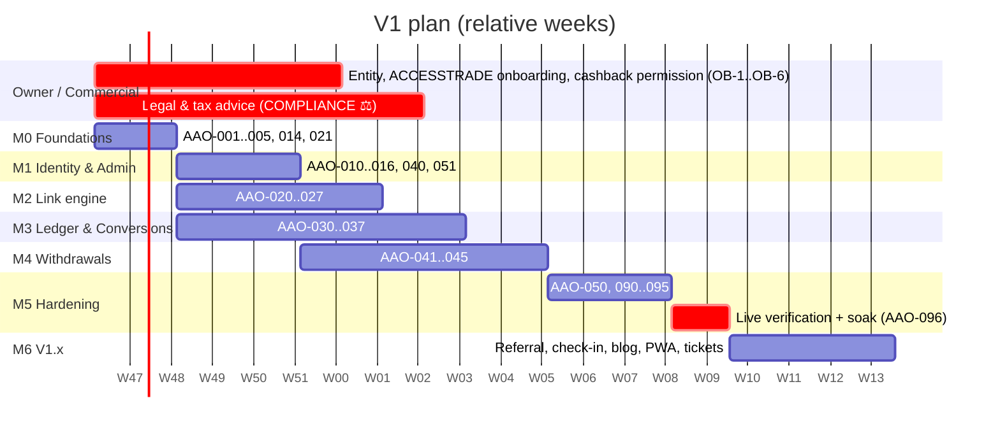

# Implementation Roadmap

Status: PROPOSED. Durations assume the three-agent team working in parallel lanes (`ENGINEERING_BACKLOG.md` §3), with owner review taking ≤ 2 working days per PR. They're planning estimates, not commitments.

## Milestone exit criteria
| Milestone | Exit criteria |
|---|---|
| M0 | CI green on main. `just dev` runs web+worker against local Postgres. Money/ID primitives property-tested. Job queue proven under concurrency |
| M1 | User can register, verify, log in (password + Google). Staff log in with TOTP. Audit log chain verified. Admin shell live in staging |
| M2 | In staging, a user pastes Shopee/TikTok links and gets a tracked link via the ACCESSTRADE **mock**. With a sandbox/live key (OB-2) a real link is created. `/go` meets latency target |
| M3 | Synthetic conversions flow through all states. Ledger invariants hold across property tests. Settlement recording makes cashback available. Advance policy works but is off |
| M4 | Full withdrawal lifecycle with maker-checker, VietQR payload, statement import. All concurrency and payout tests green |
| M5 | Security review closed. Backups restore-tested. Real low-value orders verified end to end (AAO-096). Owner go/no-go |
| M6 | V1.x features behind flags. Enabling each one is an owner decision |

## Critical path
`AAO-001 → AAO-004 → AAO-030 → AAO-031 (needs 025) → AAO-033 → AAO-034 → AAO-042 → AAO-043 → AAO-045 → AAO-090 → AAO-096`, plus the commercial path **OB-1…OB-4**. Engineering can finish before the commercial approvals do. If OB-4 (written cashback permission) is refused, launch is blocked whatever the state of the code (Risk R-01).

## Release strategy
1. **Closed beta** (invite-only, ≤ 100 users, friends and staff): real orders, manual payouts, advance funding off, daily owner review of ledger position.
2. **Open beta**: public sign-up, rate limits tightened, referral off.
3. **GA**: referral and check-in enabled (if budgets are approved), blog/SEO push.
