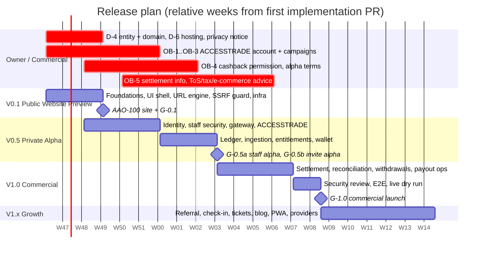

# Implementation Roadmap

Status: PROPOSED, re-planned 2026-11-18 into incremental releases (ADR-0015). Release contents, gates and acceptance criteria are in `RELEASE_PLAN.md`. Issue-level detail is in `ENGINEERING_BACKLOG.md`.

Durations below assume two concurrent sessions per model on `parallelizable` issues, with owner review taking ≤ 2 working days per PR. With one session per model, roughly add 60% (see `RELEASE_PLAN.md` §5). These are planning estimates, not commitments.

## Release exit criteria (summary)
| Release | Exit |
|---|---|
| V0.1 | Gate G-0.1: public site live, analyzer + waitlist, no cashback claims, security headers, restore-tested backups |
| V0.5 | G-0.5a (staff, live provider verified, invariants green for 7 nights), then G-0.5b (OB-4 permission, alpha terms, invites). Withdrawals off |
| V1.0 | G-1.0: settlement-gated balances, manual-review withdrawals end to end, security review closed, counsel-approved legal docs, two finance staff |
| V1.x | Per-feature flag gates with owner (and, for referral, legal) approval |

## Critical path
`AAO-001 → AAO-004 → AAO-010 → AAO-013 → AAO-023 → AAO-025 → AAO-031 → AAO-033 → AAO-034 → AAO-042 → AAO-043 → AAO-045 → AAO-090 → AAO-096`. The V0.1 branch is `AAO-001 → AAO-003 → AAO-020 → AAO-100`. The commercial path (OB-1…OB-5, counsel) runs in parallel and may be longer than engineering. If OB-4 is refused, the invite alpha and V1.0 are blocked whatever the state of the code.

## Release strategy
1. **V0.1 preview**: public, indexable, waitlist only.
2. **V0.5a staff alpha**: real links and orders by staff, disclosed to ACCESSTRADE.
3. **V0.5b invite alpha**: ≤ 100 waitlist users, cashback accrues, no withdrawals.
4. **V1.0 GA**: open sign-up and withdrawals. Advance funding stays off.
5. **V1.x**: features enabled one flag at a time, measured against the funnel.
