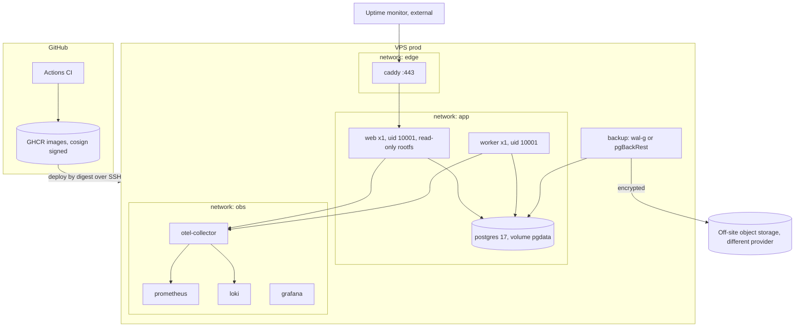

# Infrastructure and DevOps

Status: PROPOSED (ADR-0009).

## 1. Environments
| Env | Host | Data | Providers | Payouts |
|---|---|---|---|---|
| local | developer machine, `docker compose -f compose.dev.yml` (Postgres only) + `cargo leptos watch` + `cargo run -p worker` | seed fixtures | mock adapters | n/a |
| ci | GitHub Actions, Postgres service container | ephemeral | mock + recorded fixtures | n/a |
| staging | small VPS, same compose as prod | synthetic + anonymized samples (never prod PII) | ACCESSTRADE live **read-only** account or sandbox; links created only for test products | manual, test amounts to staff accounts |
| production | VPS (region decision D-6: Singapore vs Vietnam) | real | live per provider flag | manual (V1) |

## 2. Deployment architecture


Compose principles: `read_only: true` rootfs plus `tmpfs` for `/tmp`; `cap_drop: [ALL]`; `security_opt: no-new-privileges`; memory/CPU limits; healthchecks; secrets via `secrets:` files (`/run/secrets/*`), not env; only Caddy publishes ports (80/443); SSH key-only, non-default user, `ufw` deny-all except 22/80/443, `unattended-upgrades`, `fail2ban`.

### 2.1 Proxy contract for the `web` service (AAO-091, implemented by `infra/caddy/Caddyfile` in AAO-092)
- The proxy terminates TLS and forwards to `web` on the private network. It must **append** the client address to `X-Forwarded-For` (Caddy's default) and the deployment must set `TRUST_FORWARDED_FOR=true`; `web` uses the right-most entry, so a client-supplied header cannot choose its own rate-limit bucket. Never expose `web` directly while the flag is on.
- The proxy must **not** add security headers or HSTS of its own: `web` sends the full set (including `Strict-Transport-Security` in production), so a second copy would be a conflicting duplicate.
- `/metrics` is on the internal listener and is never proxied.
- The in-process limiter does not replace limits at the proxy; it also fails open if flooded with distinct addresses (see `app::ratelimit`). The Caddyfile sets a 1 MB request body cap, 10 s header/body read timeouts, a 16 KB header cap and 2 min idle timeout, and serves HTTP/1.1 and HTTP/2 only (HTTP/3 would need UDP/443 open). Per-IP connection caps are not configured yet.
- Caddy health-checks the upstream on `/healthz` (liveness), **not** `/readyz`: with a single `web` instance a failing readiness probe (for example the database) would turn a degraded site into a total outage. `/readyz` is watched by the external uptime monitor. (Deviation from `docs/OBSERVABILITY.md` §7, decision D-23.)
- Caddy's access log drops `remote_ip`, `client_ip`, `remote_port` and the request's `X-Forwarded-For` (client addresses are personal data).

### 2.2 V0.1 stack (AAO-092): `infra/`
| Path | What |
|---|---|
| `infra/compose.prod.yml` | caddy, web, postgres 17, interim backup, prometheus, grafana |
| `infra/caddy/Caddyfile` | the proxy contract above |
| `infra/observability/` | `prometheus/{prometheus,alerts,alerts_test}.yml`, Grafana provisioning, dashboard `aao-red` |
| `infra/backup/backup.sh` | interim nightly `pg_dump` (see §7) |
| `infra/bootstrap/vps-bootstrap.sh` | first-boot hardening of an Ubuntu LTS VPS |
| `infra/bootstrap/gen-secrets.sh` | creates the file-backed secrets (never overwrites, never prints) |
| `infra/up.sh` | the one command: secrets, validate, pull, `up --wait` |
| `scripts/check-infra.sh`, `scripts/stack-smoke.sh` | policy check (CI `infra` job, self-tested) and end-to-end smoke (CI `image` job) |

**Staging from scratch** (fresh Ubuntu LTS VPS, your SSH public key in `deploy.pub`):
```
sudo DEPLOY_SSH_KEY_FILE=deploy.pub infra/bootstrap/vps-bootstrap.sh   # once, as root
# log in as the deploy user, clone the repository to /opt/aao, then:
cp infra/.env.example infra/.env   # set WEB_IMAGE, SITE_ADDRESS, ACME_EMAIL (staging: ACME_CA staging URL)
infra/up.sh
```
Secrets: `postgres_password`, `database_url` and `grafana_admin_password` are generated into `infra/secrets/` (directory 0700, files 0444 because the containers run as other UIDs; the directory permission keeps other host users out). Back them up in the password manager; `database_url` embeds the Postgres password, so rotating one means rotating both (RB-09). Grafana is not on the internet: `ssh -L 3000:127.0.0.1:3000 <vps>` then `http://localhost:3000` (user `admin`).

**Containers.** web/postgres/backup/prometheus/grafana/caddy all run with a read-only root filesystem (tmpfs for `/tmp`), `cap_drop: ALL`, `no-new-privileges`, memory and CPU limits, log rotation and `restart: unless-stopped`. Caddy keeps `NET_BIND_SERVICE` and runs as root inside its container; the backup job runs as root without capabilities (it owns its fresh volume). `scripts/check-infra.sh` fails CI if any of this regresses. Networks: `edge` (caddy, web), `app` (web, postgres, backup; internal), `obs` (web, prometheus, grafana; internal). The firewall alone does not protect Postgres or Prometheus because Docker publishes ports around `ufw`: the compose file never publishes them, and the check enforces it.

**Health.** The web image is distroless, so its healthcheck is the binary itself: `web healthcheck` does `GET /healthz` on its own listener (AAO-092 added the subcommand). Caddy starts only after web is healthy, web after Postgres.

**Images are tags until Renovate pins them.** The sandbox that wrote this could not reach a registry, so `caddy`, `postgres`, `prom/prometheus` and `grafana/grafana` use version tags (from public release listings) rather than digests, and `WEB_IMAGE` is supplied per deploy. `renovate.json` extends `docker:pinDigests`, so the Renovate PRs add digests; `scripts/check-infra.sh` prints which are still unpinned. Pin them (and `WEB_IMAGE` by digest) before real users.

**Not in V0.1 (by the issue's MVP scope).** worker (the binary is a stub), otel-collector, Loki, business dashboards and Alertmanager (V0.5 gate); WAL archiving, encryption and off-site backups (AAO-093); deploy/rollback workflows (AAO-094); cosign/SBOM (AAO-090).

## 3. Build
- `Dockerfile` (AAO-002): one file, two images: `--target web` (default) and `--target worker`. Stages: `chef` (pinned Rust toolchain + `cargo-chef` + `cargo-auditable`), `planner` (`cargo chef prepare`), `builder` (cached `cargo chef cook`, then `cargo auditable build --release --locked -p web -p worker`), then `gcr.io/distroless/cc-debian12:nonroot` with the binary only. Runs as **UID 10001**, no shell, no package manager. Measured: web 26 MiB, worker 22 MiB (limit 60 MiB).
- **Deviation from the original plan.** No `cargo leptos build`, no Tailwind CLI and no `site/` directory in the image: V0.1 is server-rendered only (D-14) and the CSS/JS/fonts are committed under `crates/ui/assets` and embedded into the binary at compile time; `just css-check` (CI `lint`) guarantees the committed CSS is current. Revisit when hydration arrives.
- Reproducibility: `--locked`, pinned toolchain (the `image` job fails if the Dockerfile's `RUST_VERSION` differs from `rust-toolchain.toml`), base images pinned **by digest**, `SOURCE_DATE_EPOCH` = commit time, `--remap-path-prefix`. Tool versions live in the `image` job's `env` and are bumped by Renovate. No secrets are passed as build args.
- Build arguments: `CARGO_CHEF_VERSION`, `CARGO_AUDITABLE_VERSION` (no default), `SOURCE_DATE_EPOCH`, `VCS_REF`. Example: `docker buildx build --target web --build-arg CARGO_CHEF_VERSION=… --build-arg CARGO_AUDITABLE_VERSION=… -t aao-web .` (values: `.github/workflows/ci.yml`, job `image`).
- Image defaults: `WEB_BIND=0.0.0.0:8080`, `METRICS_BIND=0.0.0.0:9100`; only 8080 is `EXPOSE`d. **Never publish 9100** (`docs/OBSERVABILITY.md` §7). Distroless has no shell or curl, so container healthchecks need a probe from outside (Caddy/compose network) or a future `web healthcheck` subcommand (AAO-092 decides).
- **Vulnerability gate.** `scripts/install-trivy.sh` installs a checksum-pinned Trivy (deliberately not a third-party Action). CI fails on any *fixable* HIGH/CRITICAL in OS packages or in the Rust dependency set embedded by `cargo-auditable`. Exceptions live in `.trivyignore.yaml`: owner-reviewed, with a statement and an expiry date after which the gate fails again by itself.
- **Deferred to the V1.0 gate (AAO-090):** cosign keyless signing and SBOM publication (`cargo-cyclonedx` + `syft`), per the issue's MVP scope. Until then images are not signed; do not deploy outside V0.1 preview.
- **Dependency automation.** `renovate.json`: weekly grouped Rust crates (majors separate), GitHub Actions digests, Docker base images (digests), and the Rust toolchain moving together in `Dockerfile` + `rust-toolchain.toml`. It needs the Renovate GitHub App installed (owner action); `.github/dependabot.yml` should then be deleted to avoid duplicate PRs.

## 4. CI/CD (GitHub Actions)
| Workflow | Trigger | Jobs |
|---|---|---|
| `ci.yml` | PR, push main | fmt, clippy -D warnings, nextest (unit + integration with Postgres service), `sqlx prepare --check`, migrations from zero, `cargo deny`, `cargo audit`, gitleaks, i18n key check, OpenAPI drift, build images, Trivy (fail on HIGH/CRITICAL with fix), Playwright smoke (mobile + desktop), k6 smoke (30s) |
| `nightly.yml` | cron | full Playwright, property tests with high case count, k6 load profile against staging, backup restore test (weekly), `cargo outdated` report |
| `deploy-staging.yml` | merge to main | build+sign → deploy staging → migrations → smoke → notify |
| `deploy-prod.yml` | manual dispatch with tag, protected environment (owner approval) | verify signature → backup snapshot → `migrate` job → rolling restart (web then worker) → smoke → auto-rollback on failed smoke |

Rules: actions pinned by SHA; `permissions:` minimal per job; OIDC for GHCR; secrets only in environments; required checks can't be bypassed (branch protection with "include administrators").

## 5. Database migrations in deploy
1. Pre-deploy: `pg_dump --schema-only` diff + backup snapshot.
2. Run `migrator` one-shot container (`sqlx migrate run`) with `lock_timeout=5s`, `statement_timeout` per migration.
3. Migrations must be backward compatible with the running version (expand/contract), so rollback = redeploy the previous image without a DB rollback.
4. Destructive (contract) migrations ship ≥ 1 release after code stops using the object.

## 6. Rollback
`deploy-prod` keeps the previous image digests. `scripts/rollback.sh <digest>` re-points compose and restarts. Because of expand/contract the DB needs no rollback. If data corruption is suspected: freeze payouts (`payouts.suspended`), restore to a new instance via PITR, diff, then decide.

## 7. Backups, RPO/RTO
| Item | Policy |
|---|---|
| **V0.1 interim (AAO-092)** | nightly `pg_dump -Fc` to a local volume (`infra/backup/backup.sh`), 7 days kept, `.last_success` timestamp. Protects against bad deploys and operator error only: **no encryption, no off-site copy, no PITR**. Replaced by AAO-093. Acceptable for the V0.1 preview only while the database holds nothing but waitlist data |
| WAL archiving | continuous to object storage (wal-g), RPO ≤ 15 min (target ≤ 5) |
| Base backups | daily full, 35-day retention; monthly kept 12 months |
| Encryption | client-side (libsodium/age); key stored offline with owner + in password manager |
| Restore test | weekly automated restore to scratch container + `ledger` invariant check + row counts; monthly manual PITR drill |
| Off-site | different provider/region from the VPS |
| RTO | 4 h (new VPS from runbook + restore) |

## 8. Observability
- **Metrics**: RED per route, DB pool, job queue depth/age, provider calls (latency, errors, 429s, quota remaining), business gauges (liabilities by state, advance exposure, coverage ratio, unmatched conversions, open withdrawals by status/age, dead jobs).
- **Logs**: JSON via `tracing`, trace_id correlation, PII redaction, shipped to Loki (14-day retention, 90 days for audit-relevant logs).
- **Traces**: OTLP. Sampling 10% (100% on errors). Tempo is optional (add when needed). *V0.1 ships logs + metrics only (AAO-005); OTLP export is a later issue.*
- **Runtime contract for the compose file (AAO-092)**: set `APP_ENV=production` (without it the binary runs in development mode); provide `DATABASE_URL_FILE=/run/secrets/database_url` (production rejects an inline `DATABASE_URL`); set `METRICS_BIND=0.0.0.0:9100` inside the container network **and do not publish that port**: only Prometheus on the compose network may reach it, and Caddy must not proxy `/metrics`. Probe `/healthz` for liveness and `/readyz` for readiness/traffic. Details: `docs/OBSERVABILITY.md`.
- **Alerts** (Grafana → email + Telegram bot for owner): 5xx rate > 2% 5 min; p95 > 1 s 10 min; `/readyz` failing; job age > 30 min; dead jobs > 0; provider error rate > 20% 15 min; any ledger invariant failure (page); coverage ratio < 1.0 (page + auto payout suspension); disk > 80%; backup age > 26 h; certificate expiry < 14 d.
- **8.1 What exists in V0.1.** `infra/observability/prometheus/alerts.yml` implements the rules computable from today's metrics: web down 2 min (`up`), 5xx ratio > 2% for 5 min, p95 > 1 s for 10 min, unit-tested with `promtool test rules` in CI. There is **no Alertmanager** yet, so rules are visible in Prometheus/Grafana but nothing pages: the external uptime monitor (hitting `/readyz`) is the V0.1 pager (owner action, D-24). Still to add when the metric/exporter exists: `/readyz` failing (monitor), job age and dead jobs (worker), provider error rate (provider adapters), ledger invariant and coverage ratio (ledger), disk (node exporter), backup age (`.last_success`, AAO-093), certificate expiry (Caddy metrics, to be verified against Caddy docs).
- **SLOs** (V1): availability 99.5% monthly (web `/readyz` + synthetic analyze); p95 page server time < 300 ms; link creation p95 < 2.5 s; sync freshness: 95% of provider updates visible within 30 min.

## 9. Runbooks (to write as `docs/runbooks/*.md` in AAO-094)
| Runbook | Trigger | First steps |
|---|---|---|
| RB-01 Site down | uptime alert | check Caddy/web health, `docker compose ps`, disk, DB; roll back last deploy |
| RB-02 Ledger invariant failure | page | `payouts.suspended=on`; snapshot DB; run invariant report; identify transactions; compensating fix via adjustment with owner |
| RB-03 Coverage < 1 | page | payouts auto-suspended; review advance exposure; owner funds or tightens policy |
| RB-04 Provider API failing / key revoked | alert | check status, rotate key, disable routes (no link issuance), banner |
| RB-05 Payout unknown | queue | bank statement check, never re-send until resolved |
| RB-06 Suspected account takeover wave | spike in resets/logins | tighten limits, enable CAPTCHA globally, freeze withdrawals for affected users |
| RB-07 Data breach | detection | contain, preserve evidence, legal counsel, PDPL notification within statutory deadline, user notice |
| RB-08 Restore from backup | disaster | provision VPS via script, restore PITR, verify invariants, DNS switch |
| RB-09 Secret rotation | schedule/leak | rotate KEK/DEK, provider tokens, OAuth secret, SMTP creds |

## 10. Capacity & scaling roadmap
See `COST_ESTIMATION.md` for sizing per user tier. Scaling steps are in `ARCHITECTURE.md` §9. Trigger points: CPU > 70% sustained, DB p95 > 20 ms, connection pool saturation, disk IO wait > 10%.
