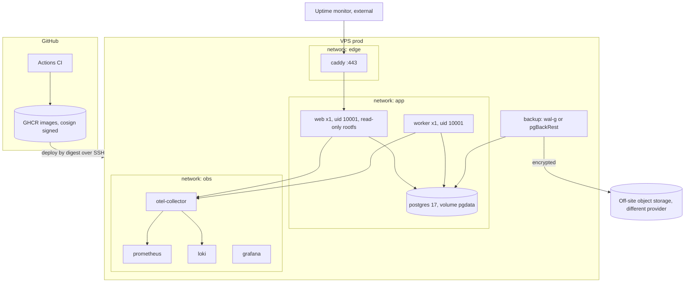

# Infrastructure and DevOps

Status: PROPOSED (ADR-0009).

## 1. Environments
| Env | Host | Data | Providers | Payouts |
|---|---|---|---|---|
| local | developer machine, `docker compose -f compose.dev.yml` (Postgres only) + `cargo leptos watch` + `cargo run -p worker` | seed fixtures | mock adapters | n/a |
| ci | GitHub Actions, Postgres service container | ephemeral | mock + recorded fixtures | n/a |
| staging | small VPS, same compose as prod | synthetic + anonymized samples (never prod PII) | ACCESSTRADE live **read-only** account or sandbox; links created only for test products | manual, test amounts to staff accounts |
| production | VPS (region decision D-6: Singapore vs Vietnam) | real | live per provider flag | manual (V1) |

## 2. Deployment architecture

Compose principles: `read_only: true` rootfs plus `tmpfs` for `/tmp`; `cap_drop: [ALL]`; `security_opt: no-new-privileges`; memory/CPU limits; healthchecks; secrets via `secrets:` files (`/run/secrets/*`), not env; only Caddy publishes ports (80/443); SSH key-only, non-default user, `ufw` deny-all except 22/80/443, `unattended-upgrades`, `fail2ban`.

## 3. Build
- Dockerfile: stage 1 `cargo-chef prepare`, stage 2 `cook` deps (cached), stage 3 build `web` (`cargo leptos build --release`, Tailwind standalone CLI) and `worker`, stage 4 `gcr.io/distroless/cc-debian12:nonroot` with binaries plus `site/` assets.
- Reproducibility: `--locked`, pinned toolchain, `SOURCE_DATE_EPOCH`.
- SBOM (`cargo cyclonedx` + `syft`) attached to the release.

## 4. CI/CD (GitHub Actions)
| Workflow | Trigger | Jobs |
|---|---|---|
| `ci.yml` | PR, push main | fmt, clippy -D warnings, nextest (unit + integration with Postgres service), `sqlx prepare --check`, migrations from zero, `cargo deny`, `cargo audit`, gitleaks, i18n key check, OpenAPI drift, build images, Trivy (fail on HIGH/CRITICAL with fix), Playwright smoke (mobile + desktop), k6 smoke (30s) |
| `nightly.yml` | cron | full Playwright, property tests with high case count, k6 load profile against staging, backup restore test (weekly), `cargo outdated` report |
| `deploy-staging.yml` | merge to main | build+sign → deploy staging → migrations → smoke → notify |
| `deploy-prod.yml` | manual dispatch with tag, protected environment (owner approval) | verify signature → backup snapshot → `migrate` job → rolling restart (web then worker) → smoke → auto-rollback on failed smoke |

Rules: actions pinned by SHA; `permissions:` minimal per job; OIDC for GHCR; secrets only in environments; required checks can't be bypassed (branch protection with "include administrators").

## 5. Database migrations in deploy
1. Pre-deploy: `pg_dump --schema-only` diff + backup snapshot.
2. Run `migrator` one-shot container (`sqlx migrate run`) with `lock_timeout=5s`, `statement_timeout` per migration.
3. Migrations must be backward compatible with the running version (expand/contract), so rollback = redeploy the previous image without a DB rollback.
4. Destructive (contract) migrations ship ≥ 1 release after code stops using the object.

## 6. Rollback
`deploy-prod` keeps the previous image digests. `scripts/rollback.sh <digest>` re-points compose and restarts. Because of expand/contract the DB needs no rollback. If data corruption is suspected: freeze payouts (`payouts.suspended`), restore to a new instance via PITR, diff, then decide.

## 7. Backups, RPO/RTO
| Item | Policy |
|---|---|
| WAL archiving | continuous to object storage (wal-g), RPO ≤ 15 min (target ≤ 5) |
| Base backups | daily full, 35-day retention; monthly kept 12 months |
| Encryption | client-side (libsodium/age); key stored offline with owner + in password manager |
| Restore test | weekly automated restore to scratch container + `ledger` invariant check + row counts; monthly manual PITR drill |
| Off-site | different provider/region from the VPS |
| RTO | 4 h (new VPS from runbook + restore) |

## 8. Observability
- **Metrics**: RED per route, DB pool, job queue depth/age, provider calls (latency, errors, 429s, quota remaining), business gauges (liabilities by state, advance exposure, coverage ratio, unmatched conversions, open withdrawals by status/age, dead jobs).
- **Logs**: JSON via `tracing`, trace_id correlation, PII redaction, shipped to Loki (14-day retention, 90 days for audit-relevant logs).
- **Traces**: OTLP. Sampling 10% (100% on errors). Tempo is optional (add when needed). *V0.1 ships logs + metrics only (AAO-005); OTLP export is a later issue.*
- **Runtime contract for the compose file (AAO-092)**: set `APP_ENV=production` (without it the binary runs in development mode); provide `DATABASE_URL_FILE=/run/secrets/database_url` (production rejects an inline `DATABASE_URL`); set `METRICS_BIND=0.0.0.0:9100` inside the container network **and do not publish that port**: only Prometheus on the compose network may reach it, and Caddy must not proxy `/metrics`. Probe `/healthz` for liveness and `/readyz` for readiness/traffic. Details: `docs/OBSERVABILITY.md`.
- **Alerts** (Grafana → email + Telegram bot for owner): 5xx rate > 2% 5 min; p95 > 1 s 10 min; `/readyz` failing; job age > 30 min; dead jobs > 0; provider error rate > 20% 15 min; any ledger invariant failure (page); coverage ratio < 1.0 (page + auto payout suspension); disk > 80%; backup age > 26 h; certificate expiry < 14 d.
- **SLOs** (V1): availability 99.5% monthly (web `/readyz` + synthetic analyze); p95 page server time < 300 ms; link creation p95 < 2.5 s; sync freshness: 95% of provider updates visible within 30 min.

## 9. Runbooks (to write as `docs/runbooks/*.md` in AAO-094)
| Runbook | Trigger | First steps |
|---|---|---|
| RB-01 Site down | uptime alert | check Caddy/web health, `docker compose ps`, disk, DB; roll back last deploy |
| RB-02 Ledger invariant failure | page | `payouts.suspended=on`; snapshot DB; run invariant report; identify transactions; compensating fix via adjustment with owner |
| RB-03 Coverage < 1 | page | payouts auto-suspended; review advance exposure; owner funds or tightens policy |
| RB-04 Provider API failing / key revoked | alert | check status, rotate key, disable routes (no link issuance), banner |
| RB-05 Payout unknown | queue | bank statement check, never re-send until resolved |
| RB-06 Suspected account takeover wave | spike in resets/logins | tighten limits, enable CAPTCHA globally, freeze withdrawals for affected users |
| RB-07 Data breach | detection | contain, preserve evidence, legal counsel, PDPL notification within statutory deadline, user notice |
| RB-08 Restore from backup | disaster | provision VPS via script, restore PITR, verify invariants, DNS switch |
| RB-09 Secret rotation | schedule/leak | rotate KEK/DEK, provider tokens, OAuth secret, SMTP creds |

## 10. Capacity & scaling roadmap
See `COST_ESTIMATION.md` for sizing per user tier. Scaling steps are in `ARCHITECTURE.md` §9. Trigger points: CPU > 70% sustained, DB p95 > 20 ms, connection pool saturation, disk IO wait > 10%.
