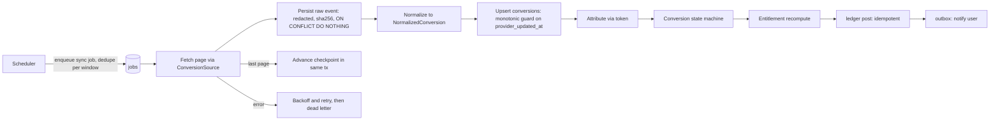
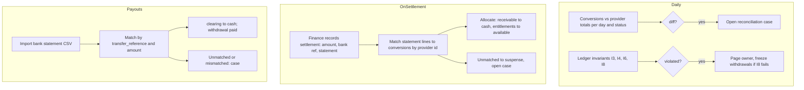
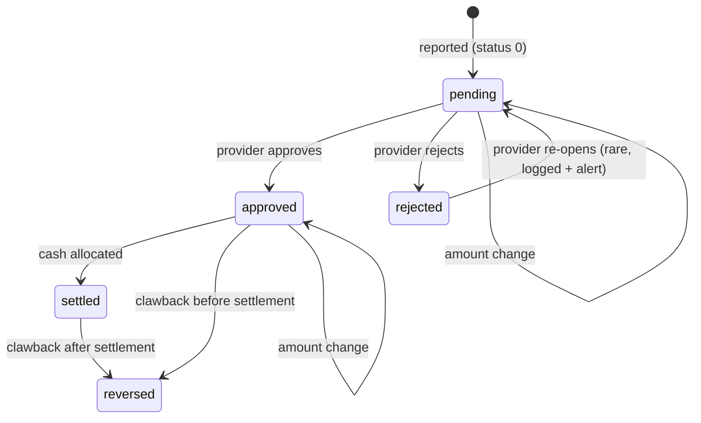
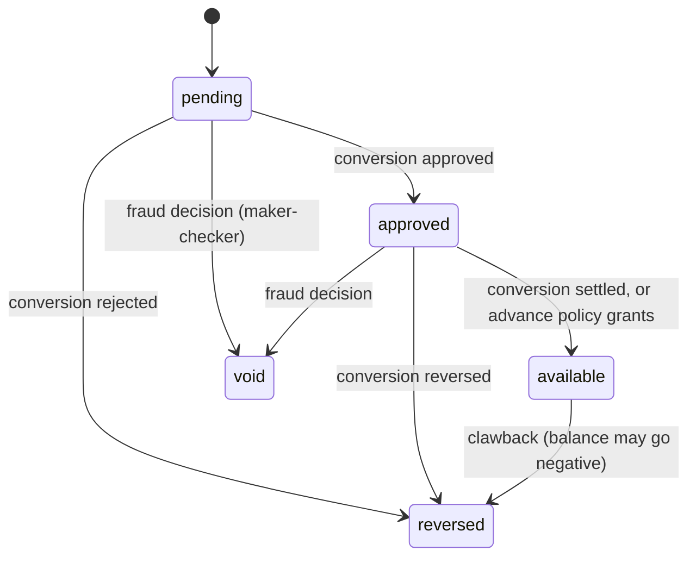

# Order Tracking and Reconciliation

Status: PROPOSED.

## 1. Ingestion sources
| Source | When | Trust |
|---|---|---|
| Polling (primary) | Scheduled per provider stream | Authoritative (authenticated API) |
| Webhook/postback | If the provider supports it | **Trigger only**: fetch the authoritative record by id before applying, unless the provider signs payloads and the adapter verifies the signature |
| CSV import | Finance uploads a provider report, where the provider permits it | Authoritative after maker-checker approval |
| Backfill | Admin-triggered for a date range | Same pipeline as polling |

All four write to `provider_events_raw` and then flow through **one** normalizer, so there's only one code path for state changes.

## 2. Pipeline

**Redaction:** before storage, the raw payload drops or masks customer-identifying fields (names, phones, addresses, emails, IPs, full device ids) through a per-provider allowlist of keys we keep. Unknown keys are stored only as hashes.

**Polling cadence (ACCESSTRADE, PROPOSED):**
- `recent`: every 10 min, window `[now − 26h, now]` on `update_time` (2h overlap with the previous day window).
- `daily`: once per day, re-scan the last 31 days by `update_time` (max allowed range) in 1-day slices.
- `monthly`: re-scan sale-time windows for the past 120 days (catches late reversals). Pages run at `limit=300`.
- Budget check: 10 req/min. Worst case per day = 144×(pages) + 31 + ~120 slices. We alert if request volume approaches 70% of the limit.

**Checkpoints:** `sync_checkpoints(provider, stream).cursor = {window_end, last_page}`. They're updated in the same transaction as the page's upserts. A crash means the page is reprocessed, which is harmless because everything is idempotent.

## 3. Reconciliation loops

`reconciliation_cases(id, kind, subject, status, assignee, notes, resolution, ledger_tx_id)`: every manual fix is a case with an audit trail and, if money moves, a balanced `adjustment` posting approved by a second person.

## 4. State machines

### 4.1 Conversion (provider-facing)

Rules: transitions are driven only by provider data or settlement allocation, never by user action. A `rejected → pending` transition is allowed but raises an alert. Each transition increments `revision` and writes `conversion_status_history`.

### 4.2 Cashback entitlement (user-facing)

A `frozen_reason` blocks forward transitions (it doesn't block reversals).

### 4.3 Settlement
`recorded → allocating → allocated`, or `→ disputed`. Allocation is idempotent per `(settlement_id, conversion_id)`.

### 4.4 Withdrawal
See `WITHDRAWAL_DESIGN.md` §3.

## 5. Edge cases
| Case | Handling |
|---|---|
| Duplicate event | Raw unique `(provider, dedupe_key, sha256)`. Conversion upsert is a no-op when nothing changed |
| Out-of-order events | Apply only if `provider_updated_at` is newer. If timestamps tie, use the status rank (`rejected/reversed` > `approved` > `pending`) |
| Partial refund | Commission decreases → entitlement recomputed from the **pinned rule version** → delta posting |
| Commission adjustment up | Same as above, positive delta |
| Cancellation | Provider `rejected` → reversal |
| Multiple identical items in one order | One conversion per `conversion_id` (per line). Never dedupe on `(order, product)` |
| Delayed settlement | Entitlement stays `approved`. UI shows "đã duyệt – chờ đối soát". Aging report alerts at configurable days |
| Unknown attribution | `unmatched`, visible in admin. Users can claim via missing-cashback ticket |
| Provider downtime | Backoff. Checkpoint unchanged. Health score drops, which affects routing |
| Rate limit (429) | Respect `Retry-After`. The token bucket prevents it in normal operation |
| Worker crash | Lease expiry → retry. Idempotent everywhere |
| Webhook + poll concurrently | Both go through the same upsert with the monotonic guard. Row lock on the conversion during the state transition (`SELECT … FOR UPDATE`) |
| Provider changes an approved amount after we paid out | Clawback rules (`FINANCIAL_LEDGER.md` §5.1) |
| Conversion for a closed user account | Entitlement goes to `void` with reason. Funds stay with the platform; legal team decides about owed amounts |

## 6. Missing cashback flow
1. User opens the claim form from the order or link history. They pick a link request (we only show their own) and provide the merchant order id, date, value and a screenshot (stored in object storage, private, virus-scanned, 2 MB cap, images only).
2. System auto-search: conversions in ±2 days on the same provider with a matching order id or unmatched status.
3. If found and unmatched → support proposes manual attribution, finance approves, then entitlement is created.
4. If not found after `claims.provider_lag_days` (default 7) → escalate to the provider's support (ACCESSTRADE has publisher support; process UNKNOWN). The case stays open with an SLA timer.
5. Outcomes are always communicated through a notification. Users never get cashback "on trust" without a provider-reported conversion, unless the owner approves a goodwill credit as a promo reward (5110, budget-limited).
