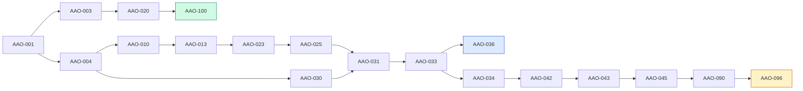

# Release Plan

Status: PROPOSED (2026-11-18), supersedes the milestone-only plan (M0–M6 labels are kept as technical phase tags). Decision record: ADR-0015. Backlog data: `scripts/backlog/releases.py`; generated view: `ENGINEERING_BACKLOG.md`.

**Principle:** ship the smallest dependency-complete slice that is safe at each step. Every release is gated, and every money-moving or attribution-sensitive capability is *built* in an earlier release but *enabled* only by its readiness gate.

## 1. Releases at a glance

| Release | What users get | What is deliberately **off** | Issues | Launch blockers |
|---|---|---|---|---|
| **V0.1 — Public Website Preview** | Landing, link analyzer preview (detects Shopee/TikTok Shop products incl. short links), waitlist, FAQ, preview Terms + Privacy | Accounts, affiliate links, estimates, cashback, provider API calls | 13 | 13 |
| **V0.5 — Private Alpha** | Invite-only accounts, real tracked ACCESSTRADE links, order tracking, pending/approved cashback in wallet | Withdrawals, settlement-based availability, public sign-up, Google login, referrals | 16 | 16 |
| **V1.0 — Commercial Cashback Platform** | Open sign-up, settlement-gated available balance, manually reviewed bank withdrawals, admin money tooling, transactional email, Google login | Advance funding, automated payouts, referrals, check-in, tickets UI (email support instead) | 15 | 13 |
| **V1.x — Growth & Feature Expansion** | Referral (single-level), check-in, ticketing, blog CMS, PWA, leaderboard, second providers | Multi-level referral (hard-off) | 8 | 0 |

Totals: **52 issues** (51 existing + **AAO-100**, the new V0.1 website slice). No issue was closed or deleted.

## 2. Release contents (GitHub issue numbers)

| Release | Count | Issues |
|---|---|---|
| V0.1 | 13 | #1 AAO-001, #2 AAO-002, #3 AAO-003, #4 AAO-004, #5 AAO-005, #10 AAO-014, #13 AAO-020, #14 AAO-021, #38 AAO-091, #39 AAO-092, #40 AAO-093, #41 AAO-094, #53 AAO-100 |
| V0.5 | 16 | #6 AAO-010, #7 AAO-011, #9 AAO-013, #11 AAO-015, #12 AAO-016, #15 AAO-022, #16 AAO-023, #17 AAO-024, #18 AAO-025, #19 AAO-026, #21 AAO-030, #22 AAO-031, #23 AAO-032, #24 AAO-033, #27 AAO-036, #29 AAO-040 |
| V1.0 | 15 | #8 AAO-012, #20 AAO-027, #25 AAO-034, #26 AAO-035, #28 AAO-037, #30 AAO-041, #31 AAO-042, #32 AAO-043, #33 AAO-044, #34 AAO-045, #35 AAO-050, #36 AAO-051, #37 AAO-090, #42 AAO-095, #43 AAO-096 |
| V1.x | 8 | #44 AAO-052, #45 AAO-060, #46 AAO-061, #47 AAO-070, #48 AAO-071, #49 AAO-072, #50 AAO-073, #51 AAO-075 |

> The authoritative number mapping is `scripts/backlog/issue_numbers.json` and the index table in `ENGINEERING_BACKLOG.md` §5 (regenerated after issue updates).

## 3. Why this cut

- **V0.1 is zero-exposure.** It stores only waitlist emails, so it needs secure infra, backups, privacy notice and SSRF-safe parsing, but no accounts, ledger or provider contract. Reusing AAO-020/021 means the analyzer users try on day one is the same code the alpha uses.
- **V0.5 proves attribution, not payouts.** The riskiest unknowns are commercial (campaign approval, live attribution quality, status mapping). An invite-only alpha with real links measures them while withdrawals stay off, so a bug can only mis-*display* cashback, never pay it.
- **V1.0 adds money-out only behind gates.** Settlement gating, withdrawals, reconciliation and security review are all blockers; anything that is engagement (referral, check-in) or automation (advance funding, payout rails, ticket UI) is deferred.
- **Manual over automated:** payouts are manually reviewed and executed from the company bank app with VietQR payloads; missing-cashback and data-subject requests go through a monitored support email with a documented SLA until AAO-052/051 self-service ships.

## 4. Readiness gates (flags that may only flip when the gate passes)

| Gate | Flips | Conditions (all required) |
|---|---|---|
| **G-0.1 Publish preview** | DNS public, `signup.mode=waitlist` | All V0.1 blockers merged · D-4 entity/brand/domain decided · privacy notice reviewed by counsel · Observatory A / CSP enforced · restore test passed · uptime + error alerts live · copy lint passes (no cashback promises) |
| **G-0.5a Staff alpha** | provider `mode=live` (staging → prod), `cashback.links_enabled` for staff | OB-1/2/3 done (entity, ACCESSTRADE account, Shopee + TikTok Shop campaigns approved) · AAO-024 + AAO-032 live-verification evidence (real link, real low-value order synced) · ledger invariants green for 7 consecutive nightly runs on staging · staff MFA enforced · authz tests cover every route · full observability (Loki + business dashboards) |
| **G-0.5b Invite alpha** | `signup.mode=invite` for non-staff | G-0.5a · **OB-4 written cashback permission for the campaigns in use** · alpha terms (cashback accrues pending provider approval and settlement; no withdrawals during alpha; balances carry into V1.0) approved by counsel · support email + SLA published · `withdrawals.enabled=false` verified in prod config |
| **G-1.0 Commercial launch** | `withdrawals.enabled`, `signup.mode=open`, `auth.google_enabled` | All V1.0 blockers merged · OB-5 settlement cycle + statement format known and an allocation dry run done · AAO-090 closed with no open High/Critical · pen-test done if D-9 = yes · AAO-096 end-to-end dry run (order → settlement → payout to staff) evidenced · coverage invariant I8 green 14 days · payout kill switch tested · **two distinct finance-capable staff** (maker-checker is impossible with one) · counsel-approved ToS/Privacy (AAO-051) · tax position on withholding decided (C-TAX-2) · RB-02/03/05 money runbooks written |
| **V1.x feature gates** | `referrals.enabled`, `rewards.checkin_enabled`, `advance.enabled`, `support.tickets_enabled`, … | Per-feature: issue merged + owner approval; referral additionally needs C-MLM-1 legal opinion and budget D-8; advance funding needs D-2 and 60 days of settlement data |

`payouts.automated` and `referrals.multilevel` stay off in every release in this plan.

## 5. Effort and calendar (estimates)

Agent-days per issue by size: S 1.5, M 3, L 5, XL 8 (implementation + CI iterations, excluding owner review). Calendar adds ~20% for review/rework.

| Release | Opus agent-days | Sonnet agent-days | Critical path (agent-days) | Calendar, 1 session per model | Calendar, 2 concurrent sessions per model |
|---|---|---|---|---|---|
| V0.1 | 14 | 29.5 | 12 (001→003→020→100) | ~7 weeks | **~3.5–4 weeks** |
| V0.5 (cumulative) | +52 (66) | +19 (48.5) | 41 cumulative | ~16 weeks | **~10 weeks** |
| V1.0 (cumulative) | +30 (96) | +23 (71.5) | 60 cumulative | ~23 weeks | **~15 weeks** |
| V1.x | 9 | 12 | per feature | rolling | rolling |

Reading: Sonnet is the V0.1 bottleneck (infra + UI), Opus is the V0.5/V1.0 bottleneck (ledger, ingestion, withdrawals). Running two Opus and two Sonnet sessions on `parallelizable` issues with disjoint file ownership roughly halves calendar time. **Commercial gates (OB-1…OB-5, counsel) may dominate the calendar — start them now.**

## 6. Critical dependency path

## 7. Release acceptance criteria

**V0.1** — public URL live over HTTPS; landing LCP < 2.5 s on mid-range Android (Lighthouse mobile Perf ≥ 90, SEO ≥ 95, A11y ≥ 95); analyzer recognises the full AAO-020 fixture corpus incl. short links; SSRF corpus blocked; waitlist idempotent with consent version stored; no page shows a cashback amount; security headers + CSP enforced; encrypted off-site backup restored successfully; uptime alert verified by a test outage.

**V0.5** — invite-only registration, verification, reset and sessions work on iOS Safari + Android Chrome; staff TOTP enforced; real ACCESSTRADE link for Shopee and TikTok Shop created with opaque token (no PII in URL); a real order appears as a conversion within the 30-min freshness SLO; entitlement amounts reproduce from the pinned rule version; T-DUP/T-OOO/T-MULTI/T-CRASH tests green; nightly ledger invariants green; wallet shows pending/approved with "estimate/awaiting approval" labels; withdrawal CTA hidden and API returns 403 `withdrawals_disabled`.

**V1.0** — open sign-up; settlement recorded from a real statement allocates conversions and makes balances available (no advance); withdrawal flow end to end with maker-checker, VietQR payload, statement match → paid; T-CONC-1, T-PAY-1/2, T-SET-1, T-COV-1 green; coverage ratio ≥ 1 with alerting; security review closed; transactional emails delivered; counsel-approved legal docs with consent capture and account closure; Playwright journeys 1–3 + k6 thresholds met on staging; owner go decision recorded in `PROJECT_STATUS.md`.

**V1.x** — each feature behind its flag, with its own acceptance criteria in the issue; enabling requires owner approval and, where listed, legal sign-off.

## 8. Blockers

**Commercial / legal (`commercial-blocker` label)**

| Item | Blocks | Issues |
|---|---|---|
| D-4 legal entity, brand, domain; counsel-reviewed privacy notice | V0.1 | AAO-100, AAO-092 |
| D-6 hosting region (PDPL cross-border) | V0.1 | AAO-092 |
| D-7 email provider | V0.5 | AAO-011 |
| D-3 default cashback share | V0.5 | AAO-023 |
| OB-1/2/3 ACCESSTRADE account + campaign approvals | V0.5 (G-0.5a) | AAO-024, AAO-032 |
| **OB-4 written cashback permission** | V0.5 invite alpha (G-0.5b), V1.0 | AAO-096 |
| OB-5 settlement cycle + statement format | V1.0 | AAO-034 |
| Company bank account + statement export | V1.0 | AAO-043 |
| Counsel-approved ToS/Privacy; tax (C-TAX-2); e-commerce law (C-CORP-2) | V1.0 | AAO-051, AAO-096 |
| Google OAuth client verification | V1.0 (non-blocker) | AAO-012 |
| D-9 pen-test decision | V1.0 | AAO-090 |
| Shopee Open API access; MLM opinion + referral budget | V1.x | AAO-061, AAO-070 |

**Security (must hold at each gate)** — SSRF guard (V0.1); headers/CSP/Turnstile (V0.1); encrypted backups (V0.1); Argon2id + server sessions + CSRF + rate limits (V0.5); staff TOTP + step-up + audit (V0.5); envelope encryption for TOTP secrets/bank data (V0.5); open-redirect-proof `/go` (V0.5); authz matrix + threat-model re-check (V1.0); image signing + SBOM, audit hash chain (moved to V1.0 gate checklist in AAO-090).

## 9. What changed vs. the previous plan

- New issue **AAO-100** (V0.1 website slice); AAO-026 now builds on it.
- Dependency edits (to keep each release dependency-complete): AAO-015 no longer depends on AAO-012 (Google moves to V1.0 and adds its button itself); AAO-091 depends on AAO-005/014 instead of AAO-026; AAO-093 no longer depends on AAO-030 (ledger check added by AAO-030); AAO-026 adds AAO-100.
- Scope deferrals inside issues (not separate issues): advance-funding code path (AAO-034 → V1.x flag), audit hash chain and image signing/SBOM (→ V1.0 gate), in-app notification centre (AAO-050 → V1.x), self-service data export (AAO-051 → V1.x; manual within legal deadline until then), key-rotation automation (AAO-040 → V1.x), routing scores (AAO-022 → when a second provider exists).
- Reasoning effort reassessed downward where scope shrank (e.g. AAO-002, 011, 016, 022, 034, 035, 040, 050, 091, 094); money and security issues keep high/xhigh/max. Assigned models unchanged.
