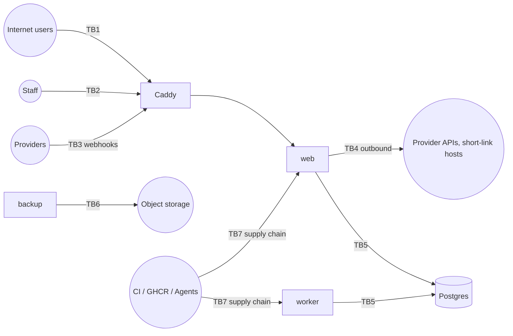

# Security Threat Model

Method: STRIDE per trust boundary, then abuse cases specific to cashback. Status: PROPOSED. To be reviewed before launch (AAO-090) and after every new provider or payout rail.

## 1. Assets
| Asset | Why it matters |
|---|---|
| Ledger and withdrawal state | Direct financial loss |
| Bank account numbers, emails, phones | PDPL personal data; account-takeover payoff |
| Provider credentials (ACCESSTRADE token, future Shopee secret) | Attacker could redirect commissions or read reports |
| Staff accounts | Can approve payouts, edit rules |
| Commission rules and routing | Silent margin theft |
| Click tokens | Attribution integrity |
| Backups | Contain everything above |

## 2. Trust boundaries

## 3. STRIDE

| ID | Boundary | Threat | Mitigations | Residual |
|---|---|---|---|---|
| S-1 | TB1 | Credential stuffing / brute force | Argon2id; per-account + per-IP limits; progressive delay; breached-password check against an offline k-anonymity list; Turnstile after N failures; generic errors | Low |
| S-2 | TB1 | Account takeover via email change or reset | Single-use 30-min tokens (hashed); step-up for email change; notify old email; revoke sessions on reset; 48h withdrawal hold after email/password/bank change | Low |
| S-3 | TB1 | OAuth login CSRF / account linking hijack | PKCE + state + nonce; `email_verified` required; linking requires an existing session or email confirmation | Low |
| S-4 | TB2 | Staff phishing | Mandatory TOTP; admin on a separate subdomain with stricter session; IP allowlist option; WebAuthn post-V1 | Medium |
| S-5 | TB3 | Spoofed postbacks | Postbacks are only triggers; authoritative fetch by id via authenticated API; secret path token + IP allowlist if the provider publishes IPs | Low |
| T-1 | TB5 | Tampering with ledger rows | Append-only triggers; `app_rw` lacks UPDATE/DELETE grants; nightly recomputation; hash-chained audit log | Low |
| T-2 | TB1 | Parameter tampering (amount, user id, bank id) | Server derives user from session; all object lookups scoped by owner; amounts validated against ledger under lock | Low |
| T-3 | TB2 | Insider edits commission rule to steal margin | Rule versions inactive until a second person approves; diff shown; audit; alert on share_bps > configured ceiling | Low |
| R-1 | all | Denial of admin actions | Audit log with actor, reason, before/after, request id, hash chain; exported daily to backup | Low |
| I-1 | TB1 | IDOR on orders/withdrawals/tickets | UUIDv7 + owner scoping in every query (lint rule: repository functions take `UserId`); authz tests per endpoint | Low |
| I-2 | TB5/TB6 | DB or backup leak | Bank numbers and provider creds envelope-encrypted; backups encrypted client-side (age/restic) with a key not on the VPS; PII minimization | Medium |
| I-3 | logs | PII/secrets in logs | `tracing` field allowlist, redaction layer, tests that grep logs for patterns | Low |
| I-4 | TB1 | User enumeration | Constant responses for forgot-password and register-with-existing-email (send an email instead) | Low |
| D-1 | TB1 | Analyze/link endpoint abuse burning provider quota | Per-IP/user limits; login required for links; provider token bucket; cache by canonical URL | Medium |
| D-2 | TB4 | SSRF/slowloris via short links | `safe_fetch` allowlist + IP pinning + timeouts + size caps (`TRACKING_AND_ATTRIBUTION.md` §2.1) | Low |
| E-1 | TB2 | Privilege escalation via role grants | Only owner can grant roles; owner role can't be granted through UI (DB seed + CLI only); audit + alert | Low |
| E-2 | TB7 | Malicious dependency or image | `cargo deny` (licenses, advisories, bans), `cargo audit`, Renovate with review, pinned actions by SHA, Trivy, cosign signing, minimal base image | Medium |
| E-3 | TB7 | AI agent pushes unsafe change | Branch protection: required checks + owner review on protected paths (CODEOWNERS for `crates/ledger`, `migrations`, `.github`, `infra`) | Medium |

## 4. Abuse cases specific to cashback
| ID | Abuse | Controls |
|---|---|---|
| A-1 | **Self-purchase + return** farming | Cashback only after settlement (returns resolve first); cancel-rate scoring; clawback with negative balance |
| A-2 | **Fake accounts** for referral farming | Rewards only on referee's settled orders; device/IP/bank clustering; one bank account per real person; referral rewards from a budget |
| A-3 | **Circular / self referral** | DB CHECK referee ≠ referrer; cluster detection; referral attribution only at sign-up and never editable by users |
| A-4 | **Double withdrawal race** | Partial unique index for one open withdrawal; balance row lock + NonNegative guard; Idempotency-Key |
| A-5 | **Withdraw then reversal** | Settlement gating; negative balance carried; withdrawals blocked while negative; write-off workflow |
| A-6 | **Bank account swap after ATO** | Step-up + cooldown + old-email notification + review flag |
| A-7 | **Attribution theft** (someone else's token in their purchase) | Tokens are random and user-bound; the conversion goes to the token owner, which is harmless to us. A token in the wild could credit the wrong user, so the result page warns against sharing links |
| A-8 | **Incentive-traffic violation** voiding a month of commissions | Per-campaign `cashback_allowed=yes` required for routing; legal disclosure; monitoring rejection reasons |
| A-9 | **Admin collusion** (approve + submit own payouts) | DB CHECK approver ≠ submitter; owner monitors daily payout report; payouts above threshold need owner approval |
| A-10 | **Advance-funding drain** | Advance disabled by default; global + per-user caps under lock; coverage invariant I8 freezes payouts when breached |

## 5. Security controls checklist (map to backlog)
- [ ] CSP: `default-src 'self'; script-src 'self' 'wasm-unsafe-eval'; img-src 'self' https://*.susercontent.com https://*.tiktokcdn.com data:; frame-ancestors 'none'` (merchant image hosts to be confirmed) — AAO-091
- [ ] HSTS preload, `X-Content-Type-Options`, `Referrer-Policy: strict-origin-when-cross-origin`, `Permissions-Policy` — AAO-091
- [ ] Open redirect: `/go/{token}` only redirects to the URL stored for that token, and every stored URL is from a provider allowlist host — AAO-025
- [ ] XSS: Leptos escapes by default; blog Markdown rendered with `pulldown-cmark` + `ammonia` sanitization — AAO-071
- [ ] SQLi: SQLx parameterized only; `query!` macros; no `format!` into SQL (clippy/grep CI check) — AAO-001
- [ ] Secrets: Docker secrets files mounted read-only; `.env` never committed (gitleaks in CI) — AAO-002
- [ ] Encryption keys: KEK on VPS as Docker secret, offline copy with owner; documented rotation — AAO-040
- [ ] Backups: encrypted, off-site, restore-tested monthly — AAO-093
- [ ] Dependency + container scanning in CI — AAO-002
- [ ] Pen-test or external review before public launch (owner decision D-9)

## 6. Incident classes and first response
See `INFRASTRUCTURE.md` §9 runbooks: credential leak, suspected ledger corruption (freeze payouts → snapshot → diff), provider API key revoked, account takeover wave, data breach (PDPL notification duty within the statutory deadline; legal confirms the timing).
