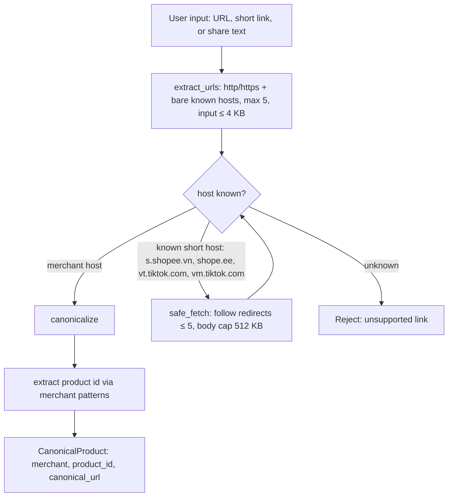
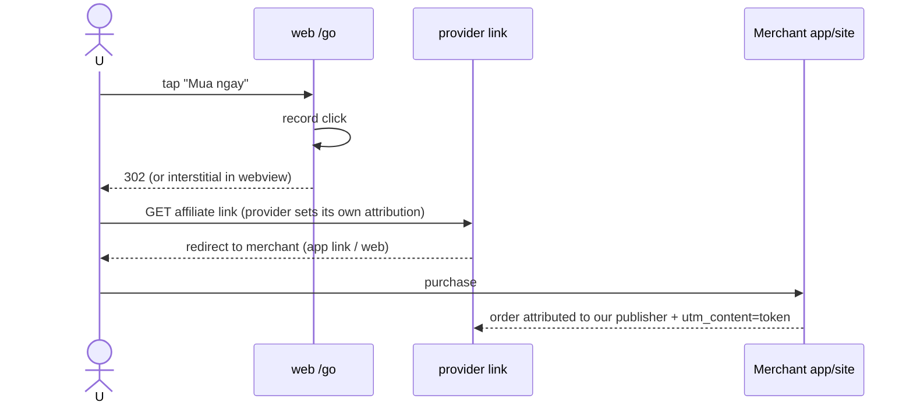

# Tracking and Attribution

Status: PROPOSED.

## 1. Goals
1. Every cashback-eligible purchase can be traced back to exactly one of our users through an identifier that reveals nothing about them.
2. We preserve the provider's own attribution parameters untouched.
3. We never manipulate attribution (no cookie stuffing, hidden redirects, auto-clicks, iframes, or overwriting other publishers' links).

## 2. Input handling and URL engine

Merchant patterns (INFERRED from public URLs; validated against fixtures in AAO-020):
- Shopee: `shopee.vn/<slug>-i.<shop_id>.<item_id>` and `shopee.vn/product/<shop_id>/<item_id>`. Canonical form = `https://shopee.vn/product/{shop_id}/{item_id}`.
- TikTok Shop: `shop.tiktok.com/view/product/<id>`, `www.tiktok.com/view/product/<id>`, `vt.tiktok.com/<code>` (short). Canonical = `https://shop.tiktok.com/view/product/{id}`.
- Tracking params (`utm_*`, `af_*`, `smtt`, `sp_atk`, `xptdk`, etc.) are stripped from the canonical URL. Other publishers' affiliate params are **never** forwarded.

### 2.1 `safe_fetch` (SSRF guard)
- Only `https`, port 443. Hostname must be on the merchant short-link allowlist (not a denylist).
- Custom DNS resolver: resolve, then reject loopback, private (RFC1918), link-local, CGNAT, multicast, IPv6 ULA/link-local, `0.0.0.0/8`, metadata `169.254.169.254`. **Connect to the vetted IP** (pinning) so DNS rebinding can't swap targets.
- Redirects are followed manually. Each hop is re-validated (scheme, host allowlist, IP). Max 5 hops, loop detection.
- `HEAD` first, falling back to `GET` with `Range: bytes=0-0`. Body is never parsed beyond a 512 KB cap. Total timeout 4 s.
- Outbound from a dedicated client with no proxy env inheritance and no cookies.
- Results are cached 24h by input hash.

## 3. Link creation and opaque tokens
- `token` = 96 random bits from `OsRng`, Crockford base32 (20 chars). It's stored in `link_requests` and maps to the user server-side only.
- The token is passed to the provider as `utm_content` and `sub1` (ACCESSTRADE). No email, phone, user id or sequential id ever appears in a URL.
- A link request expires after `link.ttl_hours` (default 72h). An expired `/go/{token}` shows a "generate a new link" page and doesn't redirect. This matches the reference guidance to regenerate after cancelling (VERIFIED parity, F-28).
- Anonymous visitors can **preview** an estimate. A tracked link requires login, because otherwise the purchase could never be attributed.

## 4. Redirect and deep linking
`GET /go/{token}`:
1. Look up the token. If invalid or expired → 404 page or regenerate page.
2. Insert `clicks` row (ip /24 prefix, SHA-256(UA + daily salt), platform guess).
3. Render an **interstitial** page (no auto-redirect for in-app browsers, explained below) or 302:

| Context | Behaviour |
|---|---|
| iOS Safari / Android Chrome | 302 to the provider affiliate URL. The provider/merchant handles app opening (universal/app links) |
| In-app browsers (Facebook, Zalo, Messenger, TikTok webview, detected by UA) | Interstitial: "Open in browser" instructions + copy button, because cookies and app handoff from webviews are unreliable |
| Desktop | 302 to web URL. Result page also shows a QR code to continue on phone |

No `<iframe>`, no hidden pixels, no auto-firing of the affiliate URL without a user gesture. The result page shows the purchase rules checklist (empty cart, no other affiliate links, pay within the window, disable ad blockers) before the button.

## 5. Attribution model
- Provider attribution is authoritative: we only learn about a sale if the provider reports it.
- Matching: `conversion.utm_content` (or `sub1`) → `link_requests.token` → user. This yields `attribution=matched`.
- No token or unknown token → `attribution=unmatched`, kept for investigation. Never auto-assigned.
- Manual attribution (support ticket with evidence) → `attribution=manual`. Needs a support operator plus finance approval and an audit entry. Capped per user per month.
- One conversion → at most one cashback entitlement (unique constraint).
- The click → conversion time is compared with the campaign `cookie_duration`. Outliers get flagged (they can be legitimate, so they're not rejected).

## 6. Anti-abuse signals (feed `risk_score`)
Self-purchase rings (many accounts, same device hash or IP prefix, same bank holder), abnormal conversion rate per user, high cancel/return ratio, links generated and clicked by automation (no JS, impossible timing), conversions on campaigns that forbid incentive traffic. Signals hold an entitlement (`frozen_reason`) for review. They never auto-reverse.

## 7. Privacy
Click IPs are truncated to /24 (IPv4) or /48 (IPv6). UA is hashed with a rotating daily salt. Raw provider payloads are redacted (`ORDER_RECONCILIATION.md` §2). Retention is in `DATABASE_DESIGN.md` §7.
