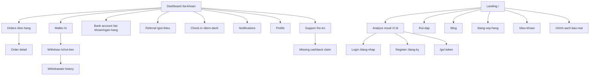

# UI/UX Specification

Status: PROPOSED. Original design: no reference-product assets, copy, colours or layout code are reused.

## 1. Principles
1. **Mobile-first, thumb-first.** Primary actions sit in the bottom 40% of the screen. Bottom navigation on mobile.
2. **Honest money.** Every amount carries its state label and colour. Estimates say "ước tính". No countdown or scarcity gimmicks.
3. **Fast on cheap phones.** SSR HTML first, islands hydrate later. JS/WASM ≤ 250 KB compressed per route. LCP < 2.5 s on Moto G-class over 4G.
4. **Accessible.** WCAG 2.1 AA, 44×44 px touch targets, focus visible, `prefers-reduced-motion`.
5. **Vietnamese-first copy**, friendly second person ("bạn"). English is a full translation, not fallback strings.

## 2. Design tokens (CSS custom properties; Tailwind theme maps to them)
Brand direction (PROPOSED): **teal + amber**. It's deliberately distinct from Shopee orange (#ee4d2d) and TikTok black/pink.

| Token | Light | Dark | Use |
|---|---|---|---|
| `--color-brand-600` | `#0F766E` | `#2DD4BF` | primary buttons, links |
| `--color-brand-50` | `#F0FDFA` | `#042F2E` | brand surfaces |
| `--color-accent-500` | `#F59E0B` | `#FBBF24` | highlights, "cashback" badge |
| `--color-bg` | `#FFFFFF` | `#0B1220` | page |
| `--color-surface` | `#F8FAFC` | `#111827` | cards |
| `--color-text` | `#0F172A` | `#E5E7EB` | body |
| `--color-text-muted` | `#475569` | `#9CA3AF` | secondary (meets AA on bg) |
| `--state-estimated` | `#64748B` | `#94A3B8` | ước tính |
| `--state-pending` | `#B45309` | `#FBBF24` | chờ duyệt |
| `--state-approved` | `#1D4ED8` | `#60A5FA` | đã duyệt |
| `--state-available` | `#15803D` | `#4ADE80` | khả dụng |
| `--state-reversed` | `#B91C1C` | `#F87171` | đã huỷ |
| `--radius-card` | 16px | | |
| `--space-*` | 4px scale | | |
| Font | `Be Vietnam Pro` (OFL) self-hosted, subset vi+latin; fallback `system-ui` | | full Vietnamese diacritics |

Theme: `prefers-color-scheme` by default. The toggle persists in a cookie, and the SSR sets `data-theme` before paint so there's no flash.

## 3. Components (crate `ui::components`)
`AppShell` (top bar desktop / bottom nav mobile) · `PasteBox` (textarea + paste-from-clipboard button + validation) · `ProductPreviewCard` (skeleton, no-preview fallback) · `EstimateBadge` (always shows "ước tính" plus a tooltip explaining conditions) · `MoneyText` (formats `35.000 ₫` per vi-VN, `₫35,000` per en) · `StatePill` · `Timeline` (order states with dates) · `BalanceCards` · `DataTable` (keyset "load more") · `EmptyState` · `ErrorState` (retry + trace id) · `Toast` · `Modal` (focus trap) · `StepUpDialog` · `BankPicker` (searchable, bank logos only if licensed; otherwise text) · `VietQRDisplay` (admin) · `CopyButton` (Clipboard API + fallback) · `PurchaseRulesChecklist` · `InAppBrowserNotice` · `LanguageSwitch` · `ThemeToggle` · `ConsentCheckbox`.

## 4. Information architecture

Vietnamese slugs are canonical. English routes live under `/en/...`, with `hreflang` alternates.

## 5. Page specifications (V1)

| Page | Key content | States | Notes |
|---|---|---|---|
| Landing | H1 value prop; PasteBox above the fold; supported merchants; 3-step how-to; settlement timeline graphic (honest: "thường X–Y ngày sau khi sàn đối soát", values from config); purchase rules; FAQ teaser; footer with entity info + legal + disclaimer | — | SSR only, no WASM required to paste+submit (form POST fallback) |
| Analyze result | Preview card, estimate badge, eligibility, CTA "Lấy link hoàn tiền" (login if anonymous), rules checklist | loading skeleton, ineligible (reason + alternatives), provider down (retry) | Estimate always labelled |
| Link result | Big "Mở Shopee/TikTok" button → `/go/:token`; copy link; QR on desktop; expiry time; in-app browser notice | expired | No auto redirect |
| Login / Register | Email+password, Google button, consent checkboxes, link to policies | errors inline, rate-limited | Password strength meter (zxcvbn-rs) |
| Email verification / Password recovery | Single-purpose screens | token invalid/expired | Constant messaging |
| Dashboard | Balance cards (pending/approved/available), recent orders, CTA paste box, notifications | empty (first-time onboarding) | |
| Orders | Filter by state, list with merchant icon, product, cashback, state pill | empty, loading more | |
| Order detail | Timeline (clicked → ordered → pending → approved → settled/available or reversed), amounts, rule explanation, "Báo thiếu hoàn tiền" | — | |
| Wallet | Balance breakdown + statement (ledger-derived, humanized) | owed (negative) banner | |
| Withdraw | Amount (min/max hints), destination, fee, step-up, confirm | insufficient, cooldown, suspended banner, negative balance | Idempotency key generated client-side per form |
| Withdrawal history | List with states and transfer reference | — | |
| Bank account | Add/change with step-up, cooldown explanation | cooling_down | Masked number |
| Referral (V1.x) | Code/link, share buttons, stats, rules | — | Flag-gated |
| Check-in (V1.x) | Daily button, streak calendar | already checked | VN day boundary |
| Leaderboard (P2) | Masked names, period selector | disabled | Flag-gated |
| Notifications | List, mark read | empty | |
| Profile | Name, email, phone, language, theme, MFA, sessions list, data export, close account | — | |
| Support / Missing cashback | Ticket list, new claim form with evidence upload | — | |
| FAQ, Blog, ToS, Privacy | SSR content, JSON-LD (FAQPage, Article), canonical, OG tags | — | |

## 6. Wireframes (low-fi)

```
Mobile – Landing                Mobile – Link result             Mobile – Wallet
┌──────────────────────┐        ┌──────────────────────┐         ┌──────────────────────┐
│ ☰  [logo]      🌙 VI │        │ ← Kết quả            │         │ Ví của bạn           │
│ Mua sắm như thường,  │        │ ┌──────────────────┐ │         │ Khả dụng             │
│ nhận lại tiền hoàn   │        │ │ [img] Tai nghe…  │ │         │ 135.000 ₫  [Rút]     │
│ ┌──────────────────┐ │        │ │ 250.000 ₫        │ │         │ ─────────────────────│
│ │ Dán link sản phẩm│ │        │ │ Hoàn ước tính    │ │         │ Chờ duyệt  42.000 ₫  │
│ └──────────────────┘ │        │ │ ≈ 12.000 ₫  (i)  │ │         │ Đã duyệt   18.000 ₫  │
│ [ Dán ] [Kiểm tra →] │        │ └──────────────────┘ │         │ Đang rút        0 ₫  │
│ Shopee · TikTok Shop │        │ ☑ Giỏ hàng trống     │         │ ─────────────────────│
│ 1 Sao chép 2 Dán 3 Mua│       │ ☑ Không dùng link khác│        │ Lịch sử giao dịch    │
│ …                    │        │ [  Mở Shopee  ]      │         │ +12.000 Khả dụng …   │
├──────────────────────┤        │ [Sao chép link]      │         ├──────────────────────┤
│ 🏠  📦  💰  👤        │        │ Hết hạn sau 72 giờ   │         │ 🏠  📦  💰  👤        │
└──────────────────────┘        └──────────────────────┘         └──────────────────────┘
```

## 7. Responsive behaviour
- `< 640px`: single column, bottom nav (Home, Orders, Wallet, Account), sticky primary CTA.
- `640–1024px`: two-column cards, bottom nav kept.
- `≥ 1024px`: top nav, max content width 1120px, dashboard 12-column grid.

## 8. PWA
Manifest (name, icons 192/512 maskable, theme colours from tokens, `display: standalone`). The service worker caches **only** static assets and the offline page, versioned per release. It never caches HTML of authenticated pages or `/api/*`. Install prompt appears after a successful link creation, not on first visit.

## 9. i18n
Fluent (`.ftl`) catalogs `vi` and `en`. CI fails on missing keys. Number, date and currency formatting uses ICU4X (`vi-VN`, `en-US`). All emails are bilingual based on user locale.

## 10. Copy rules
Never say "chắc chắn nhận" (guaranteed). Use "ước tính", "dự kiến", "khi sàn xác nhận". Explain every negative state with a next action.
