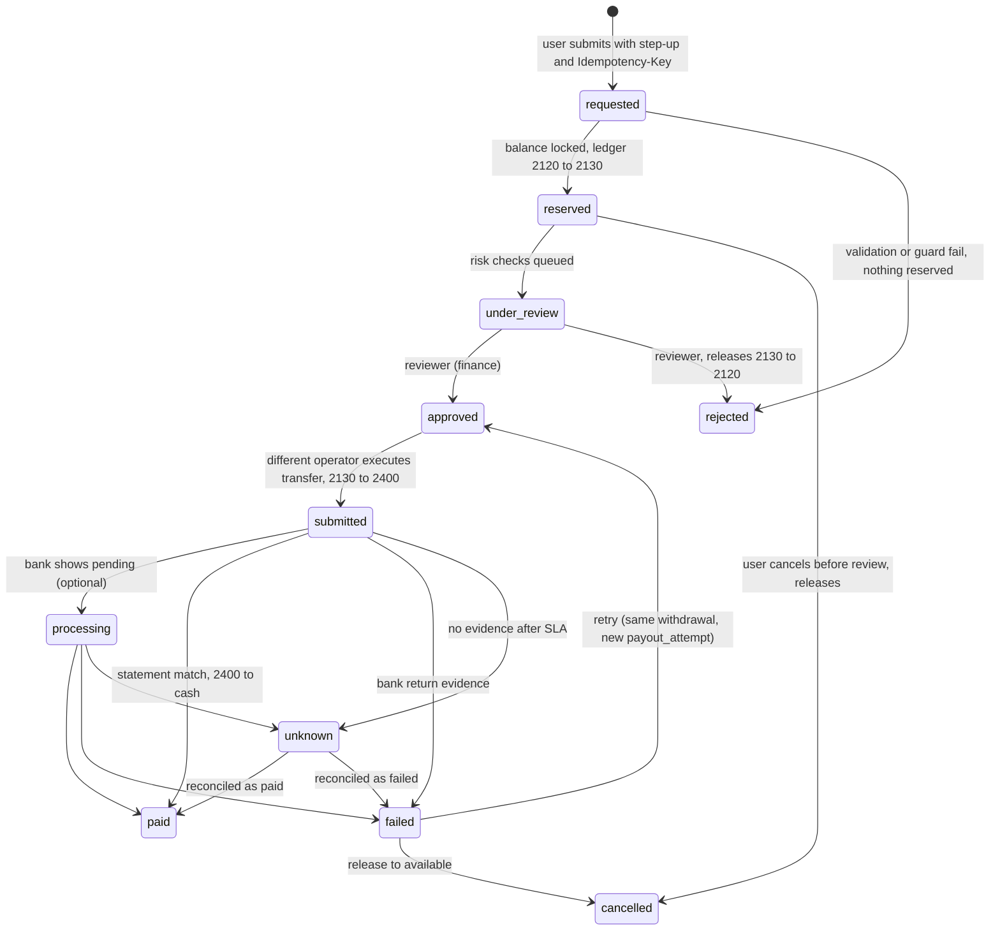

# Withdrawal and Payment Design

Status: PROPOSED. Automated payouts are disabled by default (ADR-0012).

## 1. Rails
| Rail | V1 | Mechanism | Status |
|---|---|---|---|
| Bank transfer (manual) | ✅ | Finance operator pays from the company bank app using a VietQR payload we generate. Evidence plus statement import confirms it | PROPOSED |
| VietQR | ✅ (payload only) | NAPAS/EMVCo-format QR text (bank BIN, account, amount, `transfer_reference` as content), generated locally. **VietQR is not an execution API** | PROPOSED; spec conformance test needed |
| MoMo Disbursement | ❌ (adapter disabled) | MoMo publishes single and batch disbursement APIs (`/v2/gateway/api/disbursement/*`, wallet verify, balance), which need a merchant contract | VERIFIED docs exist; eligibility UNKNOWN |
| Bank API (Open banking / bank partner) | ❌ | Requires a bank partnership | UNKNOWN |

## 2. Configuration (DB `config_values`, effective-dated)
| Key | Default (PROPOSED) | Reference |
|---|---|---|
| `withdrawal.min_vnd` | 50 000 | reference product: 50 000đ (VERIFIED) |
| `withdrawal.max_per_request_vnd` | 5 000 000 | |
| `withdrawal.daily_limit_vnd` / `monthly_limit_vnd` | 5 000 000 / 30 000 000 | VN calendar day |
| `withdrawal.fee_vnd` | 0 | fee is configurable |
| `withdrawal.require_verified_email` | true | |
| `withdrawal.new_bank_account_cooldown_hours` | 48 | |
| `withdrawal.first_withdrawal_review` | always | |
| `withdrawal.auto_approve_max_vnd` | 0 (off) | everything is reviewed in V1 |
| `payouts.automated` (flag) | off | dangerous flag |
| `payouts.suspended` (flag) | off | emergency kill switch, one-person activation, two-person deactivation |

## 3. State machine

Invariants:
- At most one open withdrawal per user (partial unique index).
- `reserved` is created atomically with the 2120 → 2130 posting under a row lock. Concurrent requests serialize, and the second one fails the guard or the unique index.
- **Unknown outcome is never retried blindly.** `unknown` keeps funds in clearing until a human reconciles against bank evidence. No new `payout_attempt` can exist while an attempt is `sent` or `unknown` (partial unique index).
- Maker-checker: `approved_by ≠ submitted_by` (DB CHECK). Owner can't approve their own withdrawal as a user.

## 4. Risk checks (`under_review`)
Each check adds a risk flag. Reviewers see flags and evidence.
- Account age < 7 days, or email verified < 24h ago.
- Bank account changed within the cooldown, or holder name ≠ normalized user display name (diacritics stripped, uppercase).
- Same bank account number hash used by other users (one-to-many is a strong fraud signal).
- Share of available balance coming from `advance` basis, or from conversions in campaigns flagged for incentive traffic.
- Conversion cancel rate > threshold. Referral-heavy balance. Device/IP overlap cluster.
- Velocity: withdrawals per day/week, amount vs historical.
- Negative-balance history.

## 5. Payout execution (manual, V1)
1. Finance opens the **Payout batch** screen and selects approved withdrawals. The system shows a VietQR for each (amount, holder, bank, `transfer_reference` like `AAIO W7K2M9QX`) and a CSV for bulk upload if the company bank supports it.
2. The operator transfers in the bank app, then marks each as submitted, entering the bank reference or attaching evidence (file hash stored). This posts 2130 → 2400.
3. The bank statement CSV is imported (daily). Matches by `transfer_reference` + amount move withdrawals to `paid` (2400 → 1100). Mismatches open a case.
4. If no statement match within `payout.unknown_after_hours` (default 72) → `unknown` and an alert.

## 6. Bank account management
- One active bank account per user in V1. Add/change requires step-up auth (password or TOTP re-entry), an email notification to the old address, and a 48h cooldown before use (`status=cooling_down`).
- The account number is encrypted (AES-GCM envelope). We store `last4` for display and `sha256(bank_bin‖number)` for duplicate detection.
- Bank list (BIN, name, short name) is a seeded table from the NAPAS/VietQR bank list, refreshed by admin. Source to be confirmed in AAO-041.
- Holder name must match the user's legal name as entered. Mismatches are flagged, not blocked (the reference product requires own-name accounts, VERIFIED).

## 7. Emergency controls
- `payouts.suspended`: all transitions into `submitted` are blocked. Users see a banner ("rút tiền tạm dừng"), and requests can still be made and reserved.
- Per-user freeze (`users.status=suspended`) blocks new requests and holds open ones in review.
- All of these are audited. Activating one pages the owner.

## 8. Tax hook
`tax_withheld_vnd` exists on withdrawals but stays 0 unless the owner enables `tax.pit_withholding` after tax advice. See `COMPLIANCE_CHECKLIST.md` C-TAX-2. If it's enabled, posting adds Cr 2500 `tax.withholding`.
